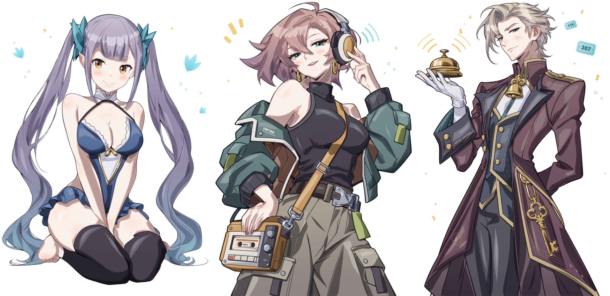

# agent-illustrations

Illustrations drawn and coloured entirely by code (TypeScript and Canvas 2D). No image generation: an AI agent writes the shapes, rules and numbers; a person directs.



## What is here

| Path | What |
|---|---|
| `src/splash/` | **Current style.** `engine.ts` and `tones.ts` are the rules; `twin`, `tape` and `bell` are drawings (data only) |
| `docs/process.md` | The rules and working loop |
| `docs/history.md` | How they were found: review rounds, measurements, mistakes |
| `docs/research-anime-rendering.md` | Research with sources; marks what is sourced, measured or inferred |
| `src/passes/`, `src/clean/`, `src/lineart/`, `src/cel/` | Earlier engines, each a step toward the current one |
| `src/skins/`, `figure.ts`, `cast.ts` | Sketch engine: posed characters in 13 drawn styles |
| `archive/neon-bell/` | The same drawing coloured by Gemini 4 Neon with the same rules |
| `gallery/` | Results |

## Run

```sh
pnpm install
pnpm dev                                                          # port 5440
node scripts/snap.ts out.png "v=bell&k=3&zoom=2" 2048 3072        # render one
pnpm check                                                        # hold figures against the reference numbers
node scripts/grid.mjs public/bell.png grid.png 420 100 190 200 8  # zoomed crop with coordinates
```

`v` is `twin`, `tape` or `bell` (also `oni2`, `oni`, `sketch`, `cel`, or nothing for the sketch studio). `upto=0..10` stops after a pass; `view=regions|masks|grey` shows the checks. `k` must be an integer; use 2 or 3, since at 1 a few regions can leak. Rendering text uses Avenir Next, so it looks different off macOS.


## New drawing

1. Put clean line art in `public/`.
2. Copy `bell.ts` and `bell-seeds.ts`, set `src`, `w`, `h` and `head`, and register the name in `src/main.ts`.
3. Follow `docs/process.md`.

## Not in this repository

Style reference screenshots are other studios' art, so `public/refs/` and comparison images are ignored by git. Line art in `public/` was supplied by the owner; check its rights before making this public.
