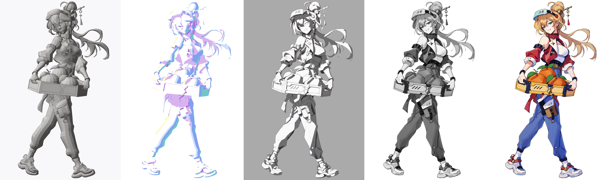
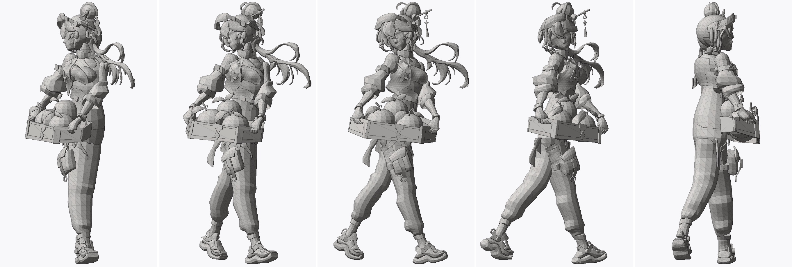
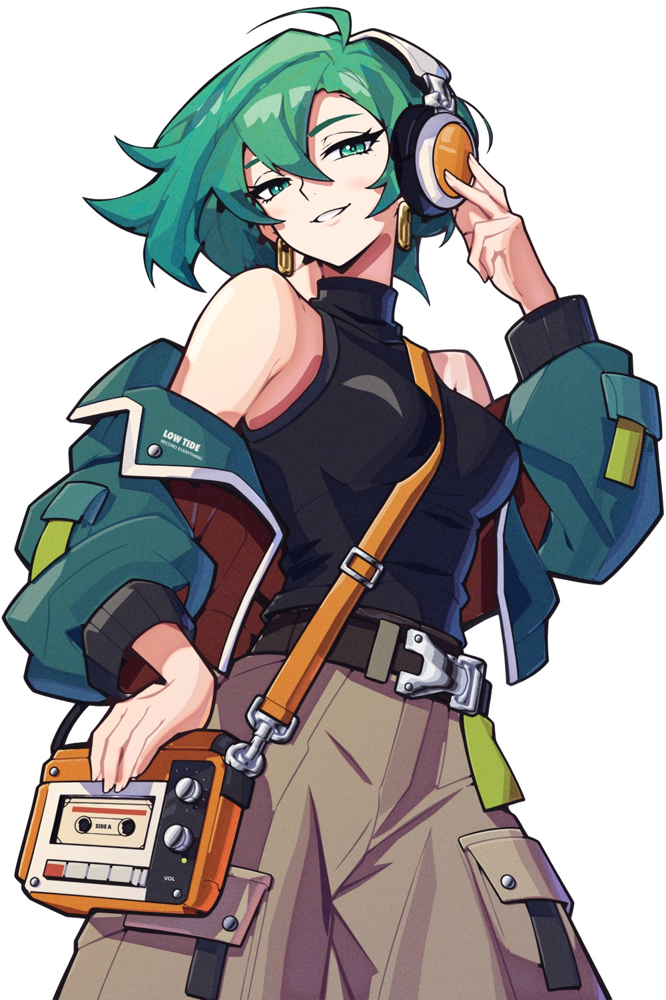
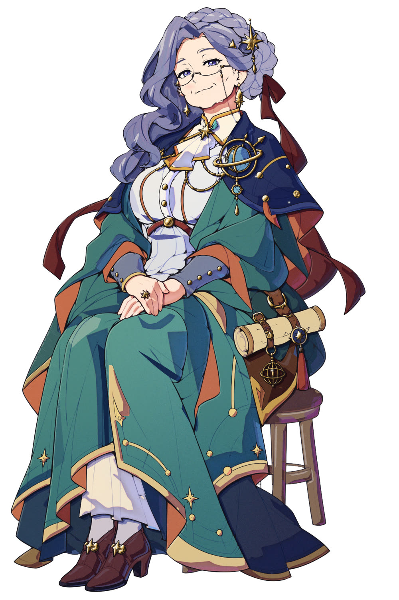
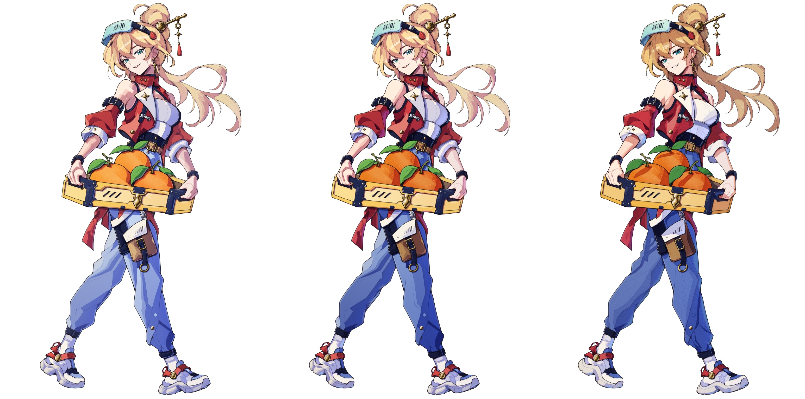

# agent-illustrations

Illustrations coloured entirely by code (TypeScript and Canvas 2D). The line art comes finished (for Visor and Maren from an image model, made and picked by the owner). From there no image generation: a person directs, an AI agent writes the shapes, rules and numbers. The goal is not one picture but a process that gets better with each one.

| | |
|---|---|
| **Rendering: works** | Finished line art in, splash illustration and layered `.clip` out. Everything on this page is about this |
| **Open drawing: does not** | Deciding pose, shapes, hands, hair and costume, or finishing a sketch. Eleven attempts by two agents, none approved: [`docs/drawing/`](docs/drawing/README.md) |


## How it works

3D blockout, form guide, shadow design, greyscale, result:



1. **Regions.** The agent names numbered patches of the line art; the engine fills them.
2. **Light and value plan.** One light, one focus, which parts are dark, mid and light, and which neighbours must stand apart. Checked in greyscale after every stage.
3. **Blockout.** The whole figure as a low-poly mesh in the drawing's own view, with depth. It is pulled onto the drawn outlines and measured: the right form shows on 97% of the figure. It is there to understand the form, not to render it.

   
4. **Form guide.** The mesh marks under the line art where surfaces turn, what casts on what, where reflected light belongs.
5. **Shadow design.** The agent draws every shadow shape over the guide. The form says where, the drawn line says how.
6. **Second light.** Reflected light as bold planes on far edges, always darker than the light.
7. **Face and eyes.** Painted between the artist's lines, which are never redrawn.
8. **The rest by rule.** Scattering, deep shade, materials, line colour, air, grain as measured on the references.
9. **Review piece by piece.** Line art, colour, shadow design and grey of one piece at a time.
10. **Last look, always.** Greyscale and three values beside the references. A script fails when big neighbours are too close; someone still has to look.
11. **Out as layers.** A clean, organised `.clip` and `.psd`, so a person can go on from there.


**Where the form is not followed:** the face is never modelled, hair is one simple shape per lock, shadows that tell a distance always stay, shaded skin is warm. The style decides, the form argues.

**Learn the steps:** [`docs/guide.md`](docs/guide.md), a rendering guide for people, with how the agent does each step and where it still falls short.

Full rules: [`docs/process.md`](docs/process.md). The form stage: [`docs/form-guide.md`](docs/form-guide.md). Every tool: [`docs/tools.md`](docs/tools.md).

## The layered file

Every drawing comes out as a `.clip` for CLIP STUDIO PAINT and a `.psd` that an illustrator can pick up and go on with:

- **A folder per part** (Hair front, Face, Jacket, Player, …), in each the same layers in the same order, clipped to the base: Base, Gradient, Half tone, Shadow 1, Shadow edge, Shadow 2, Light, Highlight, Reflected light.
- **A layer is a set of related marks with one job**, not a stroke: both irises, all reflections of the face, all first shadows of a part.
- **On top:** effects over the whole figure, prints, the face (eyes in eleven layers), and the line art with its colours clipped to it.
- **Every export checks that it is clean**, and that the layers add up to the render.

```sh
node scripts/layers.ts maren output/layers/maren --clip     # .clip, .psd, the checks
node scripts/layerview.ts output/layers/maren               # look through the layers, and a sheet
```


Open one: [`maren.clip`](examples/layers/maren/maren.clip). How it is structured: [`docs/layers.md`](docs/layers.md). The `.clip` format, which has no public spec, and what was measured: [`docs/layers-internals.md`](docs/layers-internals.md). Edits made in the drawing program are not read back into the code.

## A second drawing

The same process on other line art, the headphones drawing, from zero:



What it needed and what it changed in the process: [`docs/lessons.md`](docs/lessons.md).

## A third drawing

Seated, old, mostly cloth: the hardest line art so far. About two hours, four rounds, a blind critic between them. Eyes, braid, hair strands and accessory casts came from the client's notes; large cloth is the open part.



## What was learned

1. **Understand the form before shading it.** Answering notes spot by spot only moved the problem. A blockout ended that.
2. **A 3D model is a better guide than renderer.** Shading straight from the mesh was right and blobby.
3. **Value first, with a check that can fail, and eyes on it.** Numbers found a pass that washed out the darks. Looking found what the numbers had passed: hair that vanished into the page.
4. **Simple beats correct.** One clean shape per plane or lock.
5. **What the client approved needs a check that fails when it disappears.** New systems quietly dropped reflected light, and before that cast shadows.
6. **Someone else draws, code colours.** The drawn lines stay, above all in the face. Rendering rules transfer between drawings; drawing in code did not.
7. **Every note is sorted by cause:** could not see, did not ask, had no tool, forgot, or a rule of ours caused it. [`docs/lessons.md`](docs/lessons.md)

Rounds three, five and ten of the same drawing. Between the last two: blockout, guide, shadow design, and a new value plan.



Numbers, what failed, what is open: [`docs/findings.md`](docs/findings.md).

**Open:** run on two drawings so far; hands, shoes and crate fittings are not designed shape by shape; the shadow shapes are typed points; steps between planes are stronger than in the references; a few parts have no second light.

Line art: `public/visor.png`, data: `src/splash/visor*`. To render it, make its form field once: `node scripts/form.ts visor output/form/v 4 --field`, then `?v=visor&k=3`. At scale 2 its fine lines let a few regions leak (a lock by the face, a strap).

## Earlier drawings


Coloured with the renderer before, from shapes said as sentences about numbered lines (`band s544[0..1] r 0 26 46`). They still run in the current renderer and look different there; the images are from then. Goggles first showed that light and value come before detail:


The headphones character also has two announcement cards (own fictional brand, two hair colours from one drawing):


## What does not work: open drawing

The renderer carries out decisions that are in the line art. Where line art leaves them open, an agent has to make them, and so far that fails. Tried: figures in code, a 3D mannequin under ink, sketching in stages, drawing from references, directed image generation, and three ways of turning a sketch into line art.

Three causes: a known shape is lost when it is typed, invented shapes are symbols, and every check passed on what was rejected. A blind critic agreed with the client on the coloured drawings; the maker did not.

The [log](docs/drawing/log.md) has what broke first in each, and [`next.md`](docs/drawing/next.md) small tests for a new agent.

## Run

```sh
pnpm install && pnpm exec playwright install chromium
pnpm dev                                                             # port 5440, or PORT=5441 pnpm dev (and PORT for the scripts too)
# CHROMIUM=/path/to/chromium node scripts/…                         # the scripts on a Chromium that is already installed
node scripts/look.ts "v=rig" whole.png face.png:430,330,440,440:3    # render once, crop as often as you like
node scripts/side.ts out.png 800 a.png b.png                         # compare
node scripts/pixel.ts whole.png 2 662,515 740,520                    # colour and luma at points
pnpm check rig                                                       # alarms: numbers measured on the references
node scripts/form.ts <name> output/form/a 4 head:385,0,330,330       # blockout: fit table, turntable, rotatable view.html
node scripts/guide.ts <name> output/form/g 5 20 arm:375,295,180,150  # form guide under the line art (after form.ts --field)
node scripts/gate.ts <name>                                          # value plan and second light, per stage
node scripts/finish.ts <name> render.png 2 410 1070,410              # the last check, always: scale, head height and head centre in render px
node scripts/layers.ts <name> output/layers/<name> --clip           # the render as layers: PSD and .clip, with a check that they give it back
node scripts/layerview.ts output/layers/<name>                      # look through the layers: view.html and sheet.png
node scripts/clipcheck.ts file.clip --tree                          # read a .clip: rules, layer tree, composite against its preview
```

| Query | Shows |
|---|---|
| `v=<drawing>` | any drawing in `src/splash`: `visor`, `maren`, `meridian`, `rig`, `tape`, `bell`. `visor` and `maren` read a form field (11 MB, not in Git): make it once with `node scripts/form.ts maren output/form/m 4 --field` |
| `&upto=0..10` | stop after a pass |
| `&view=value`, `grey`, `masks`, `regions` | three values, greyscale, shadow design, regions |
| `&k=2` or `3` | scale, an integer. At 1 a few regions can leak |
| `&layers=1` | every paint step also kept as a layer (`window.__layers`), for `scripts/layers.ts` |
| `v=sheet&who=rig&box=x,y,w,h&z=4` | numbered lines; `&show=facets&part=…`; `&probe=x,y` names what is there; `&show=shapes`, `&show=pools` (patches), `&show=pools&named=1` |
| `v=thumbs&who=rig` | ideas for light, value and colour from `rig-plans.ts` |
| `v=faults&who=rig` | slivers red, edges beside lines blue |
| `v=poster&look=jacket` or `hair` | an announcement card |

Text uses Avenir Next, so it looks different off macOS. A full render takes about 15 seconds or more; give commands room.

## New drawing

```sh
node scripts/new.ts name line-art.png                                 # files in src/splash (blockout and shadow stubs too), line art in public/wip (not in Git)
node scripts/look.ts "v=sheet&who=name&show=pools&z=2" patches.png    # number the patches, write them in name-names.txt
node scripts/name.ts name                                             # names to regions
node scripts/look.ts "v=thumbs&who=name" thumbs.png                   # ideas in name-plans.ts, after parts have a material in name.ts
node scripts/freeze.ts name                                           # number the lines, once, when the regions are final
```

Then follow [`docs/process.md`](docs/process.md) and, for the blockout and shadow shapes, [`docs/form-guide.md`](docs/form-guide.md).

## Documents

- [`docs/guide.md`](docs/guide.md): the rendering guide, step by step, for people and for the agent
- [`docs/process.md`](docs/process.md): the current rules, in order
- [`docs/form-guide.md`](docs/form-guide.md): from line art to shadow shapes, with the 3D blockout
- [`docs/drawing/`](docs/drawing/README.md): open drawing, what was tried and why it fails, tests for the next agent
- [`docs/lessons.md`](docs/lessons.md): every note on a result, sorted by cause
- [`docs/tools.md`](docs/tools.md): how shapes are said, placed and checked
- [`docs/layers.md`](docs/layers.md): the layered file, how it is structured
- [`docs/layers-internals.md`](docs/layers-internals.md): how it is made, the `.clip` format, measurements
- [`docs/findings.md`](docs/findings.md): what works, what does not, numbers
- [`docs/journey.md`](docs/journey.md): the full story with images, step by step
- [`docs/history.md`](docs/history.md): measurements, mistakes and disagreements
- [`docs/reviews/`](docs/reviews/): the other models' reports in full
- [`docs/research-anime-rendering.md`](docs/research-anime-rendering.md), [`docs/research-precision-tools.md`](docs/research-precision-tools.md): research with sources
- [`docs/earlier/`](docs/earlier/): superseded notes
- [`archive/`](archive/): pixel measurements, Neon's bell drawing, the drawing attempts' code

## Previous attempts

The steps before, oldest first. Code and results are kept; each has its story and images in [`docs/journey.md`](docs/journey.md).

| Step | What | What it taught | Code |
|---|---|---|---|
| 1 | A sketch engine, 13 drawn styles | contours, weight and hatching can be code | `src/skins/` |
| 2 | Splash art as numbers, figure drawn in code | a style is eight decisions; drawing is the weak part | `src/cel/` |
| 3 | Colouring a rough pencil sketch | split the work: someone else draws, code colours | `src/lineart/` |
| 4 | Clean line art, one light | cloth looked like latex | `src/clean/` |
| 5 | Research, 15 passes | shadow shapes must be designed | `src/passes/` |
| 6 | The target style, Neon as critic, four rounds | measure every claim | the drawing is removed |
| 7 | A second character with frozen rules | skin and edges carry over, line weight did not | `src/splash/tape.ts` |
| 8 | Opus against Neon, blind | the client preferred Opus for face, eyes and large shapes, Neon for small accessories | `src/splash/bell.ts` |
| 9 | Rules fixed, cast re-rendered | shades must not gain saturation | `docs/process.md` |
| 10 | Named lines instead of coordinates | the naming approach, hair and cloth kits, eye rig | `src/tools/` |
| 11 | A new drawing from zero | the process repeats | `src/splash/rig.ts` |
| 12 | One light, real form, values | scattered light is the fault people see first | `src/tools/light.ts` |
| 13 | A fresh agent with only this repository | sort every miss by its cause | `docs/lessons.md` |
| 14 | A new target and renderer | value, hard planes and line weight do more than colour | `src/bold/` |
| 15 | Form first: blockout, guide, shadow design | the form says where, the drawn line says how | `src/form/` |
| 16 | Face, grain, a mandatory last look | what is at the top of this page | `scripts/finish.ts` |
| 17 | The process again on the headphones drawing | it carries over; never edit the plan to pass | `src/splash/maren.ts` |
| 18 | The render as layers | a `.clip` written by code opens in CLIP STUDIO PAINT | `src/layers/` |
| 19 | Layers an illustrator can pick up | a layer is a set of related marks, and clean is something a check can fail | `src/layers/arrange.ts` |
| 20 | Drawing, and sketches into line art | eleven attempts, none approved: [the log](docs/drawing/log.md) | `archive/drawing/` |


Also here: [a reel of the sketch engine](gallery/reel.mp4) and [its studio in one file](gallery/studio.html).

## Not in this repository

Style reference screenshots and every comparison image that contains them are other people's art, so they stay local, as do full-size renders, which the code regenerates. Numbers that mention references cannot be re-run without them.

Line art in progress stays out too (`public/wip`). Line art in `public/` was supplied by the owner; `visor.png`, `tape.png` (Maren), `rig.png` and `bell.png` are image-generated. The twin-tails drawing of step 6, by another artist, and every image made from it were removed on 26 November 2026; numbers and reviews that mention it stay.
