# agent-illustrations

Illustrations drawn and coloured entirely by code (TypeScript and Canvas 2D). No image generation: an AI agent writes the shapes, rules and numbers, and a person directs.


Everything below happened in one working day, 24 November 2026, in nine steps. Each step shows what was asked, what was built, what went wrong and what stayed.

| Step | What | Where |
|---|---|---|
| [1](#1-can-a-drawn-look-be-code) | A sketch engine: one set of characters in 13 drawn styles | `src/skins/` |
| [2](#2-a-splash-art-style-as-numbers) | A style as numbers, on a figure drawn in code | `src/cel/` |
| [3](#3-let-a-person-draw-let-code-colour) | Colouring a rough pencil sketch | `src/lineart/` |
| [4](#4-clean-line-art-one-light) | Clean line art, one light, warm lights and cold shadows | `src/clean/` |
| [5](#5-work-like-an-illustrator) | Research, then 15 formal passes | `src/passes/` |
| [6](#6-match-the-references-with-a-critic) | The target style, with a second model as critic | `src/splash/` |
| [7](#7-does-it-repeat) | A new character with frozen rules | `src/splash/tape.ts` |
| [8](#8-two-models-one-drawing) | Claude Opus 5.5 against Gemini 4 Neon, blind | `src/splash/bell.ts`, `archive/neon-bell/` |
| [9](#9-fix-the-rules) | Rule fixes, re-render of the whole cast | `docs/process.md` |

## 1. Can a drawn look be code?

**Asked:** is the pencil look in David Hill's character engine video made with code, and can it be reproduced?

It is code: his video shows its own source. The rebuild uses original characters. A figure is a few posed solids that output named shapes and lines, not pixels. Each style draws that same list its own way.

First tries: correct objects, lifeless lines.


What made it read as drawn: contours broken at corners that overshoot, lines heavier on the shadow side, a loose second stroke, hatching made of real strokes, construction lines that run past.


One scene, the same data, pencil and felt-tip:


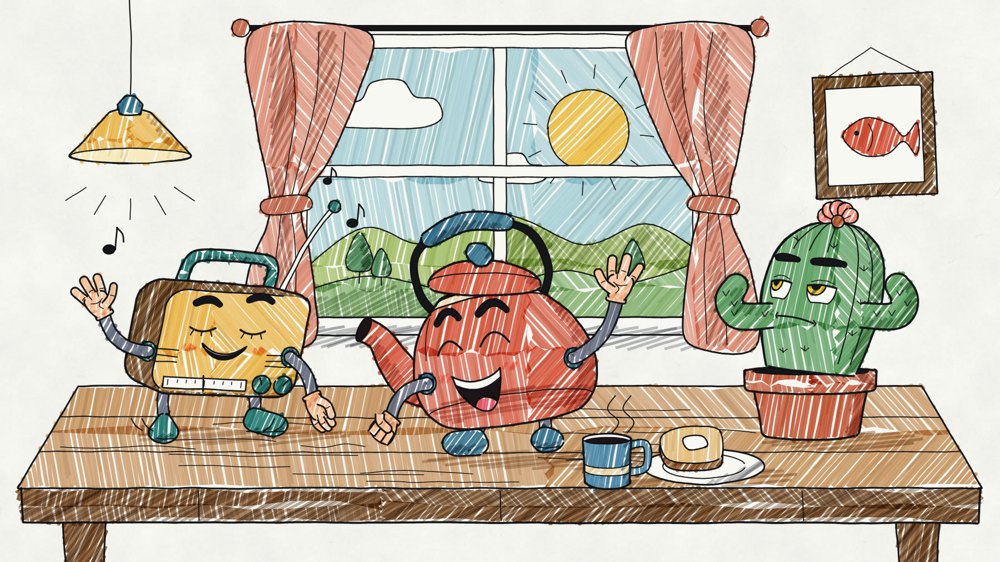

And ten more:

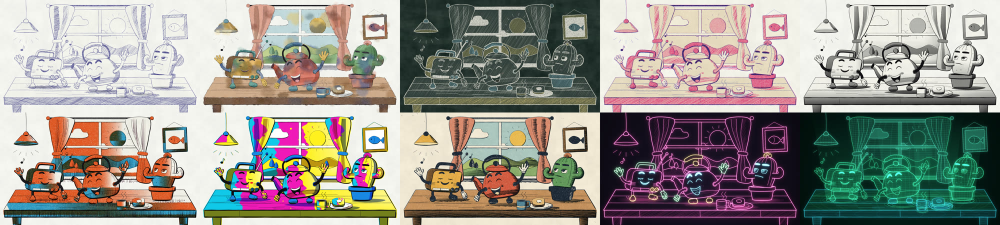


[Full reel](gallery/reel.mp4) · [interactive studio in one file](gallery/studio.html)

## 2. A splash-art style as numbers

**Asked:** how did he get there, and can general principles give other styles, such as game splash art with solid shapes and cel shading?

A reference was measured instead of described. A style came down to eight decisions: shapes, value steps, shadow hue, edges per material, line hierarchy, separation, surface, detail budget.

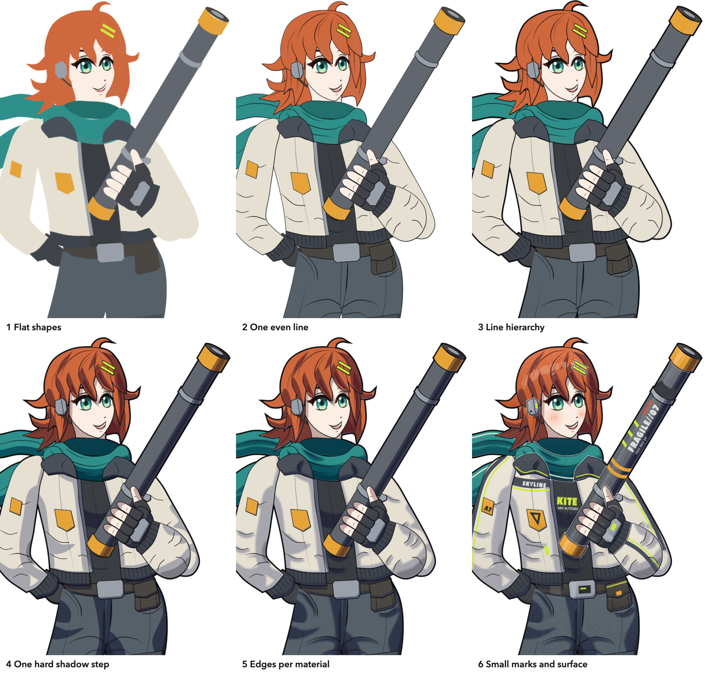

Four attempts at an original courier, drawn fully in code:

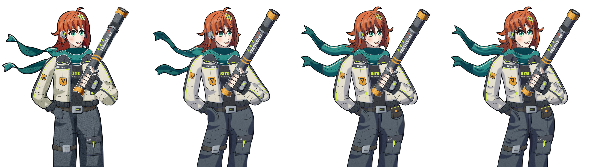


Changing almost only the numbers gives six styles, and the kitchen scene from step 1 goes through the same engine:

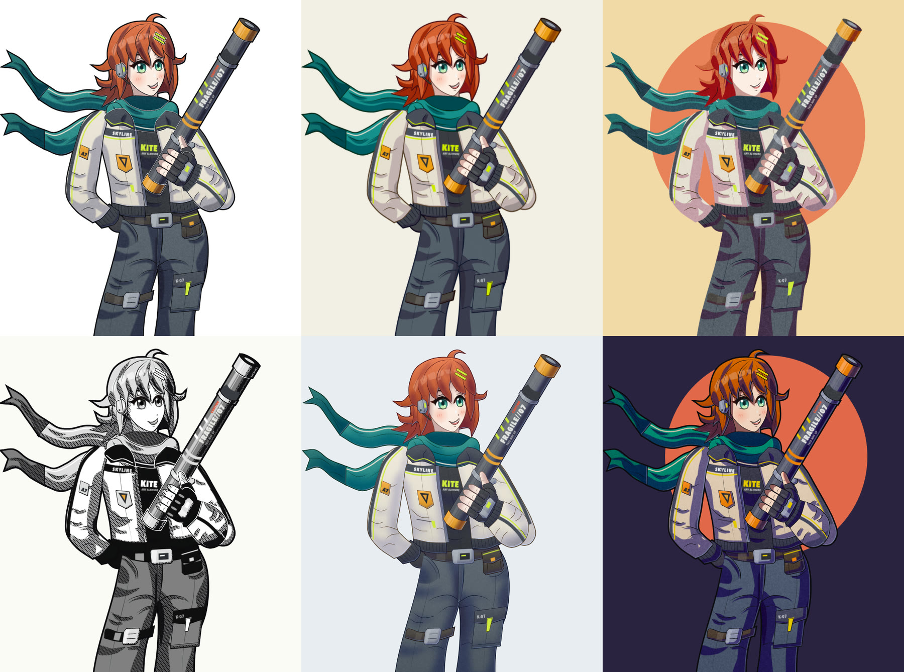
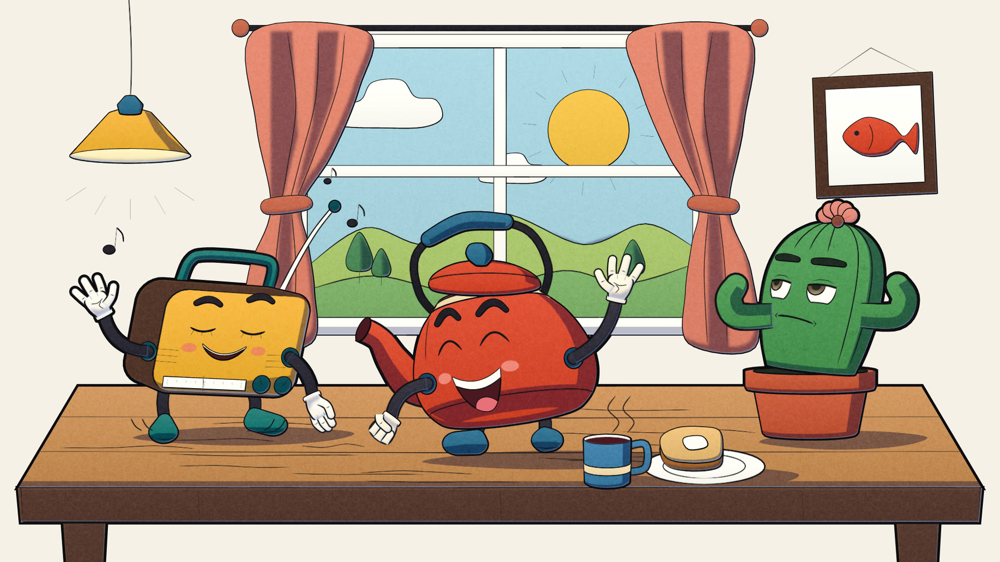

**Learned:** rendering rules transfer. Drawing does not: pose, hair, hands and face were the weak part. Shadows need a tint, not a hue rotation, or cream turns green.

## 3. Let a person draw, let code colour

**Asked:** the drawing is not there yet; render this sketch in the style instead.

Rough colour marks spread until they hit ink, so edges snap to the lines. Rules add shadows, and the pencil is smoothed along its own direction.

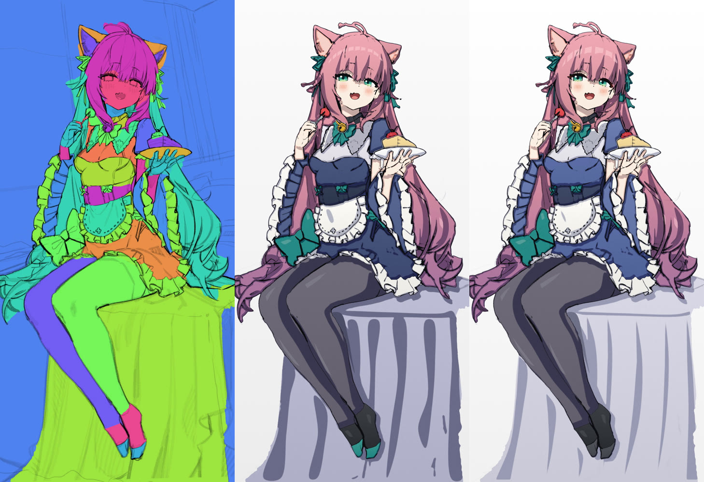

Sketch, regions, flats, result:


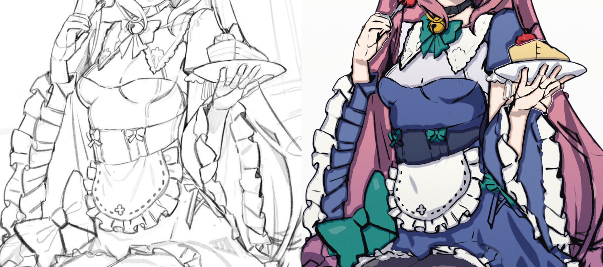

**Learned:** this split works. Construction lines became hard ink, so clean line art matters.

## 4. Clean line art, one light

**Asked:** clean lines, one consistent light, cold shadows, warm lights, more tones in eyes, face and hair.

Regions, then three rounds. Yellow shaded straight to blue turned to mud, so it goes through rust and violet.


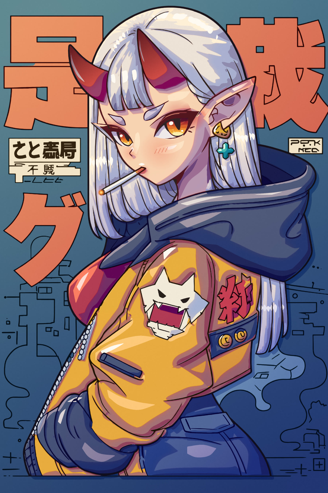

**Learned:** much better, but cloth looked like latex. Shadows copied the outline, and every material had white streaks.

## 5. Work like an illustrator

**Asked:** research how anime and Zenless Zone Zero style illustrations are rendered, turn it into formal steps, and start again from scratch.

A Claude Fable 5.2 agent did the [research](docs/research-anime-rendering.md) ([summary](docs/reviews/research-summary.md)). It found no breakdown of how that game's art is painted, and said so. It became [15 passes](docs/rendering-steps.md):


Before and after, same line art:


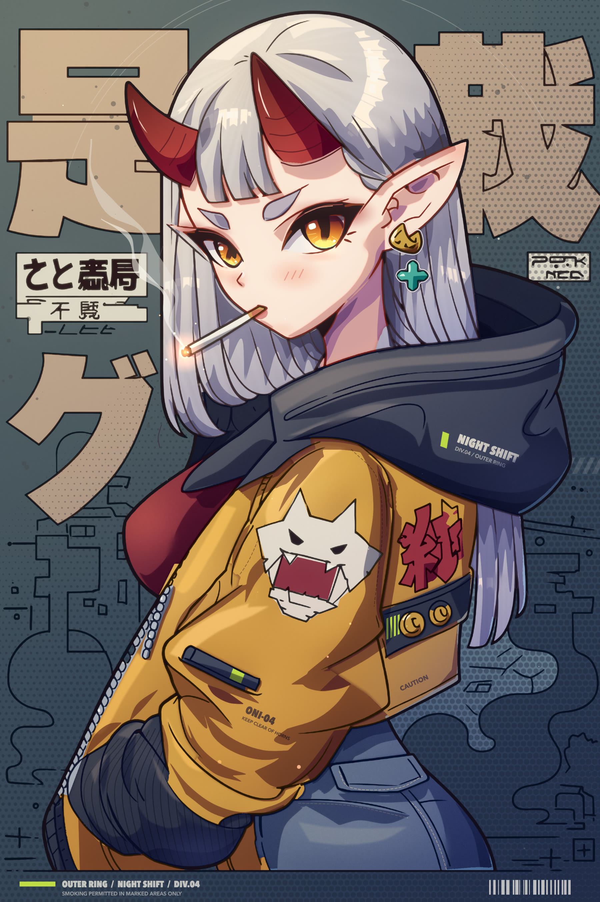


**Learned:** shadow shapes must be designed, with one clean side and one pointed side. Edge width names the material. Skin shadow starts warm. No white highlights on cloth. Grey most colours.

## 6. Match the references, with a critic

**Asked:** a new line art that must look like the references (clear outline, solid shadows, subsurface scattering, solid shapes), iterated with Gemini 4 Neon as reviewer.

Line art, regions, first render:


Rounds 1 to 3 and the signed-off version:


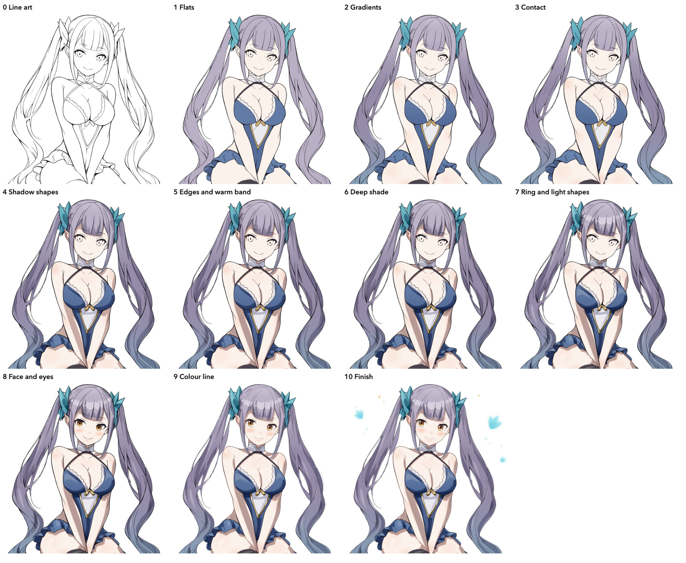

| Round | Neon's overall | Main change |
|---|---|---|
| [1](docs/reviews/twin-round-1.md) | 5.5 | first pass |
| [2](docs/reviews/twin-round-2.md) | about 6.9 | warm band inside the shadow edge, soft form and hard cast edges |
| [3](docs/reviews/twin-round-3.md) | 7.4 | hair masses, ring lip, eyes, line ownership |
| [4](docs/reviews/twin-round-4.md) | 8.4 | darker tails, deeper shade in soft shadows; signed off |

The first-round score is the reviewer's later re-score.

**Learned:** every claim was measured before acting. The maker was wrong about the side of the warm band and the paleness of skin shadow. The reviewer was wrong about feathering the hair ring, and about removing grain, halo and the nose highlight.

## 7. Does it repeat?

**Asked:** run the full process on an original character, with no review during the work, then get one final judgement.

The rules were frozen and proven unchanged by checksum. Line art, regions, shadow design, first render:

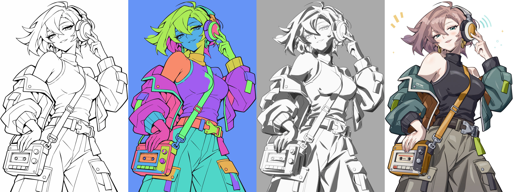

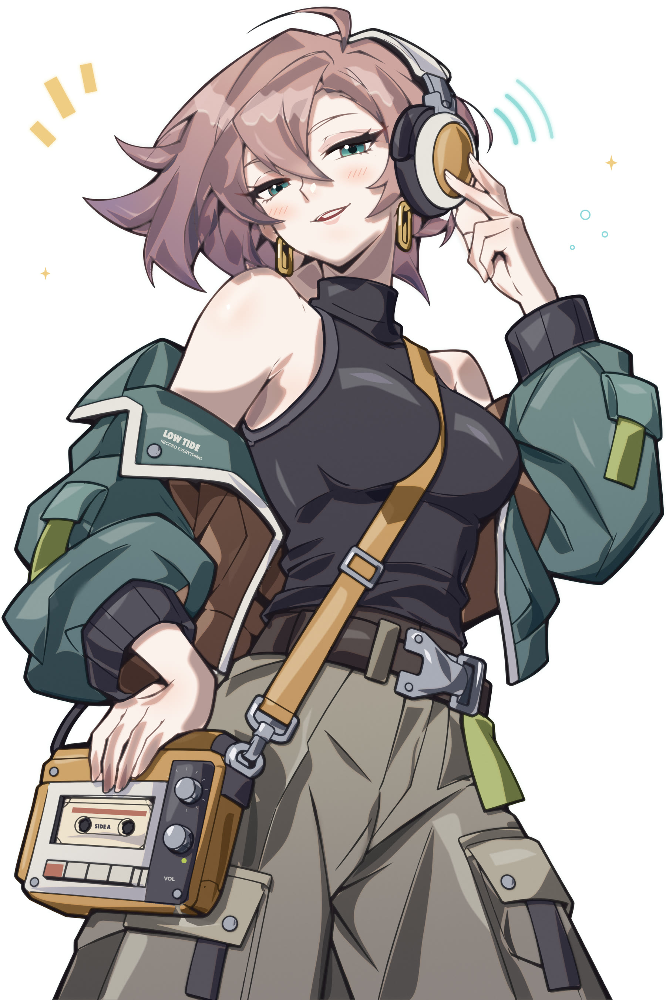

[Neon's judgement](docs/reviews/tape-final.md): 6.8 against 7.8 for the previous character, style fail, repeatability partial pass. Measuring confirmed part of it: a rule bug kept lines near black inside skin when outlines are thick, the ring was cut into pieces, and the eye-white shadow was hidden. Other claims sampled the wrong spot.

**Learned:** skin, cloth, metal and edges carry over. Anything tied to line weight did not.

## 8. Two models, one drawing

**Asked:** can Neon do better? Both render the same line art, then judge each other.

Same [brief](docs/bell-brief.md), same frozen rules, blind to each other. Opus: line art, regions, first render:


Opus left, Neon right:


| | Opus image | Neon image |
|---|---|---|
| [Scored by Opus](docs/bell-verdict-opus.md) | 7.4 | 6.9 |
| [Scored by Neon](docs/reviews/bell-swap.md) | 8.3 | 7.0 |
| Placed shapes | 254 | 201 |

Notes: [Opus](docs/bell-notes.md), [Neon](docs/reviews/bell-neon-maker.md). Neon's drawing data is in [`archive/neon-bell/`](archive/neon-bell/).

**The client's verdict:** Opus is better overall, especially the face and eyes, and those carry a lot of an illustration. Opus does better on the overall look and larger shapes. Neon did slightly better on some smaller accessories and their silhouettes.

Measuring both also found a second rule bug: shades gained too much saturation.

## 9. Fix the rules

**Asked:** update the rules.

- **Face and eyes first.** Face ink is never thinned; lashes stay the darkest mark.
- **Shade saturation is capped.** The reference blue goes 0.41, 0.44, 0.50. The rule gave 0.41, 0.54, 0.70 and now gives 0.41, 0.44, 0.49.
- **Line colour adapts to each drawing's line weight.**
- **Accessories get their own silhouette:** a pale key line and deeper metal.
- **`pnpm check`** holds each figure to numbers measured on the references.

Before left, after right:

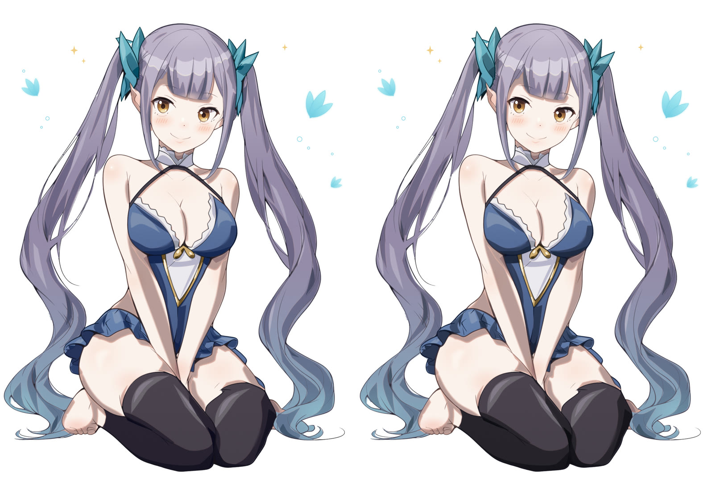
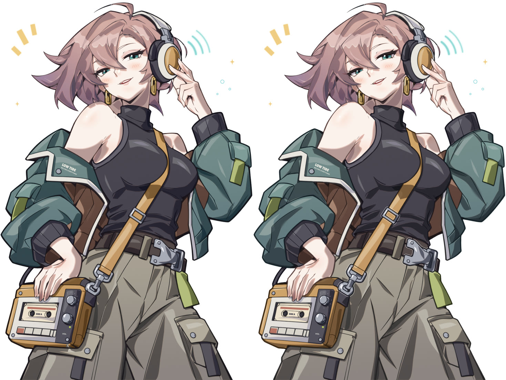
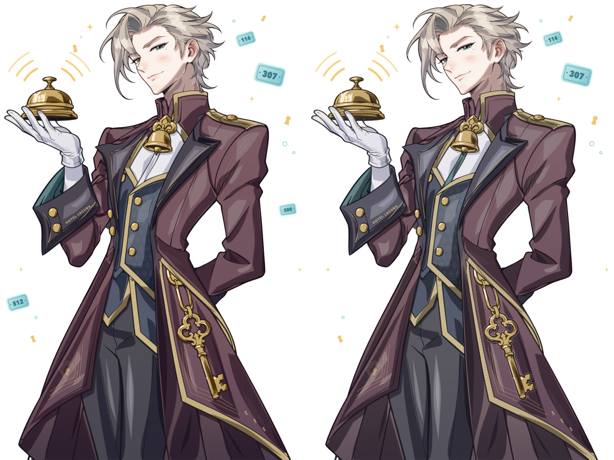


| | Twin-tails | Headphones | Concierge | References |
|---|---|---|---|---|
| Low-saturation pixels | 87% | 86% | 80% (was 55%) | 82 to 99% |
| Near-black pixels | 1.7% | 2.0% | 4.7% (was 7.4%) | 0.1 to 3.8% |

These versions were not reviewed by Neon.

### All passes of the current process

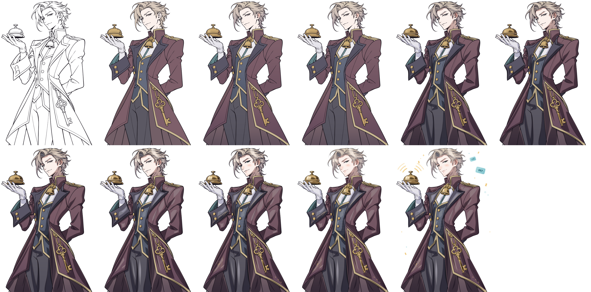

## What it costs

| | Twin-tails | Headphones | Concierge |
|---|---|---|---|
| Colour marks | 298 | 335 | 463 |
| Cast rules | 22 | 39 | 33 |
| Placed light and shadow shapes | 218 | 267 | 254 |

Counts are from when each drawing was first finished. The placed shapes are the main cost and do not carry over to the next drawing. That is the open problem.

## Run

```sh
pnpm install
pnpm dev                                                          # port 5440
node scripts/snap.ts out.png "v=bell&k=3&zoom=2" 2048 3072        # render one
pnpm check                                                        # hold figures against the reference numbers
node scripts/grid.mjs public/bell.png grid.png 420 100 190 200 8  # zoomed crop with coordinates
```

`v` is `twin`, `tape` or `bell` (also `oni2`, `oni`, `sketch`, `cel`, or nothing for the sketch studio). `upto=0..10` stops after a pass; `view=regions|masks|grey` shows the checks. `k` must be an integer; use 2 or 3, since at 1 a few regions can leak. Rendering text uses Avenir Next, so it looks different off macOS.

## New drawing

1. Put clean line art in `public/`.
2. Copy `bell.ts` and `bell-seeds.ts`, set `src`, `w`, `h` and `head`, and register the name in `src/main.ts`.
3. Follow [`docs/process.md`](docs/process.md).

## Documents

- [`docs/process.md`](docs/process.md): the current rules and working loop
- [`docs/history.md`](docs/history.md): measurements, mistakes and disagreements
- [`docs/reviews/`](docs/reviews/): the other models' reports in full
- [`docs/style-notes.md`](docs/style-notes.md), [`docs/rendering-steps.md`](docs/rendering-steps.md): earlier notes
- [`archive/measurements/`](archive/measurements/): the pixel measurements

## Not in this repository

Style reference screenshots, frames of the video in step 1, and every comparison image that contains them are other people's art, so they stay local. Full-size renders and working crops are left out too; the code regenerates the final ones. Attempts in this README were recovered from the working session, so some are smaller than the originals.

Line art in `public/` was supplied by the owner. Check its rights before making this public.
