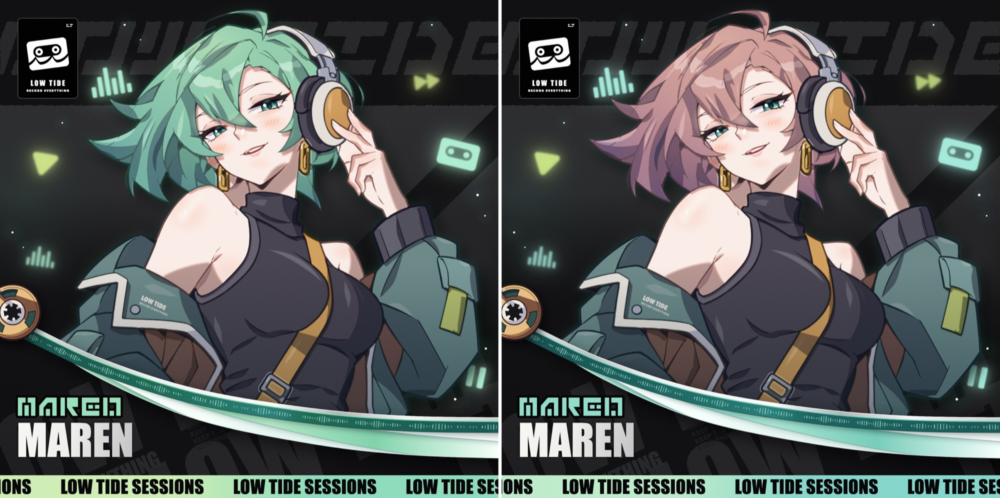
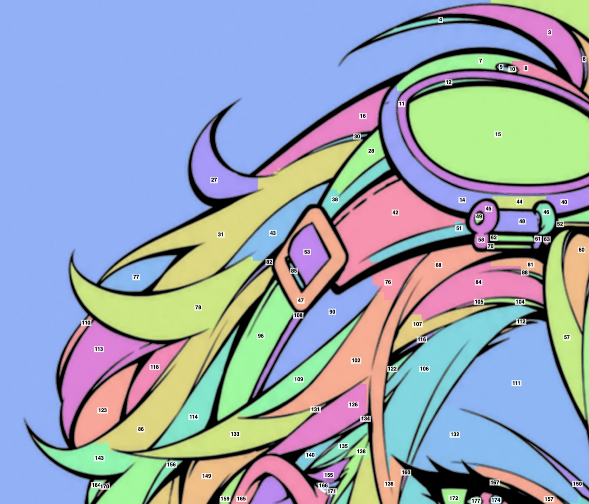
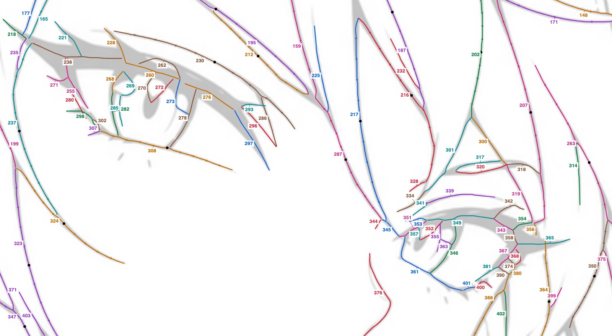
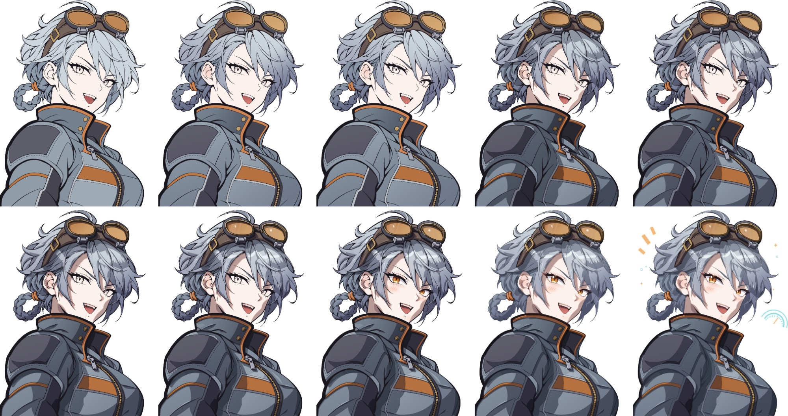
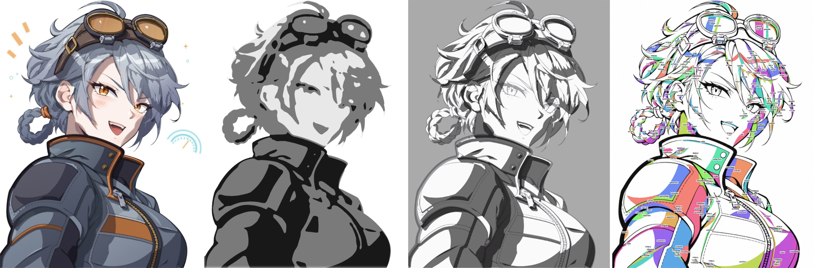
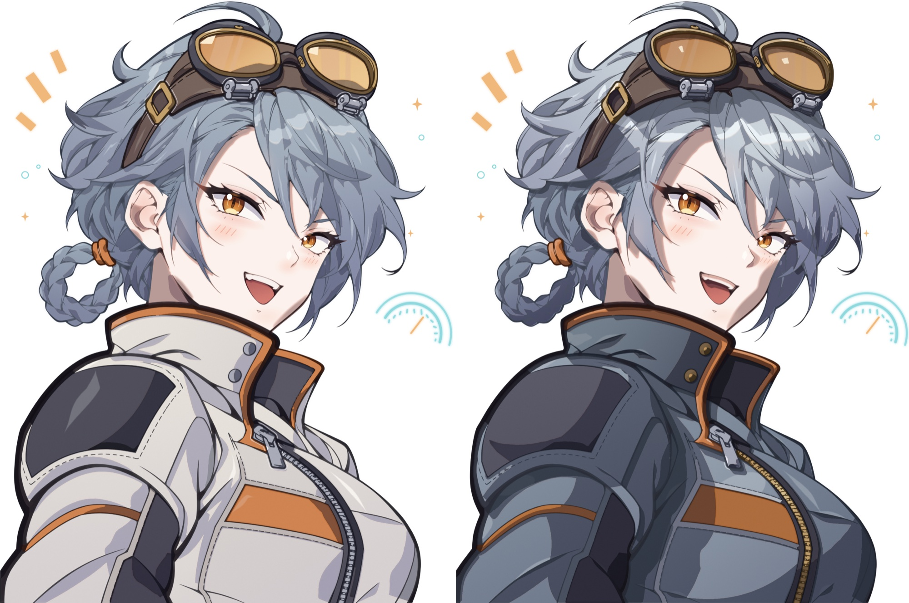
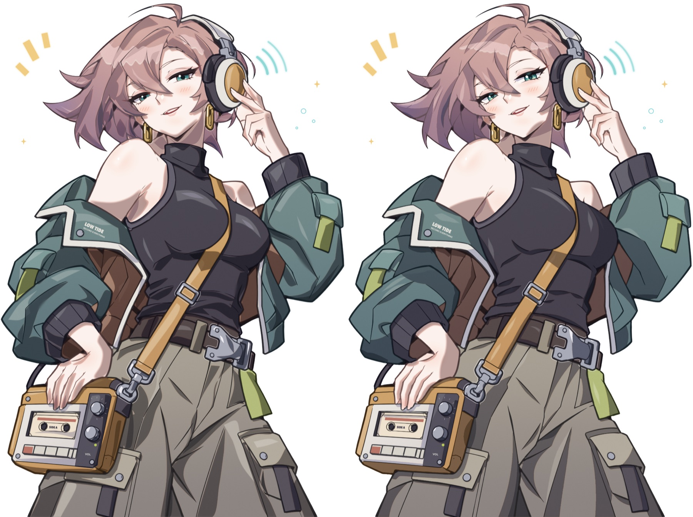

# agent-illustrations

Illustrations coloured entirely by code (TypeScript and Canvas 2D). No image generation: a person supplies line art and directs, an AI agent writes the shapes, rules and numbers.


This drawing has no typed coordinate in its light and shadow shapes. Line art to first version took about 17 minutes and four rounds; a second pass added a declared light, thickness and a value plan. Colours, gradients, washes and floating marks are still chosen and typed by hand.


Goggles is the current process. The others were rendered along the way and use parts of it. The headphones character also has two announcement cards (own fictional brand, two hair colours from one drawing):



## How it works

**Light and value first.** Each drawing states one light and one focus. The big parts get three values, so the face is the lightest mass.

**Name things, do not measure them.** Regions are numbered patches and the drawn lines are numbered. A shape is a sentence about a line: `band s544[0..1] r 0 26 46`. The engine works out the geometry, stops at the ink, and says when a shape leaked, did nothing or could not find its place.




**One light drives the rest.** Cast shadows with a deep part, shaded sides of tubes and balls, folds, rims and hair shade all ask the same light.

**Passes.** Flats, gradients, contact, shadow shapes, edges and warm band, deep shade, ring and lights, face and eyes, line colour, finish:



**Checks.** Final, three value groups, shadow masks, every named shape:



Full rules: [`docs/process.md`](docs/process.md). Every tool: [`docs/tools.md`](docs/tools.md).

## What was learned

1. **Light and value come before detail.** The client saw that nothing attracted the eye; the numbers confirmed it: the jacket was lighter (172) than the head (154).
2. **Objects need thickness.** Every overlap casts, hard parts get a lit and a shaded rim.
3. **An agent reads numbers on a drawing well and coordinates badly.** Naming lines took typed coordinates in shapes from 2,954 to 18, then 0, and lit slivers from 150 to 0.
4. **Large planes first, accents second, then a separate round for lights.**
5. **A person draws, code colours.** Rendering rules transfer between drawings; drawing in code did not.
6. **Reviews must be doable.** Neon gave 12 findings with a place, a measurement, the exact change and a check. Most held when measured.

Before and after the light and value pass. The jacket changed colour to fix the value:



| Goggles, head against the rest | First | Final | Closest reference |
|---|---|---|---|
| Head median luma | 154 | 141 | 183 |
| Rest median luma | 172 | 84 | 85 |
| Rest that is dark | 27% | 51% | 50% |
| Local contrast, head over rest | 1.12 | 1.97 | 1.24 |

All numbers, what failed, and what is still open: [`docs/findings.md`](docs/findings.md).

**Open:** body contrast is still below the reference (9.6 against 12.7), choosing the shapes is still judgement, light and focus exist on one drawing of four, and a timed third drawing is missing.

## Run

```sh
pnpm install
pnpm dev                                                     # port 5440
node scripts/snap.ts out.png "v=rig&k=2&zoom=2" 2172 2896    # render one
pnpm check                                                   # hold figures against the reference numbers
```

| Query | Shows |
|---|---|
| `v=rig` | a drawing: `rig`, `tape`, `bell`, `twin` |
| `upto=0..10` | stop after a pass |
| `view=value`, `grey`, `masks`, `regions` | checks |
| `k=2` or `3` | scale, an integer. At 1 a few regions can leak |
| `v=sheet&who=rig&box=x,y,w,h&z=4` | numbered lines; add `show=shapes` or `show=pools` |
| `v=poster&look=jacket` or `hair` | an announcement card |

Text uses Avenir Next, so it looks different off macOS. `pnpm check` needs the dev server.

## New drawing

1. Put clean line art in `public/`, closed lines, lower lids drawn.
2. Copy `src/splash/rig.ts` and its parts (`rig-*.ts`), set `src`, `w`, `h`, `head`, `light` and `focus`, register the name in `src/main.ts`.
3. Name the patches from `show=pools&list=1`, then `node scripts/freeze.ts name` and print the line sheets.
4. Follow [`docs/process.md`](docs/process.md).

## Documents

- [`docs/process.md`](docs/process.md): the current rules, in order
- [`docs/tools.md`](docs/tools.md): how shapes are said, placed and checked
- [`docs/findings.md`](docs/findings.md): what works, what does not, numbers
- [`docs/journey.md`](docs/journey.md): the full story with images, step by step
- [`docs/history.md`](docs/history.md): measurements, mistakes and disagreements
- [`docs/reviews/`](docs/reviews/): the other models' reports in full
- [`docs/research-anime-rendering.md`](docs/research-anime-rendering.md), [`docs/research-precision-tools.md`](docs/research-precision-tools.md): research with sources
- [`docs/earlier/`](docs/earlier/): superseded notes
- [`archive/`](archive/): pixel measurements, Neon's bell drawing

## Previous attempts

The steps before, oldest first. Code and results are kept; each has its story and images in [`docs/journey.md`](docs/journey.md).

| Step | What | What it taught | Code |
|---|---|---|---|
| 1 | A sketch engine, 13 drawn styles | contours, weight and hatching can be code | `src/skins/` |
| 2 | Splash art as numbers, figure drawn in code | a style is eight decisions; drawing is the weak part | `src/cel/` |
| 3 | Colouring a rough pencil sketch | split the work: a person draws, code colours | `src/lineart/` |
| 4 | Clean line art, one light | cloth looked like latex | `src/clean/` |
| 5 | Research, 15 passes | shadow shapes must be designed | `src/passes/` |
| 6 | The target style, Neon as critic, four rounds | measure every claim | `src/splash/twin.ts` |
| 7 | A second character with frozen rules | skin and edges carry over, line weight did not | `src/splash/tape.ts` |
| 8 | Opus against Neon, blind | the client preferred Opus for face, eyes and large shapes, Neon for small accessories | `src/splash/bell.ts` |
| 9 | Rules fixed, cast re-rendered | shades must not gain saturation | `docs/process.md` |
| 10 | Named lines instead of coordinates | the naming approach, hair and cloth kits, eye rig | `src/tools/` |
| 11 | A new drawing from zero | the process repeats | `src/splash/rig.ts` |
| 12 | One light, real form, values | what is at the top of this page | `src/tools/light.ts` |




Also here: [a reel of the sketch engine](gallery/reel.mp4) and [its studio in one file](gallery/studio.html).

## Not in this repository

Style reference screenshots and every comparison image that contains them are other people's art, so they stay local, as do full-size renders, which the code regenerates. Numbers that mention references cannot be re-run without them.

Line art in `public/` was supplied by the owner. Check its rights before making this public.
