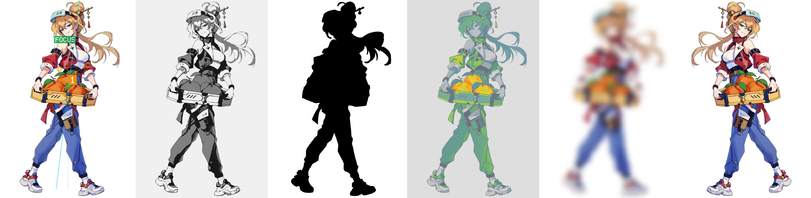

# Critic: a review for a CLIP STUDIO PAINT workflow

A second pair of eyes for stylized anime illustration, at every stage from sketch to render. You save or export from CSP and get:

- **a report** (`report.html`, one self-contained file, opens offline),
- **a redline** (`redline.png`), a transparent PNG at the exact canvas size to drop into CSP as a layer, with numbered marks matching the report.

The checks are deterministic: the same file always gives the same findings, and they need no network and no API key. An AI critique from Claude can be added on top. It is told the measurements and draws its own regions on the same redline.



```sh
pnpm install
node scripts/critic.ts art.png --no-ai                       # measurements and report only
node scripts/critic.ts art.clip --stage flats                # + AI critique (needs ANTHROPIC_API_KEY or `ant auth login`)
node scripts/critic.ts --watch ~/Pictures/wip --stage sketch # review every save or export in a folder
pnpm test:critic                                             # the tests
```

Output goes to `output/critic/<name>/` (`<name>-clip/` for a `.clip`), or to `--out <dir>`.

| Option | |
|---|---|
| `--stage sketch\|lineart\|flats\|render` | what to judge, default `render` (below) |
| `--no-ai` | measured checks and report only |
| `--watch <dir>` | review each `.png`, `.jpg` or `.clip` when it is saved; `--initial` also reviews the files already there |
| `--focus x,y,w,h` | the focal area in canvas pixels, if the face finder gets it wrong or the focus is not a face |
| `--mask <png>` | the silhouette: black figure on white, or any PNG with transparency |
| `--segmenter auto\|none\|"<cmd {in} {out}>"` | background removal for the silhouette; `auto` uses `rembg` if it is on `PATH`, or `$CRITIC_SEGMENTER` |
| `--keypoints <json>` | pose keypoints: OpenPose / DWPose JSON, a COCO-17 array, or `{"points": {"nose": [x, y, score], …}}` |
| `--pose-cmd "<cmd {in}>"` | a pose estimator that prints such JSON for a PNG (or `$CRITIC_POSE_CMD`) |
| `--model <id>` | Claude model for the critique, default `claude-opus-5-5` |

## Files it writes

| File | |
|---|---|
| `report.html` | the review: picture with the redline (toggle), numbered findings with a fix in CSP terms, the AI critique, every view, the measurements, the focal crops |
| `redline.png` | canvas-size transparent overlay. In CSP: File › Import › Image (or drag it onto the canvas), keep it on top, set it to Multiply or lower its opacity if you like |
| `findings.json` | every finding, canvas pixels: for scripts and agents |
| `metrics.json` | every measurement, and the AI critique as returned |
| `views/*.png` | greyscale, 3-value map, saturation, muddy mid-tones, silhouette, flip, squint, attention map, pose skeleton |
| `crops/*.png` | full-resolution crops: face, upper body, hands (with pose), the strongest attractors away from the focus |

Redline colours: red = major, orange = minor, blue = note, an orange path A → B → … = eye flow, green dashed box = focus, cyan line = the silhouette's main axis against true vertical.

## Stages

Every check runs at every stage. The stage decides which ones are in focus, and which rubric the AI critic gets. Findings from checks out of focus stay in the report as notes.

| Stage | In focus | The AI critic judges |
|---|---|---|
| `sketch` | silhouette, flip, squint, pose, focus | gesture, balance, proportion, composition, eye flow. Not line quality, colour or finish |
| `lineart` | silhouette, flip, pose, focus, squint | line weight hierarchy, closed shapes, tangents, anatomy the clean line locks in |
| `flats` | values, palette, saturation, silhouette, focus | separation of big shapes in value, palette harmony, saturation placed on the focus, gaps and bleed. Not missing shading |
| `render` | everything | value grouping, light logic, edges, shadow colour, rim and bounce light, materials, face and eyes, detail hierarchy |

## Checks

Everything is measured at 1200 px on the long side, then mapped back to the canvas. Thresholds are below; each finding in the report quotes the numbers behind it.

**Value.** Greyscale is CIE L*, perceived lightness, not an RGB average. A saturated blue gets the grey it looks like. The 3-value map splits L* with a three-class Otsu threshold over the figure (over the whole image when there is no reliable silhouette), so it shows the value groups the picture actually has. Flags: a value range (L* 95th − 5th percentile) under 45, or over 62% of the figure in L* 30–70 with a range under 60. Neighbouring groups whose mean L* differ by under 18. A group under 4% of the figure. Over 22% *mud*: mid values with almost no chroma (OKLab C < 0.035).

**Saturation and palette.** HSV saturation × value (a saturated dark cannot shout) as a heatmap over a faded greyscale. Over 30% of the figure highly saturated is flagged. A saturated area over 1.2% of the picture away from the focus is flagged as competing. The palette is k-means (k = 7, seeded, so it is repeatable) in OKLab, with near-identical clusters merged.

**Silhouette.** In order of preference: your `--mask`, the file's transparency, an external segmenter, or a border flood. The flood models the background from the border and floods it in from the edges. It is exact on a figure on a plain or gently graded page. When under 70% of the border matches one colour it says the silhouette is unreliable, and value and saturation are then measured over the whole image instead. Small enclosed holes (eye whites, highlights) are filled; big ones are kept as negative space. Flags, only for a figure not cut by the frame: a compact blob with no negative space (P²/4πA under 2), a main axis 7–45° off vertical, and a centre of mass more than 22% of the figure's width outside the base (the lowest 6% of the figure).

**Flip and squint.** A mirrored copy, and the picture shrunk to 160 px and blurred. If the blurred L* has a standard deviation under 10, the figure disappears at thumbnail size.

**Focus and crops.** The attention map combines value contrast (45%), colour contrast (30%) and edge density (25%). Its peaks are the eye flow. The focus is `--focus` if given. Otherwise it is the face: from pose keypoints if they put skin there, else the sizeable skin-coloured patch in the top 30% of the figure with the most dark detail (eyes, lashes, mouth) inside it, else the top of the silhouette. An attractor outside the focus with 15% more attention than the focus is flagged. Crops are cut from the full-size source, so the AI critic sees eyes and line quality at native resolution.

**Pose (optional).** Shoulder and hip tilt, and whether they counter each other (contrapposto), parallel tilt or level. Height in heads: the crown is placed from the eye line, with anime eyes about 55% down the head, so it is approximate and labelled as such. Left/right limb lengths. Keypoints that contradict the silhouette are dropped and the report says so: points off the figure, or a head more than 38% down an uncropped figure. Without keypoints the check is skipped and the report says why.

## The `.clip` file is only read

A `.clip` is a chunk container with a SQLite database inside. CSP stores a PNG of the flattened canvas in its `CanvasPreview` table. The critic reads the file's bytes (open flag `r`), copies the database bytes to a private temp directory, opens that copy read-only, reads the preview and the canvas size, and deletes the copy. The `.clip` itself is never opened for writing, locked or renamed, so it is safe on a file CSP has open; a test checks its hash, size and modification time before and after. If a preview is smaller than its canvas, crops are limited to the preview's resolution and the redline is still drawn at canvas size.

## The AI critique

With an API key (or an `ant auth login` profile), Claude (`claude-opus-5-5`, effort `high`) receives the picture (at most 1568 px on the long side), the greyscale, the 3-value map, the focal crops with their positions, the stage rubric, and the measurements with their flags. It answers in a fixed JSON schema (structured outputs): an overall read, readiness for the next stage, strengths, up to 8 issues (each with a region, the image it was seen in, a fix in CSP, and a confidence), and any measurement it thinks is misleading for this picture.

Against confident nonsense:

- Measurements are given as facts it must not contradict silently; disagreements go in their own list.
- Regions are clamped to the canvas.
- Issues under 35% confidence become notes.
- A refusal, a schema mismatch or a network error leaves the measured report intact with the reason.
- Server-side refusal fallbacks are on for the models that support them.

The picture is sent to the Anthropic API: use `--no-ai` for anything that must not leave the machine. One review sends about 5–8 images. That is an estimate of roughly 10–20k input tokens, a few cents per review at Opus list prices. Watch mode calls the API on every save, so use `--no-ai` for fast loops.

The request and the handling of the answer are tested through the real SDK with a stub transport. No live call was made while building this.

## Optional helpers

- **Background removal:** `pip install "rembg[cli]"`. With `rembg` on `PATH`, `--segmenter auto` (the default) uses it whenever the file has no transparency. Any other tool works with `--segmenter "mytool {in} {out}"`, writing a PNG with alpha.
- **Pose, MediaPipe:** `pip install mediapipe`, then `--pose-cmd "python3 scripts/critic-pose-mediapipe.py {in}"`. The model (about 9 MB) downloads once to `~/.cache/critic/`; on Linux MediaPipe also needs `libegl1`. Trained on photos, it finds full-body anime figures' legs well and sometimes puts the head on a prop. The plausibility check catches that, as it did on Visor, whose head it put on the crate. It finds nothing on cropped busts.
- **Pose, DWPose or hand-placed:** export OpenPose JSON (ComfyUI's DWPose preprocessor, or any OpenPose editor) and pass it with `--keypoints`. Face landmarks in it give an exact chin for the head count.

## Limits

- The face finder is a colour heuristic. It is right on most of the drawings here. It can land on blonde hair, a bare shoulder or a tan goggle lens (the Rig drawing), and its confidence is shown. Use `--focus` when it misses.
- The border flood needs a plain or gently graded background. On a painted scene, export with the background hidden, or pass `--mask`.
- "Mud" counts every low-chroma mid value, including materials meant to be neutral (khaki, steel, grey cloth). It is flagged only above 22% of the figure, and the map shows where it is, so you can judge.
- The checks measure; they do not know intent. A deliberate lean, a muted palette or a focus on a prop all trigger flags that are right about the picture and wrong about the plan.

## Code

`scripts/critic.ts` (CLI), `src/critic/`:

| File | |
|---|---|
| `run.ts` | the pipeline |
| `image.ts` | PNG (every colour type, bit depth, Adam7) and JPEG decoding, resize, crop |
| `clip.ts` | the read-only `.clip` preview |
| `checks/` | one file per check |
| `stages.ts` | stage profiles and rubrics |
| `vlm.ts` | the AI critique |
| `report.ts` | the HTML report |
| `redline.ts`, `draw.ts` | the overlay |
| `watch.ts` | watch mode |

Tests are in `src/critic/test/`: synthetic figures for every check, every PNG colour type, the `.clip` left untouched, the AI request and its failure modes, the end-to-end run and watch mode.
