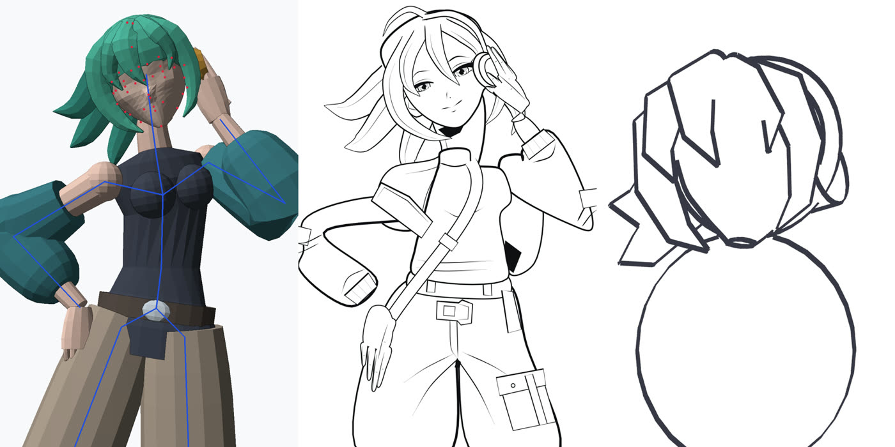
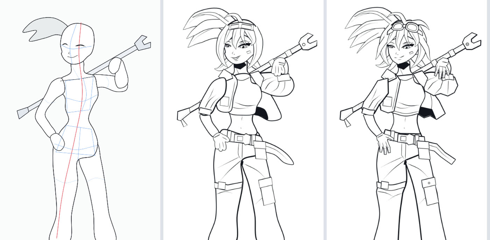
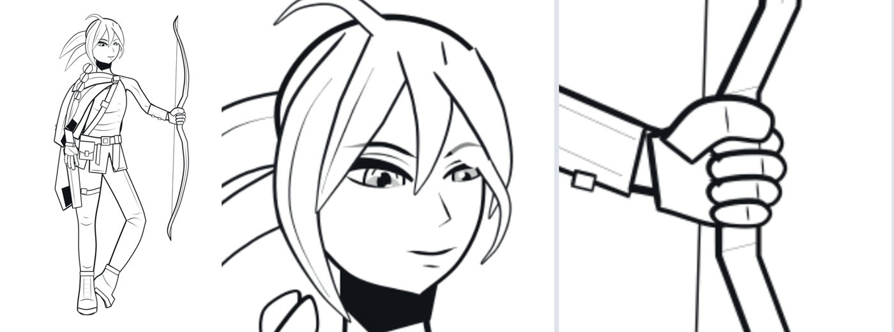
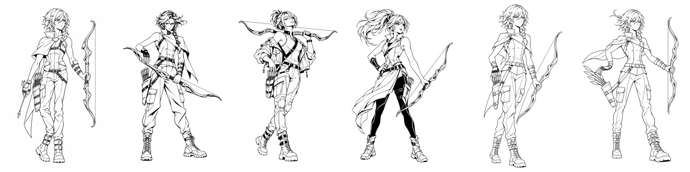

# The log

Every attempt to have an agent draw, or decide what is drawn, oldest first. 24 to 26 November 2026. Conclusions: [`README.md`](README.md). What to test next: [`next.md`](next.md).

Makers: Claude Opus and Gemini 4 Neon wrote the code; GPT 6.2 Astra High made the generated images of attempts 6 and 7. The client is one person, and judged every result by eye. Causes are marked **measured**, **seen** (visible in the pictures) or **guess**.

| # | Attempt | Input | Who decides the shapes | Verdict |
|---|---|---|---|---|
| 1 | Sketch engine | none | code | a drawn look, yes; a figure with life, no |
| 2 | Courier, a figure in code | a style reference | agent | drawing is the weak part |
| 3 | Redrawing a face over line art | finished line art | agent, for eyes and lips | rejected; leaving them alone worked |
| 4 | 3D mannequin, then ink | an existing drawing's pose | agent | rejected |
| 5 | Sketching in stages | a text idea | agent | rejected |
| 6 | Drawing from a reference board | brief, generated photos | agent | not good enough |
| 7 | Directed image generation | brief, style references | image model, picked by agent | "total failure" |
| 8 | Sketch redrawn as closed pieces | rough sketch | artist half, agent half | rejected |
| 9 | Rough sketch, second | very rough sketch | agent mostly | stopped |
| 10 | Lines pulled onto the pencil | refined pencil sketch | artist, line by line the agent | rejected |
| 11 | The sketch's own pixels | pencil sketch | artist, but little was drawn | rejected |
| control | Rendering on finished line art | line art | whoever drew it | approved, twice |

## 1. Sketch engine
- **Did:** figures as a few posed solids that output named lines, drawn in thirteen styles. [Step 1](../journey.md). Code: `src/skins/`.
- **Result:** pencil, felt-tip and ten more looks. Objects correct, first lines lifeless.
- **Keep:** broken contours with overshoot, weight on the shadow side, a loose second stroke, hatching from real strokes. Line craft is code's easy part.

## 2. Courier
- **Did:** an original character drawn fully in code, four versions. [Step 2](../journey.md). Code: `src/cel/`.
- **Verdict:** the drawing is not there yet. It led to the split that worked: someone draws, code colours.
- **Broke:** pose, hair, hands, face. **Seen:** flat pose, polygon hair, doll joints, one line weight.

## 3. Redrawing eyes and lips
- **Did:** on approved line art, new lashes, lids and mouth typed over the drawn ones for "more detail".
- **Verdict:** rejected at once; do not redraw their shape. Painting between the artist's lines was approved.
- **Why (seen):** a few typed points cannot replace a drawn curve, and on a face 2 px is another expression.

## 4. 3D mannequin, then ink

- **Did:** an articulated 3D figure with a head mesh, projected, and inked in 2D with tapered strokes and a gate for proportions. Beside it, Blender Freestyle on simple forms. Two ink versions. The pose copied an existing drawing.
- **Expected:** 3D gives anatomy and perspective, 2D gives appeal.
- **Verdict:** "The test you did doesn't look good." "They also relied on copying a post and character, and even then the result is off. But indeed not as bad as open drawing." "I like the fact that the line art your produced is solid, even if the drawing is bad."
- **Broke first:** at the model. Tube limbs, balloon sleeves, one hand a mitten with spikes; every later step kept it.
- **Why:** capsule limbs give wooden silhouettes (**seen**). A rigid start removes gesture and exaggeration (**guess**). It copied a known pose and still failed, so inventing was not the only problem (**seen**).
- **Keep:** Blender headless with Cycles CPU and Freestyle works, 0.69 s a frame; `BLENDER_EEVEE_NEXT` came out black (**measured**).
- **Reported:** better than it was.

## 5. Sketching in stages

- **Did:** as people learn it: four thumbnails with a line of action, masses, costume, one critique pass. An original character, 2D only, drawn as closed white shapes back to front.
- **Verdict:** "As long as you place flat shapes down, this won't be solved. The hand for example is gripping something, so it doesn't sit flat like that." "The workflow is not meant for me to tell you each single human feature, grip, accessories, like a whack-a-mole thing."
- **Broke first:** in the primitive and the masses. Hands lie on the prop, not round it; clothes are stickers; the pose stayed frontal.
- **Why:** closed outlines cannot interlock or fade out at a crease (**seen**). With nothing to look at, the agent falls back on symbols (**guess**).
- **Keep:** thumbnails and a 120 px silhouette did improve the pose, before any detail was spent.
- **Reported:** better than it was; checked at 1× only, no crops of the hands.

## 6. Drawing from a reference board

- **Did:** the client's idea that nobody draws from nothing. A brief ("a female hunter, slim but strong, relaxed standing stance, holding her bow, looking determined"), four generated photo references (pose, hands, gear, face and cloth), two rounds of drawing in code.
- **Result:** the grip wraps round the bow. Everything else stayed coarse, stiff, sticker-like.
- **Verdict:** the client moved on to directed image generation; no words on the drawing itself.
- **Broke first:** turning what was seen into typed points. Face, hair, knuckles and cloth became 8 to 12 point curves.
- **Why:** typing x,y for a whole figure loses the small turns that make anatomy (**seen**). Two causes were mixed and never separated: closed shapes, and blind typing at 1× (**guess**).
- **Keep:** references fix what overlaps what. The review sheet: 300% crops, flip, silhouette, beside the target.
- **Reported:** as it was.

## 7. Directed image generation

Generated images, kept as evidence. Nothing in the pipeline uses them.

- **Did:** five rounds with an image model, led by an agent: design sheets first, pushback on generic parts, three variants against sameness, a merge, an open silhouette.
- **Verdict:** "Forget image generation, not smart enough and way too much of the 'slop' look all the times, for everything that you shared. Assume this was a total failure." During it: "white space and silhouette are also really important. The major details and pose should be clear just from it."
- **Broke first:** at the start. Each round fixed faults (grip, string, crossed legs) and none changed the averaged look.
- **Why:** hand-picking moves around a model's average, not away from it (**guess**). The last image matched a supplied line art in ink, 4.6 to 4.3%, and in stroke widths, 2/3/4/6/8 to 2/2/3/5/7 px, and its outline was closed (**measured**): these numbers say it can be coloured, not that it is good.
- **Keep:** asking for three variants shows drift. Never thin a 2 px line art before flood filling it: it leaks.
- **Reported:** far better than it was. Pieces scored 9 and 9.5, and "this workflow genuinely cracked it", one message before the rejection.

## 8. A sketch redrawn as closed pieces (`linen`)
Sketches of attempts 8 to 11, and what came of them, are not published.

- **Did:** a full figure from a rough sketch. About 90 outlines typed over it, back to front: regions and weighted lines follow from what covers what. Then the whole rendering process.
- **Verdict:** lost the appeal of most hinted details; a mass without movement; hands, feet, volume and hair off, hair artificial, without flow.
- **Broke first:** at the typed outlines. The artist's curve was read, described and replaced.
- **Why:** execution: the sketch had the decision, the copy lost it (**seen**). Every gate passed (**measured**).
- **Keep:** pieces back to front never leak, and give line weight by what lies on the two sides. Ink traps where lines close in.
- **Reported:** better than it was.

## 9. A very rough sketch (`duel`)
- **Did:** a first pass, then stopped by the client: the sketch was too rough, shapes not defined.
- **Learned:** ask about a shape that is not defined. Nothing after it can repair a guess.

## 10. Lines pulled onto the pencil (`bob`)
- **Did:** the pencil extracted, a smooth curve per line pulled onto it as a whole, pressure as weight, hair as brush strokes. A head and shoulders by another artist, a local study only.
- **Verdict:** off again; the good details lost; too much face for what we can do; the lines need not be redrawn.
- **Broke first:** choosing which pencil lines are lines, then eyes, ear and skull.
- **Why:** each line is as good as the agent's reading of it (**seen**). Three closed shapes in the whole drawing left the shading nothing to follow (**measured**).
- **Keep:** pulling a whole curve does not jump between doubled lines, snapping points does.
- **Reported:** better than it was.

## 11. The sketch's own pixels (`tee`)
- **Did:** the pencil stays as line art, greys included; about forty contours strengthened; searching lines erased in named areas.
- **Verdict:** "Not good. You are struggling a lot here." The client's guess: less detail means more to invent, and the feedback loop breaks.
- **Broke first:** before the start: nothing checked the input. A crop tee, shorts and skin: 20 closed shapes, 58% of the figure further than 9 px from any edge at 1,250 px height.
- **Why:** lines were no longer lost, so this is mostly the decision: 55% of shadow edges follow no drawn line, and they are invented (**measured**). Unfinished searching lines remained (**seen**).
- **Keep:** greys kept as greys work inside a form.
- **Reported:** better than it was.

## Control: finished line art
`visor` and `maren`, approved, and `rig` before them. Same renderer, about the same number of designed shadow shapes. The line art was supplied by the owner; how it was drawn is not recorded here, so do not read it as "drawn by hand".

## The comparison after attempt 11

| | visor | maren | linen | bob | tee |
|---|---|---|---|---|---|
| Client | yes | yes | no | no | no |
| Gate fails | 0 | 0 | 0 | 0 | 0 |
| Blind critic, of 10 | 7 | 7.5 | 2.5 | 2 | 3.5 |
| Closed shapes in the line art | 237 | 144 | 67 | 3 | 20 |
| Parts | 80 | 48 | 33 | 10 | 18 |
| Shadow shapes designed | 151 | 176 | 134 | 81 | 116 |
| Shadow edges on a drawn line | 75% | 66% | 57% | 63% | 45% |
| Figure covered by edges (references 18 to 20%) | 28% | 17% | 18% | 11% | 9% |
| Widest empty circle, share of figure size (references 13 to 17%) | 15% | 21% | 20% | 22% | 32% |

The critic was a fresh agent: names and verdicts removed, the references beside, causes split into drawing, line, rendering and density. Its words: "Rendering technique looks much the same in all five. The design and drawing beneath it decide the result." It named drawing for `maren` and `linen`, density for `visor` and `tee`, and said colouring alone could not save `linen` or `bob`. One run, five pictures: a direction, not a law. Script: [`archive/drawing/audit.ts`](../../archive/drawing/audit.ts).

## The critic on line art alone
Eight line arts in grey, names removed, another fresh agent: four supplied ones, two generated (attempt 7, rounds 3 and 5), two drawn in code (attempts 5 and 6).

| | Accepts, of 10 | Generic, 10 is worst |
|---|---|---|
| supplied: maren, bell, rig, twin | 8.5, 8, 7.5, 6.5 | 3, 2, 5, 9 |
| generated: round 3, round 5 | 7, 5.5 | 6, 8 |
| in code: attempt 5, attempt 6 | 2.5, 1.5 | 4, 6 |

- It puts both code drawings last and together, 95% sure of one maker.
- It does not sort generated from supplied cleanly: the two overlap in both columns. A single critic catches broken drawing. Whether it catches what the client calls slop is open.
- Skill and authorship are two scales. Attempt 5 is less generic than the generated ones and far worse drawn.
- One run. Scores from a model are weak; reasons and places are what to read.

## Code
Frozen copies, not maintained and not runnable as they are: [`archive/drawing/`](../../archive/drawing/).

| Folder | Attempts |
|---|---|
| `mannequin/` | 4 |
| `sketching/` | 5 |
| `hunter/` | 6 |
| `sketch-to-line/` | 8 to 11; `engine.patch` is what the renderer needed |
| `audit.ts` | the comparison |

## Adding an entry
Did, verdict in the client's words, what broke **first**, why (measured, seen or guess), what to keep, and whether it was reported better than it was.
