# Rendering anime art from line art to finish

Open your clean line art in any drawing program (CLIP STUDIO PAINT, Krita, Procreate, or Photoshop) and follow these steps in order.

*Finished render: upper-left light, bright face and shoulder, cool reflected light on the far right edges.*

*From left to right: lines, flats, main shadow, casts, deep shadow, light, bounce light, eyes, and finish.*

## Before you start

**Layers.** Put your line art on top and lock it. Below it, make one folder per part with one flat layer at the bottom. Clip every shading layer to its flat so paint stays inside that shape.

From bottom to top, each part uses the same stack:

1. **Flat** (Normal)
2. **Gradient** (Normal)
3. **Half tone** (Multiply)
4. **Shadow 1** (Multiply), plus **Cast shadow** (Multiply) above it
5. **Shadow edge** (Multiply)
6. **Shadow lift** (Color Dodge)
7. **Shadow 2** (Multiply)
8. **Light** (Normal)
9. **Reflected light** (Normal)

**One light source.** Pick one light direction first and keep it fixed. Here it comes from the upper left, so right and lower sides turn into shadow.

## Plan

Check your palette, values, simple forms, and shadow shapes before shading.

*Four colour plans in three values and stamp size. Plan A wins: mid-green hair, lightest face, black top as anchor, dark teal jacket, pale trousers.*

*Flats in grey, three values, and final in grey. Toggle a top black layer in **Color** mode after every step.*

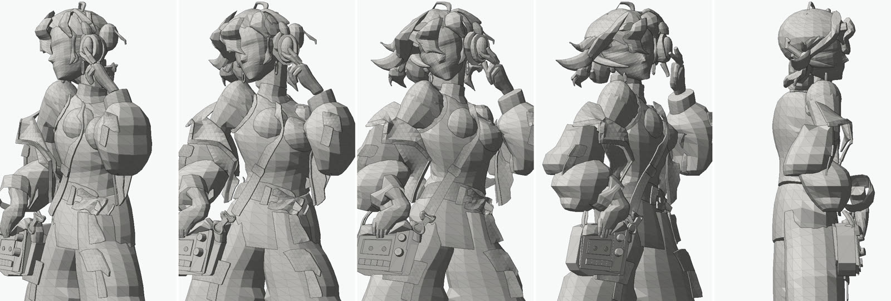
*Figure as simple solids from five angles. Think cylinders and boxes before shading.*

*Left: light map (pale yellow lit, blue turned away, violet cast, teal far edge for reflected light). Right: shadow shapes alone in grey.*

## Step by step

In Steps 2 to 14, left shows where this step sits on the figure, middle is a close-up before, and right is after.

### 1. Flats
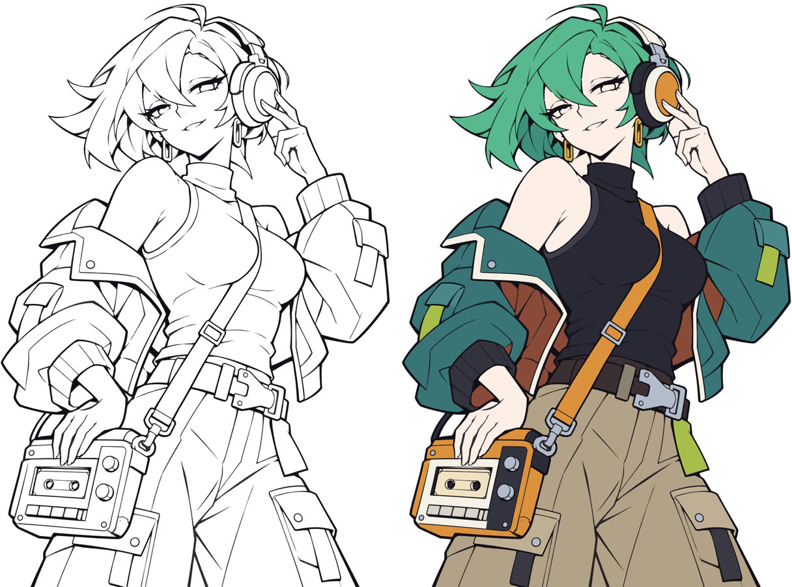
*Lines on the left, one flat colour per part on the right.*

**Why:** Clean flats lock in your values and give every shading layer a shape to clip to.

**How:**
1. Make one `Flat` (**Normal**) layer per part under the line art.
2. Pick values first: face lightest, hair mid, top darkest.
3. Fill each part with the **fill bucket** (gap-closing on), or **lasso** and fill open shapes.
4. Hide the white background and fix white specks along lines with a **hard brush**.

**Done when:** Every part is solid, speck-free, and separates cleanly in greyscale.

### 2. Colour gradients
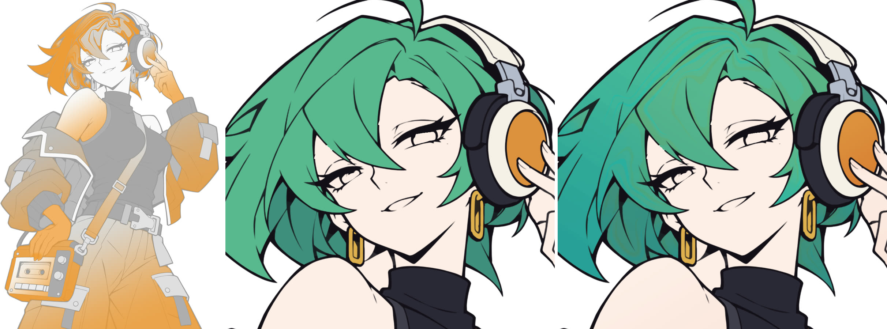
*Subtle shifts across the flats; hair shifts from green to teal toward the tips.*

**Why:** Gentle colour shifts keep large flats alive without disturbing your values.

**How:**
1. Add a clipped `Gradient` (**Normal**) layer above each flat with a large **soft airbrush** at low opacity.
2. Shift the hair from green to teal toward the tips.
3. Darken the lower jacket and trousers slightly, and warm the skin at the hands.
4. Keep it subtle — if you spot the gradient first, lower its opacity.

**Done when:** Big flats feel richer top to bottom while holding the same greyscale read.

### 3. Main shadow (Shadow 1)
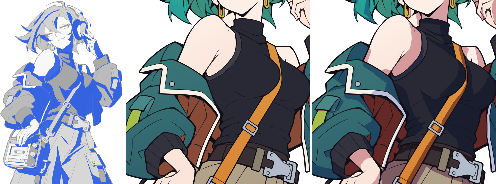
*Hard-edged main shadows on every right and lower plane turned away from upper-left light.*

**Why:** This is the most important step — big, clear shadow shapes make the figure look solid.

**How:**
1. Add a clipped `Shadow 1` layer in **Multiply** mode (Multiply darkens and tints whatever sits underneath).
2. Pick a light cool lavender-blue, never grey or black: skin `#d9aab5`, jacket `#ada5d0`, top `#a3b0de`, trousers `#b491ba`, hair `#a8b0db`.
3. Use a hard-edged **lasso** fill on every right and lower side turned away from the light.
4. Paint big simple shapes: one clean edge, the other ending in a point.
5. Land edges on a drawn line or clearly across the form — never a few pixels beside a line.

**Done when:** Hiding the flats leaves simple shadow shapes that describe the whole pose.

### 4. Cast shadows
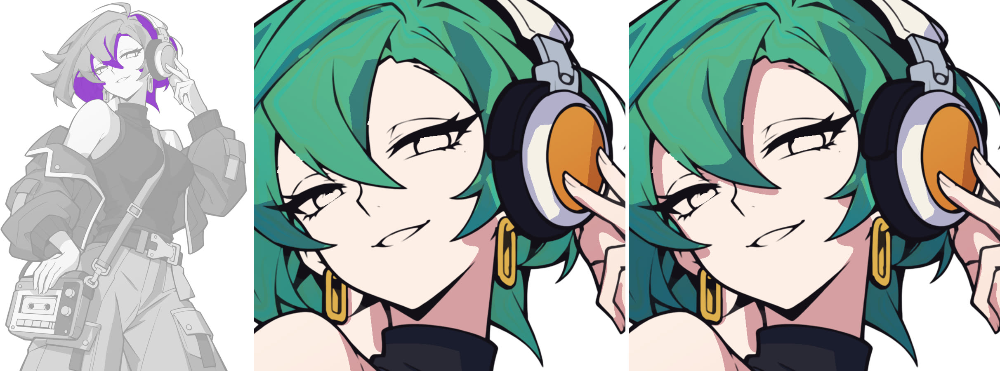
*Hard shadows cast by hair onto face and neck, headphones onto hair, and fingers onto the headphone.*

**Why:** Cast shadows tell distance so hair, straps, and hands sit solidly on what is behind them.

**How:**
1. Add a clipped `Cast shadow` (**Multiply**) layer above `Shadow 1` with the same shadow colour.
2. Find every overlapping piece: hair on face and neck, headphones on hair, hand on headphone and player, strap on top.
3. Copy the caster's silhouette with the **lasso**, shift it down-right (away from light), and fill with a hard edge.
4. Keep them bold even if they look like blots — softening them loses depth.

**Done when:** Every part standing off a surface casts a crisp shadow behind it.

### 5. Half tone

*A narrow pale band along the lit side of each main shadow on the arm and sleeve.*

**Why:** A narrow third value where forms start to turn makes them look round, not cut paper.

**How:**
1. Add a clipped `Half tone` (**Multiply**) layer **below** `Shadow 1`.
2. Pick a very light cool tint (around `#d8dcef`).
3. Use a **hard brush** or **lasso** to paint a narrow band along the lit edge of curved main shadows.
4. Keep it narrow and skip sharp corners — wide bands eat the lit side.

**Done when:** Arms, sleeves, and folds step cleanly from light to half tone to shadow.

### 6. Shadow edge

*A thin, warm band along the light-to-shadow boundary on the shoulder.*

**Why:** Light passes slightly through skin at the shadow edge, leaving a narrow rim of richer, warmer colour.

**How:**
1. Add a clipped `Shadow edge` (**Multiply**) layer right above `Shadow 1`.
2. On skin especially, pick a richer, warmer peach-orange than your main shadow.
3. With a small **soft airbrush**, trace a tight band right along the light-to-shadow boundary.
4. Keep it narrow so it never muddies the lit side or turns skin sunburnt.

**Done when:** Skin shadow edges look softly warm instead of chalky.

### 7. Deep shadow (Shadow 2)
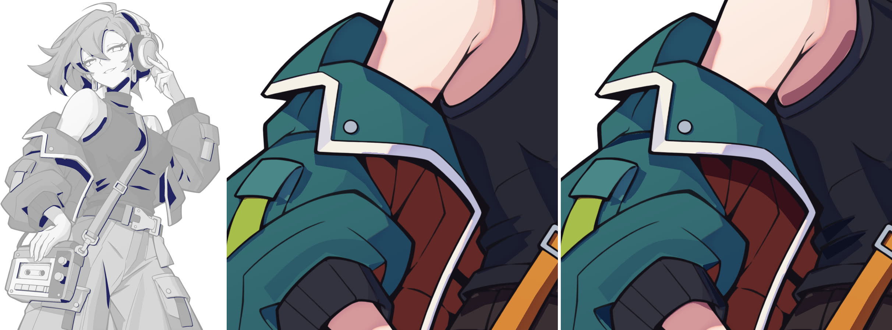
*Small dark violet pockets tucked under the collar, inside sleeve folds, and in the arm crease.*

**Why:** Small pockets where no light reaches give weight to folds, creases, and deep overlaps.

**How:**
1. Add a clipped `Shadow 2` (**Multiply**) layer above `Shadow edge`.
2. Pick a darker, more violet shadow: skin `#b48eac`, jacket `#8a73ad`, top `#8389b6`.
3. Use a **hard brush** or **lasso** only in small recesses: under the chin, armpit, inside folds, jacket lining against the body, and right beside casters.
4. Use near-black only under parts standing far off; never outline every main shadow.

**Done when:** Deep creases feel grounded while main shadows still dominate.

### 8. Shadow lift
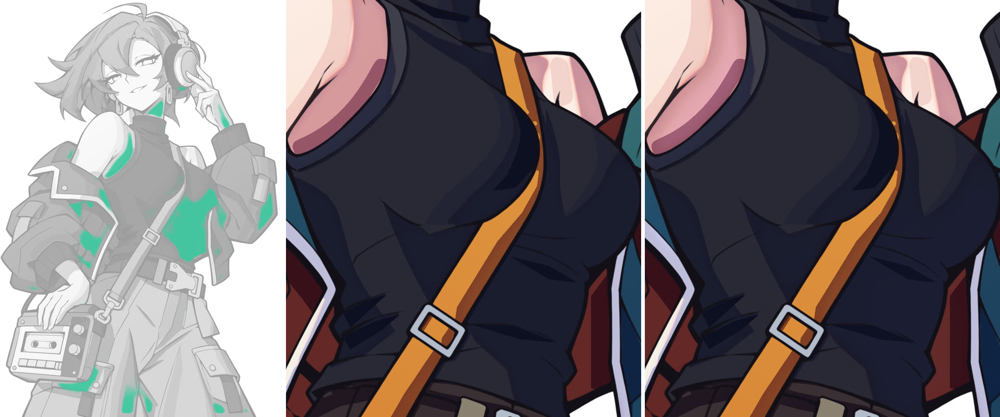
*Soft cool lift brushed into the far side of the black top's shadow under the strap.*

**Why:** Shadows on dark cloth turn into dead black holes unless they lighten and cool far from the light.

**How:**
1. Add a clipped `Shadow lift` layer below `Shadow 2` in **Color Dodge** mode (brightens darks softly without turning them grey; Add/Glow also works).
2. Pick a near-black blue (`#000717` or `#111721`).
3. With a **soft airbrush**, brush inside big shadows on the side farthest from the light.
4. Never use bright blue on Color Dodge — it blows out instantly.

**Done when:** Dark cloth shadows stay dark yet shift softly cooler away from the light.

### 9. Light
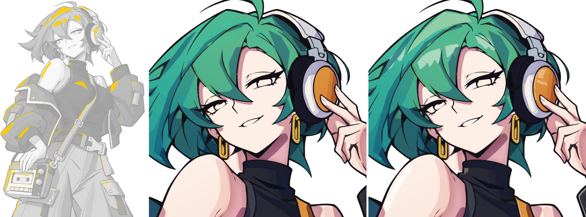
*Green highlight blocks on the hair locks, lit planes on cloth, and a soft sheen on the dark top.*

**Why:** Controlled lit shapes show where the light strikes directly and give hair and cloth clear planes.

**How:**
1. Add a clipped `Light` (**Normal**) layer above `Shadow 2`.
2. **Eyedrop** the flat colour, then nudge it lighter and slightly less saturated.
3. Paint one highlight block per hair lock with a wavy lower edge (`#9ed1ad` on green hair), lit planes on cloth, and a soft cool sheen on the dark top.
4. Skip white shiny spots on skin or matte cloth.

**Done when:** Hair catches crisp highlights and dark cloth shows form without turning glossy.

### 10. Reflected light
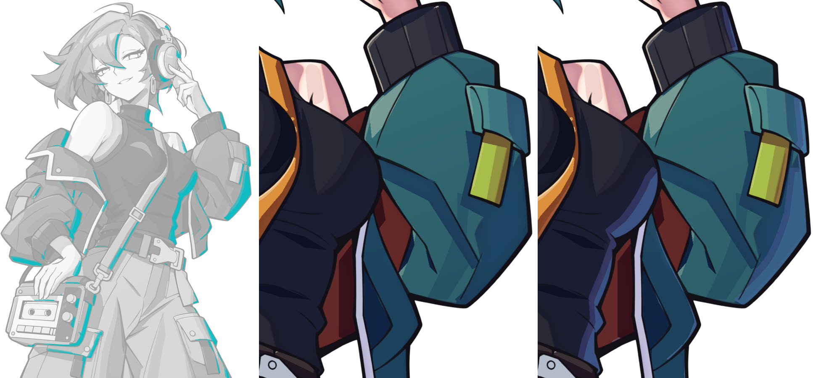
*Hard, pointed bands of cool blue reflected light along the back edges of the black top and sleeve.*

**Why:** Bounce light from the surroundings rounds forms and separates dark back edges from the background.

**How:**
1. Add a clipped `Reflected light` (**Normal**) layer at the top of each part's stack.
2. Pick the colour from the surroundings: cool blue on cloth (`#3d638e` jacket, `#3d5387` top) and peach on skin (`#f1b2a0`).
3. Use a **hard brush** or **lasso** to paint a crisp band along far shadow edges with open air behind (right and lower edges), pointed at both ends.
4. Keep it always darker than the lit side — brighter bounce light reverses the lighting.

**Done when:** Right and lower shadow edges separate cleanly without fighting the upper-left light.

### 11. Metal and plastic
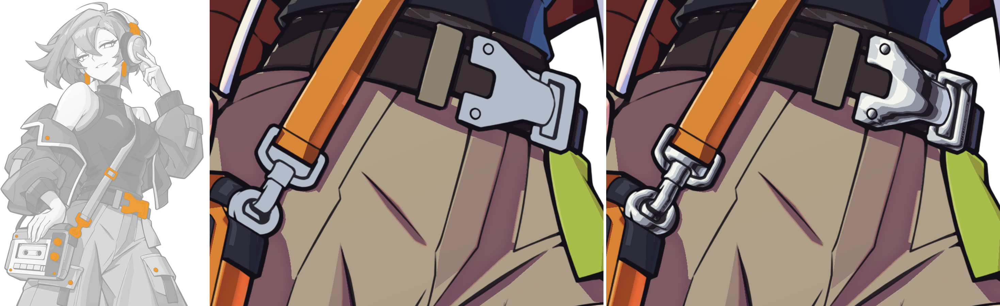
*Dark cores right beside bright rims and sharp glints turn the flat buckle and strap clip into metal.*

**Why:** Contrasting sharp metal and smooth plastic against matte cloth makes every material believable.

**How:**
1. On metal (belt buckle, strap clip, snaps, earrings), paint on clipped **Normal** layers with a **hard brush** or **lasso**.
2. Put the darkest core right next to a bright lit rim — skip soft grey gradients, which read as clay.
3. Add one sharp white glint per metal piece on its lit corner.
4. On plastic (headphones, player case), use a **soft airbrush** for a broad, smooth highlight.

**Done when:** Metal, plastic, and matte cloth read differently even in greyscale.

### 12. Skin warmth and blush

*An orange Overlay warms the skin shadows, and soft pink blush brings life to the cheeks.*

**Why:** Skin looks lifeless if shadows read cold or grey; warmth and blush restore natural colour.

**How:**
1. Inside the skin and face folders, add a clipped **Overlay** layer (boosts warmth and contrast without covering paint below).
2. With a **soft airbrush**, brush soft orange over the skin shadows so none read grey.
3. Add a clipped **Normal** layer and dab soft pink blush on cheeks, ears, and knuckles.
4. Lower opacity if it looks sunburnt.

**Done when:** Skin shadows read warm peach and the cheeks carry a subtle glow.

### 13. Eyes and face
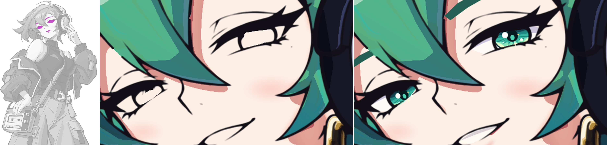
*Shaded eyes with crisp lights, solid dark green brows, and an almost flat face.*

**Why:** Eyes draw attention first, and keeping the rest of the face simple preserves a clean anime expression.

**How:**
1. Paint strictly between the eye and mouth lines below the line art — never redraw those lines.
2. Fill the eye white with the upper lid's shadow across the top.
3. Shade the iris dark above, lighter and more saturated below, add the pupil, then one big white light and a few small sparks.
4. Paint brows as one solid tapered shape in the hair's dark colour.
5. Keep the face almost flat: hair cast shadow, tiny nose mark, and a sliver under the jaw.

**Done when:** The eyes sparkle clearly and the face stays clean at normal zoom.

### 14. Line colour

*Inner skin crease lines turn warm brown while outer silhouette and overlap lines stay dark.*

**Why:** Tinting inner lines softens harsh black ink on skin and hair while keeping the outline crisp.

**How:**
1. Add a **Normal** layer above the line art and clip it to the line art.
2. **Eyedrop** the flat beside an inner line, shift a step darker, and paint inner lines: warm brown on skin, dark green in hair.
3. Keep the outer silhouette and major overlaps dark.
4. Avoid lightening every line equally, which washes out the drawing.

**Done when:** Inner lines sit softly in skin and hair while the silhouette stays strong.

### 15. Finish

*Before on the left, after on the right: warm-to-cool wash, paler back hair, fine coloured grain, and a small glow.*

**Why:** A subtle unifying pass pulls separate parts into one shared light and atmosphere.

**How:**
1. Above everything, add a low-opacity **Multiply** layer and airbrush warm light on the upper left and cool shade on the far side.
2. Make parts further back slightly paler and bluer so the foreground pops.
3. Add fine coloured grain on a **Linear Light** layer (adds crisp micro-texture) at low opacity, strongest in the darks.
4. Add a small, subtle glow on the brightest edge — if you notice the effect before the character, lower its opacity.

**Done when:** Toggling the finish layers adds subtle cohesion without shifting your colours or values.

## Finished layers

*Top: the picture built layer type by layer type. Below: one folder per part, each with the same clipped stack.*

One folder per part with identical clipped layers lets you adjust any shadow or colour later without repainting neighbours.

## Check

- **Greyscale.** Toggle your top black `Color` layer — the face should read first and big shapes stay apart.
- **Squint.** Zoom to stamp size or squint; main light and shadow shapes should still read.
- **200–400% zoom.** Pan piece by piece for white specks, stray pixels, or sloppy edges.
- **Fresh eyes.** Step away for an hour (or flip the canvas) and compare beside art you admire.

## Practice

- **Four plans:** Flat one drawing in four palettes, view in greyscale and stamp size, and pick the one where the head reads first.
- **Shadow-only pass:** Shade a jacket or trousers on one clipped Multiply layer using at most five shapes; hide the flat to verify the shadows read alone.
- **Cast pass:** Paint hard cast shadows under every overlapping part (hair, straps, hands, gear) from one light direction.
- **Three materials:** Render three identical cylinders under upper-left light as matte cloth, smooth plastic, and shiny metal.
