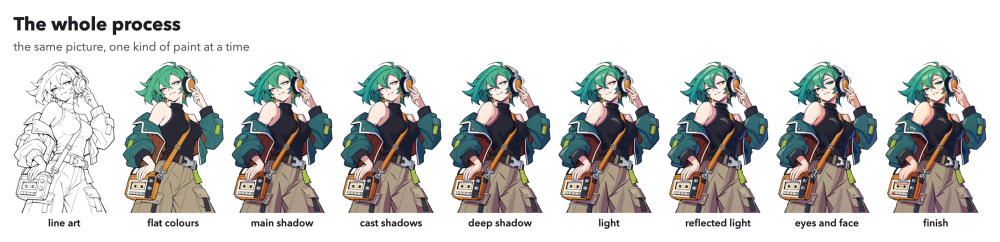
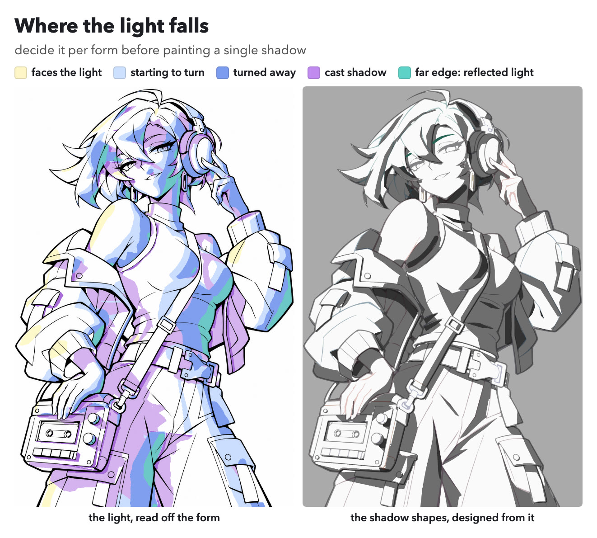
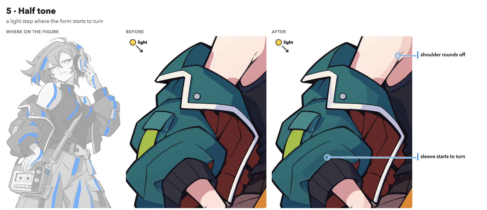
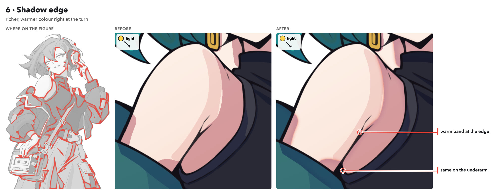
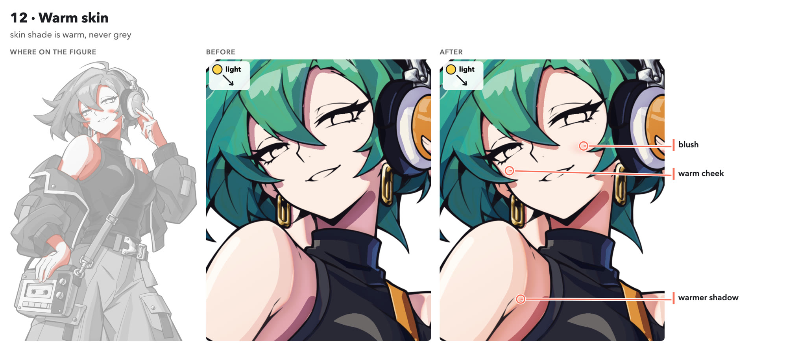
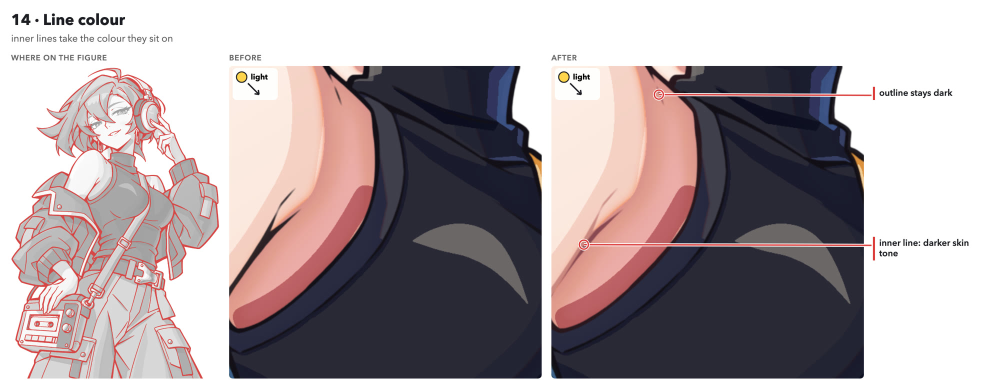
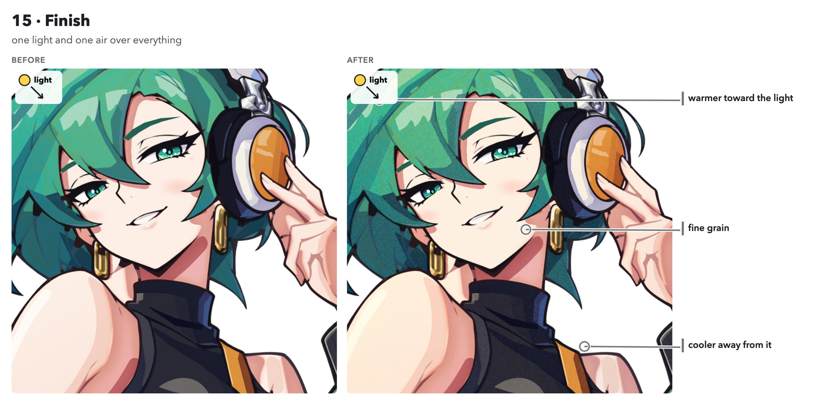

# How anime illustrations are rendered

Rendering turns flat line art into light, weight, and form. Each step adds one kind of light or shadow and builds on the last. Read in order and follow the arrows to see what changed.

## Before you paint

Pick one light source first and keep it fixed for the whole picture.

Test several colour ideas while the drawing is still simple. Viewing options small and in three values shows at once which plan draws the eye to the face and which ones blur together. Changing direction here takes minutes instead of hours.

Value—how light or dark a colour is—does the heavy work. Colour sets mood, but value separates shapes and guides the eye. Checking in grey strips away colour so weak contrast stands out immediately.

Line art is flat, yet light strikes solid surfaces. Picture every part as simple solids: cylinders, boxes, and cloth draped over them. Once you see which way a surface faces, shading stops being guesswork.

With your single light source set, decide per form what faces the light, what turns away, and what blocks another surface. Turn that reading into simple shadow shapes before painting detail. Planning the shadow pattern first keeps lighting consistent from head to toe.

## Step by step

### 1 · Flat colours

Flat colours lock in your value groups and separate every part before light enters. Without clean, solid flats, later shading blends parts together.

- Decide what is light, mid, and dark before choosing exact colours.
- Keep the head and face easy to spot against what surrounds them.
- Fill every shape cleanly up to the lines.

### 2 · Colour shifts

Large flat shapes can feel stiff, like stickers. A gentle colour shift across a big area adds life without disturbing your values.

- Shift colour slowly across large shapes like hair or wide cloth.
- Keep lightness almost unchanged so big shapes stay clear.
- Keep it subtle; if you spot the shift first, pull it back.

### 3 · Main shadow

This is the most important step. Big, simple shadows on every side turned away from the light give flat lines immediate solidity. Without them, later polish floats on a flat drawing.

- Use a darker, cooler version of the base colour, never grey or black.
- Give each shape one clean side and one pointed end; place edges on a drawn line or clearly across the form, never just beside a line.
- Few large shapes beat many small ones, and simple beats strictly correct.

Common mistake: hugging every outline with thin shadows instead of grouping planes into big shapes.

### 4 · Cast shadows

Cast shadows tell distance. Anything standing in front of a surface throws its own shape onto what sits behind it. Without them, overlapping parts look pasted flat.

- Echo the blocking shape, shifted away from the light.
- Keep edges sharp and bold, even if a shadow looks like a blot.

Common mistake: softening cast shadows until overlaps lose depth.

### 5 · Half tone

Lit and shadowed shapes alone make curved forms look like cut paper. A third, light step where a form starts to turn makes it feel round.

- Keep the band narrow so it does not eat the lit side.
- Use it on curving forms and skip sharp corners.

### 6 · Shadow edge

On skin, light passes slightly through the surface at the turn and leaves a thin band of richer, warmer colour. Without it, skin shadows feel chalky.

- Keep the band thin along the exact light-to-shadow border.
- Make it warmer and richer than the shadow beside it.

Common mistake: spreading it too wide so skin looks sunburnt.

### 7 · Deep shadow

Open shadows still catch stray light. Only tight pockets where no light gets in—an armpit, inside folds, or tucked behind—drop to the darkest tone, giving overlaps weight.

- Keep these shapes small and dark.
- Use them sparingly; never outline every main shadow.

### 8 · Shadow lift

Big shadows, especially on dark cloth, can turn into dead holes. Lightening and cooling the shadow far from the light keeps form visible in the darks.

- Lift gently far from the light so dark cloth stays dark.
- Shift it cooler so it stays behind the lit side.

### 9 · Light

Bright shapes on planes facing the light add clarity and pull attention upward. Keeping them selective shows which surfaces catch light directly.

- Paint one highlight block per hair lock.
- Skip white shiny spots on skin and matte cloth.

### 10 · Reflected light

Light bounces from the surroundings onto far shadowed edges with air behind them. That rim rounds out dark forms and separates them from the background.

- Shape it as a crisp band pointed at both ends along far edges.
- Colour it with what surrounds the figure.
- Keep it always darker than the lit side, or the light reverses.

### 11 · Materials

Shading every surface the same turns metal, plastic, and cloth into clay. Distinct light behaviour makes each material believable.

- Metal puts its darkest tone right beside its brightest, plus a sharp glint.
- Plastic takes a broad, soft shine.
- Cloth stays matte with no sharp shine.

### 12 · Warm skin

Cool shadows suit clothing, but skin looks lifeless if its shade leans grey. Warming skin shade and adding a touch of blush brings back life.

- Keep skin shade warm, never grey.
- Add a soft touch of blush where skin feels thin, like cheeks.

### 13 · Eyes and face

Viewers look at the eyes first. Heavy shading across the face breaks a clean anime expression, so keep the face quiet and put contrast in the eyes.

- Keep the face almost flat.
- Paint between the eye and mouth lines, never over them.
- Shade the iris dark at the top and brighter at the bottom with lights; paint each brow as one solid shape.

### 14 · Line colour

Dark lines everywhere look harsh against bright skin or hair. Tinting inner lines lets detail sit naturally in the paint while the outline stays strong.

- Colour inner lines with a darker version of the colour they sit on.
- Keep the outline and lines between overlapping parts dark.

Common mistake: lightening every line equally, which washes out the drawing.

### 15 · Finish

Parts painted one by one can feel slightly separate. A light final pass pulls every colour and shadow into one shared light.

- Add a subtle warm tint toward the light and a cool tint away from it.
- Make parts further back slightly paler and bluer.
- Add fine grain to tie the surface together.

Common mistake: letting effects stand out; if you notice them first, pull back.

## Check your work

- **Check in grey.** Make sure the face reads first and big shapes stay apart.
- **Squint or shrink to stamp size.** Main light and shadow shapes should still read clearly.
- **Zoom in.** Clean up rough edges and stray gaps up close.
- **Fresh eyes.** Step away, then compare beside work you admire.

## Practice

- **Five-shape shadows.** Shade a figure or jacket with one shadow colour and five shapes only.
- **Cast shadows only.** Over flat colours, paint only the sharp shadows thrown by overlapping parts.
- **Three materials.** Paint one cylinder as matte cloth, smooth plastic, and metal under the same light.
- **Four colour plans.** Try four colour schemes on one drawing, check them small in three values, and pick the clearest.
