# Rendering anime splash art

Colouring and shading finished line art, on one character: Maren, lit from the upper left.

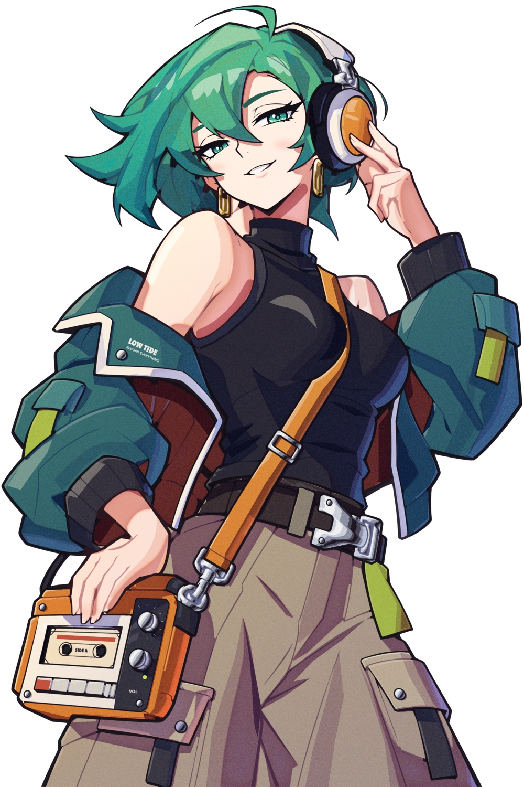

*Finished render: upper-left light, bright face and shoulder, cool reflected light on far right edges.*

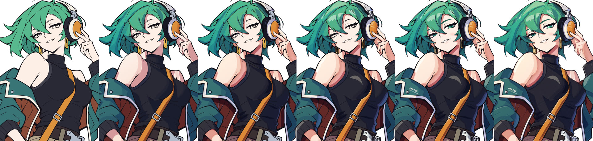

*Six stages: flats; big shadow planes; deep shade; materials and reflected light; eyes and face; tinted lines, air, and grain.*

## 1. Flats and colour plans

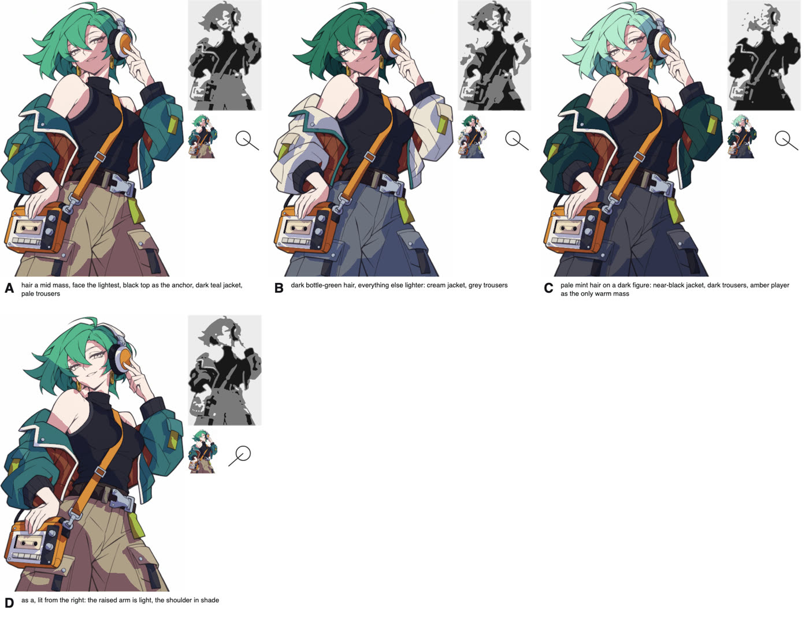

*Four plans with three-value and stamp-size views. Plan A wins: mid-green hair frames a bright face over a dark top. In C, pale hair merges into the face.*

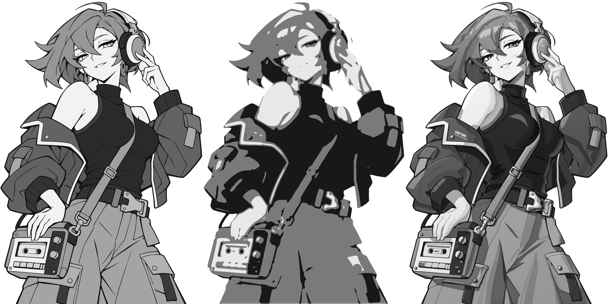

*Flats in greyscale, three values, and finished greyscale. Big neighbours stay apart throughout.*

- Start from closed line art. Put each part on a flat layer and pick its material: skin, hair, cloth, metal, plastic, or leather.
- Pick one light and one focus. Squint at small plans: the head reads first, hair is one mass darker than the face, and big neighbours differ clearly in grey.
- Try: toggle a black layer in Color mode on top after every step.

## 2. Form

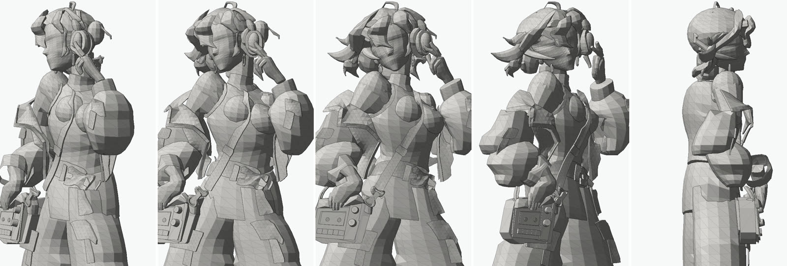

*Simple solids from five angles: cylinders for limbs, a box for the torso, cloth over them. Use this to understand the form, never for the shading itself.*

- The form says where the shadow goes; the drawn line says where its edge runs.

## 3. Shadow shapes, deep shade, and reflected light

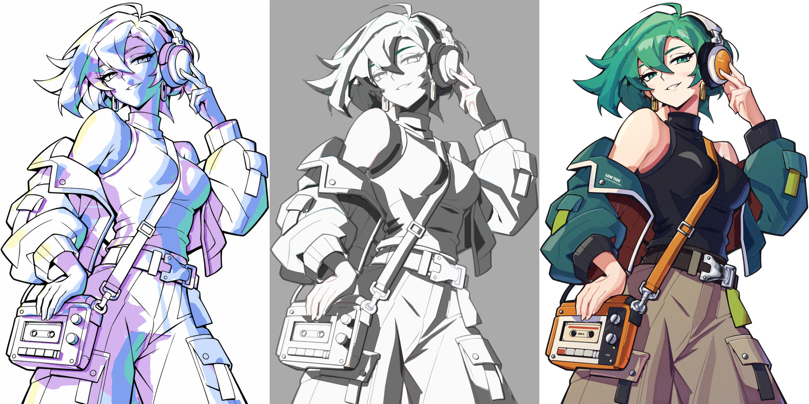

*Left: light map (yellow lit, blue turned away, violet cast, teal reflected). Middle: designed shadows in grey. Right: finish.*

- Paint the biggest planes first on a Multiply layer clipped to each flat, using the lasso or a hard brush. Few large shapes beat many small ones; simple beats correct.
- One clean side, the other ending in a point. Put edges on a drawn line or clearly away from it, never a few pixels beside it.
- Deep shade sits where no light gets in (under the chin, inside folds, beside a caster); black only under parts standing well off. Add a bold band of reflected light on far edges with air behind, darker than the lit side and coloured by what is around.

## 4. Face and eyes

*Close-ups below show flats, designed shadows in grey, and finish. The face stays almost flat (hair cast, tiny nose mark, jaw sliver); the neck carries the shade.*

- Never redraw eye or mouth lines; paint between them.
- Eye: white with lid shadow on top, iris dark above and lighter below, pupil, one big and a few small lights.
- Brows: one solid tapered shape in the hair's dark.

## 5. Hair

*One mid-green mass darker than the face, with lock shadows, deep undercuts, and crown highlight blocks.*

- One mass first, then one shadow shape per lock from root to tip.
- Deep shade where locks tuck under; one highlight block per lock.

## 6. Skin

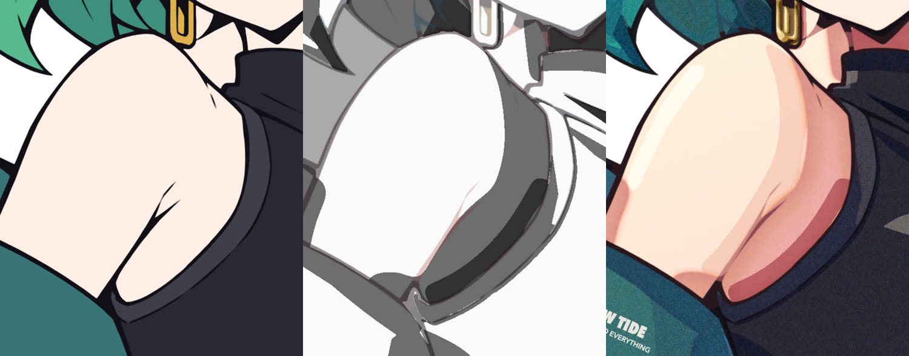

*The shoulder turns into warm peach shade, deepest in the arm crease, with no glossy highlight.*

- Keep skin warm in shade, never grey, with no shiny highlights.

## 7. Dark cloth and casts

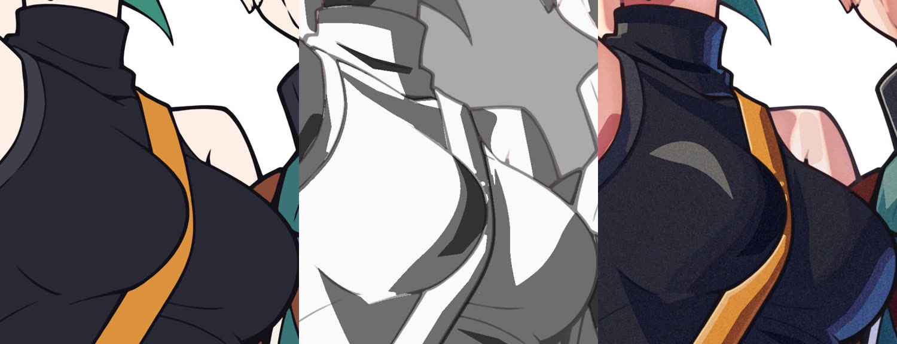

*A cool sheen shapes the black top, the strap casts hard across it, and blue reflected light lifts the right edge.*

- Dark cloth still shows planes with a cool sheen on the lit side.
- Everything standing off a surface casts on it: hair on face, headphones on hair, strap on top, hand on player.

## 8. Cloth folds, lines, and metal

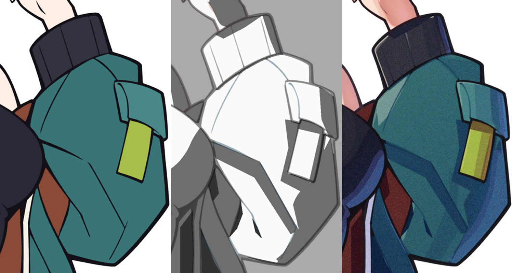

*Large shadow planes follow sleeve folds, the pocket flap casts on the yellow tab, and blue reflected light lifts the outer edge.*

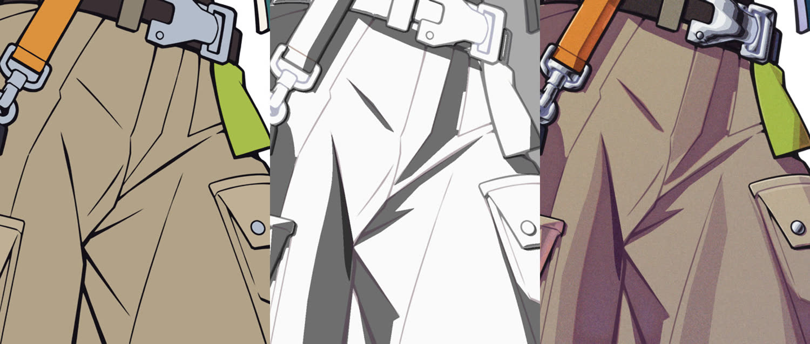

*Tapered fold shadows end in points, inner lines turn warm brown, and the silver buckle puts near-black beside white.*

- Keep cloth matte, with no shiny highlights.
- Outer and separating lines stay dark; inner lines become a darker step of the colour they sit on.
- Metal puts darkest right beside brightest, with a lit rim and one sharp glint.

## 9. Plastic and bold casts

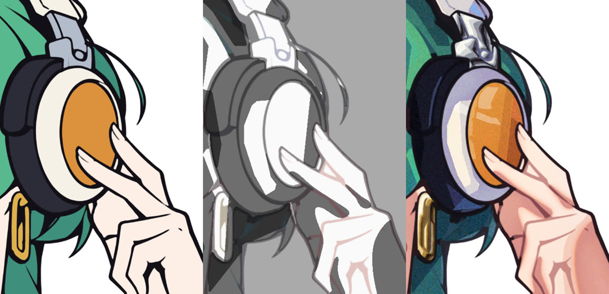

*Smooth orange plastic with a broad soft highlight, crisp chrome and gold, and a deep headphone cast on the hair.*

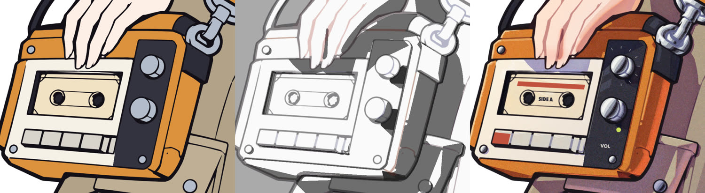

*The hand casts a bold blot across the player and tape window; metal knobs and clip contrast dark against bright.*

- Plastic stays smooth with a broad soft highlight.
- Keep cast shadows even when they look like blots — they tell distance.

## 10. Layers and finish

*Top: the picture built by layer type. Below: one folder per part, each with the same clipped stack.*

- Use one folder per part with the same layers clipped to its flat.
- Finish with a warm-light / cool-shade overlay, fine grain, and paler, bluer tones on parts further back.
- Look in greyscale and three values, zoom to 200–400% piece by piece, then show a fresh pair of eyes beside work you know is good.

## Practice

- **Four plans:** Flat your line art in four palettes, view in greyscale and at stamp size, and pick the one where the head reads first.
- **Shadow-only pass:** Shade a jacket or trousers on one clipped Multiply layer using at most five shapes. Hide the flats; the shadows should read alone.
- **Cast pass:** Paint one hard cast shadow under every overlapping part (hair, straps, hands, accessories).
- **Three materials:** Render one cylinder three ways under upper-left light: matte cloth, smooth plastic, and metal.
