# Rendering guide

How to take finished anime line art to a game splash illustration: value, light, form, shadow shapes, materials. Each step is written for a person with a drawing program first, then shows how the agent in this repository does the same thing, with its data and the mistakes it made on the way.

The worked example is Meridian, a seated cartographer: image-generated line art, rendered by the agent in four rounds. It is not finished, and the guide says where it falls short. That is the part to beat.

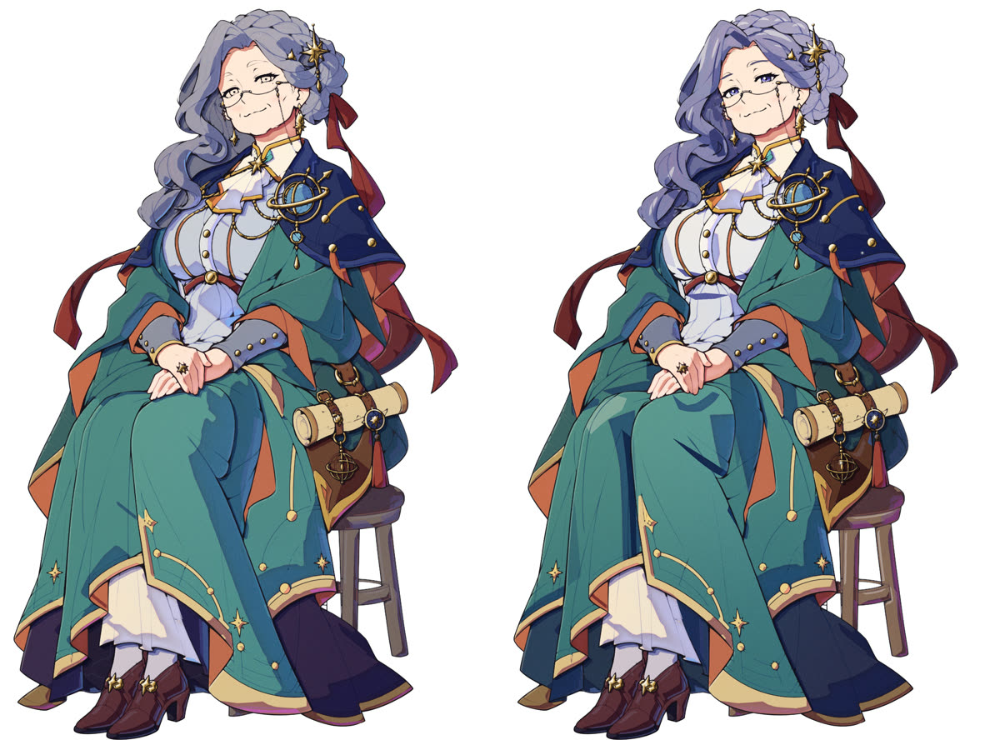

*Left: the first full render, shading taken from a 3D model. Right: after four rounds of the steps below.*

## The order

| | Step | You are done when |
|---|---|---|
| 0 | [Check the line art](#0-check-the-line-art) | every shape is closed and decided |
| 1 | [Flats](#1-flats-every-part-a-colour-and-a-material) | every part has one colour and a material |
| 2 | [Light and value plan](#2-light-and-value-plan) | the picture reads in three greys at stamp size |
| 3 | [Understand the form](#3-understand-the-form) | you could turn the figure in your head |
| 4 | [Find where the light turns](#4-find-where-the-light-turns) | you know which side of every form is dark |
| 5 | [Design the shadow shapes](#5-design-the-shadow-shapes) | the shadows alone read as a drawing |
| 6 | [Cast shadows](#6-cast-shadows-tell-distance) | everything that stands off casts |
| 7 | [Deep shade](#7-deep-shade) | the darkest darks sit where no light gets in |
| 8 | [Second light](#8-second-light) | far edges catch a darker, coloured light |
| 9 | [Face and eyes](#9-face-and-eyes) | the face is the clearest place in the picture |
| 10 | [Hair](#10-hair) | locks read one by one, the mass still reads as one |
| 11 | [Materials](#11-materials) | skin, cloth, metal and leather each answer the light their own way |
| 12 | [Line colour](#12-line-colour) | inner lines recede, separating lines hold |
| 13 | [Air and grain](#13-air-and-grain) | the picture sits in one atmosphere |
| 14 | [Check](#14-check-greyscale-three-values-fresh-eyes) | greyscale, three values and a fresh eye agree |
| 15 | [Layers](#15-layers-to-go-on-by-hand) | someone else can open the file and continue |

The same picture, stage by stage: flats, big planes, deep shade, materials and second light, face, line colour and air.

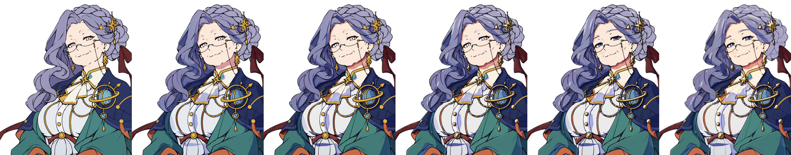

Three rules run through every step:

1. **Value before colour.** If it does not read in grey, no colour saves it. Look at grey after every step.
2. **The form says where, the line says how.** A shadow falls where the form turns away from the light. Its edge runs along the nearest drawn line.
3. **Simple beats correct.** One clean shape per plane. A right but ragged edge looks worse than a simple one.

---

## 0. Check the line art

Rendering carries out decisions. It does not make them. Before any colour, look for what the line art leaves open: shapes that are not closed, hands or hair you cannot read, areas larger than a head with nothing in them. Fix them in the line art, or ask whoever drew it. Everything after this step only gets harder if a shape is guessed.

**Good line art for rendering:** closed shapes, lower lids drawn, thicker lines at the silhouette and at overlaps, thin inner lines, little solid black.

**How the agent does it.** It counts closed patches. The two approved drawings had 144 and 237. The three rejected ones had 67, 20 and 3. Meridian has 698 patches in 84 parts. Its line art was grey, not black, so the levels were stretched before cleaning: the cleaning step had taken grey lines for grey fills.

**Mistakes made here.** Three drawings from loose sketches were coloured anyway, and rejected. The full story is in [`drawing/log.md`](drawing/log.md).

## 1. Flats: every part a colour and a material

Fill every part with one flat colour on its own layer, and decide what it is made of: skin, hair, cloth, leather, metal, glass. The material decides later how it takes light. Give each part a height too: what lies on top of what. That decides who casts on whom.

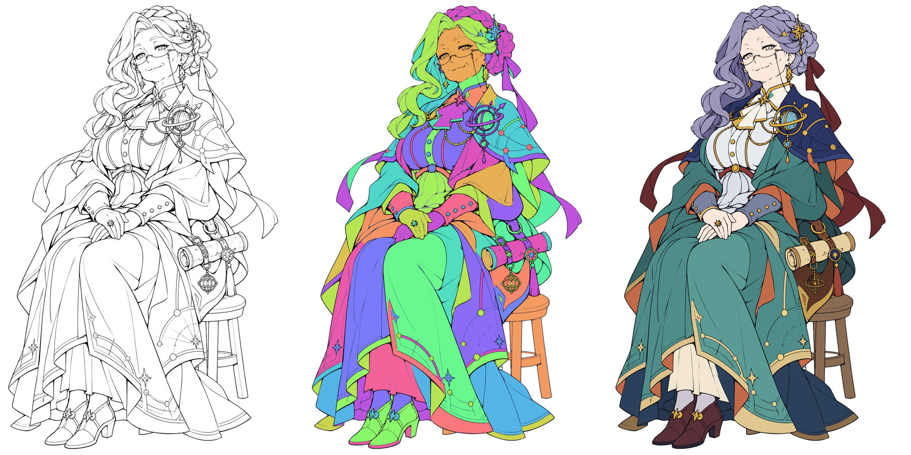

**By hand.** One flat layer per part, filled with the bucket tool on a reference layer of the lines. Close gaps under 3 px first. In CLIP STUDIO PAINT: *Fill > Refer other layers*, with *Close gap* on.

**How the agent does it.** It numbers every closed patch on a sheet, then writes names against the numbers:

```
hairF: 247 280 9 14 15 17 21 …
braid: 3 4 5 6 7 8 10 11 13 16 …
panelC: 491 632 635 642 …
```

Each name then gets a colour, a material and a height (`panelC: { color: "#5b9a95", kind: "cloth", z: 10 }`). A patch that an open line gave to the wrong part is moved with an outline, never with a straight cut. A straight cut turned a tapering hem into a block on Meridian.

## 2. Light and value plan

Decide one light and one focus before shading anything. Then sort the parts into three values, dark, mid and light, so that the head reads first and the hands second. Paint four to six small colour thumbnails that differ in more than hue, and pick one.

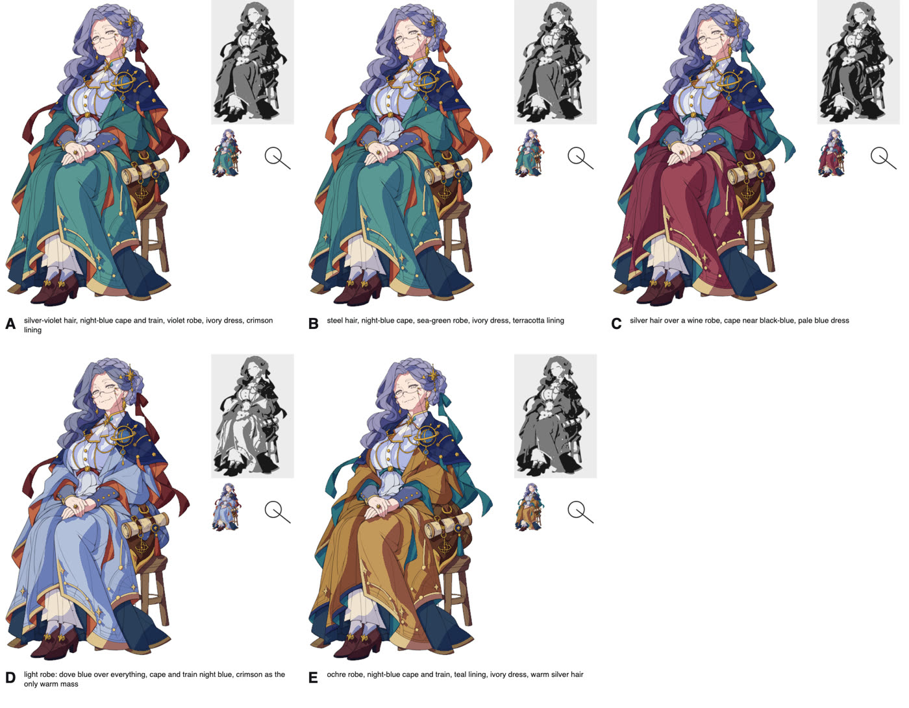

*Five plans, each with a three-value squint and a stamp-size version. B was picked: green robe, night-blue cape, ivory blouse.*

- **The head reads first.** The face is the lightest large shape. The hair is a mass of its own, well under the face and over the dark clothes.
- **Big neighbours stand apart in grey.** Hair against face, cape against blouse, robe against train.
- **Each layer of clothing gets its own value.** If the cape, the hem and the train share a colour, nobody can tell which garment is which.


*Flats in grey, three values, the finished picture in grey.*

**By hand.** Add a layer filled with black in *Color* blend mode on top, or turn the canvas grey, after every step. Zoom out until the figure is 100 px tall. Squint.

**How the agent does it.** The plan is data, and a script fails when the picture breaks it:

```
light: { fall: [0.78, 0.62], up: 0.5 }       light from the upper left
values: { dark: ["cape", "train", …], mid: ["hairF", "panelC", …], light: ["face", "vest", …] }
apart: [["hairF", "face", 50], ["cape", "vest", 110], ["panelC", "train", 50], …]
```

A blind critic, a fresh agent shown the plans with no names, picked the same plan, and its notes went in: silver hair, a grey-blue blouse so the face stays the warmest light, darker sleeves so the hands read against them.

**Mistake.** When a check fails, change the picture, never the plan. Once a part was taken off the list to make the check pass, and the picture still showed the fault.

## 3. Understand the form

Before shading, know the solid behind every piece: the thigh is a cylinder, the head a box with a rounded front, the cape a sheet over a shoulder ball. Shade that is not tied to a form is the fault people see first: notes answered one spot at a time only moved the problem around.

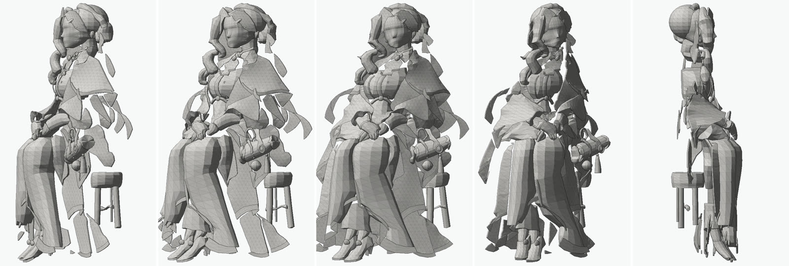

**By hand.** Sketch simple solids over a copy of the figure: cylinders for limbs, boxes for the torso and seat, a sheet for cloth. Or pose a 3D doll beside it. The goal is to understand, not to copy: illustration bends real forms on purpose.

**How the agent does it.** It builds a low-poly mesh of the whole figure in the drawing's own view, then measures it against the line art. On Meridian the right form shows on 91% of the figure. Left and right limbs must be equally long in space: upper arm 199 and 208, forearm 214 and 217, thigh 261 and 266.

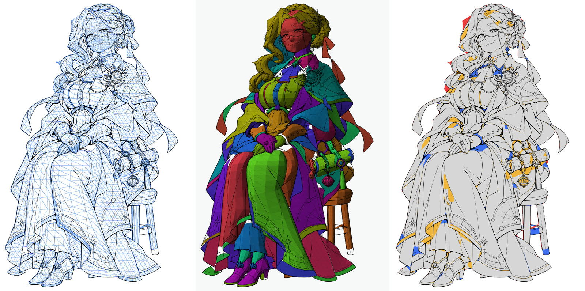

*Mesh over the line art, each part in its own colour, and the places where the wrong part shows.*

## 4. Find where the light turns

With the solids and the light, find for every piece where the surface turns away, what casts on what, and which far edges have open air behind them.

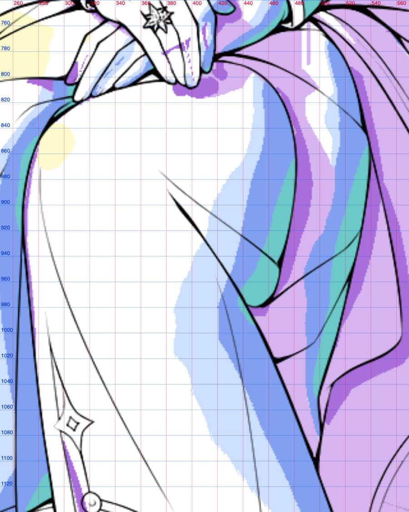

*Blue: turns away from the light. Violet: cast. Teal: far edge, where the second light goes. Pale yellow: faces the light.*

**By hand.** Shade the simple solids once, roughly, on a layer under the line art, set to low opacity. It is a map, not a painting.

**How the agent does it.** The mesh is lit and ray-cast, and the result is drawn in these colours under the line art, with a grid.

**Mistake.** Rendering the mesh shading directly. It is right and blobby: soft, round, no design. It ruined hair outright.

## 5. Design the shadow shapes

The core of the style. Over the map from step 4, draw each shadow as a shape: biggest planes first, then deep shade, half tone and lit planes.

- **One clean side, one pointed.** A shadow runs along a form and ends in a point; it does not frame a shape all round.
- **On a line, or clearly off it.** An edge 2 to 6 px beside a drawn line looks like a mistake. Put it on the line or cross the plane cleanly.
- **Few, large shapes.** References use a few big shadow masses, not a wedge beside every fold.
- **The form decides, the style overrides.** Cloth follows the form along the drawn folds. Hair is one shape per lock. The face is not modelled at all (step 9).

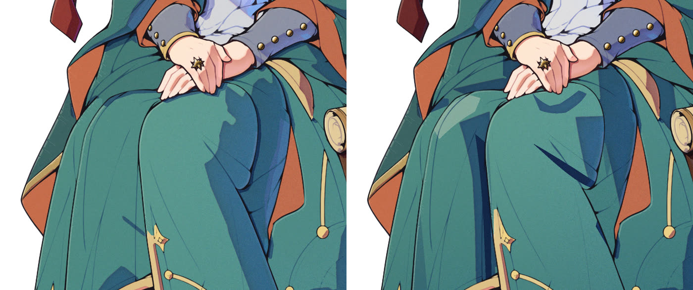

*Left: shading straight from the 3D model, angular slabs that ignore the knees. Right: the same lap designed by hand. The top of the thigh is lit, the near shin turns away, the valley between the legs is in core shadow, and the hands cast on the knee.*

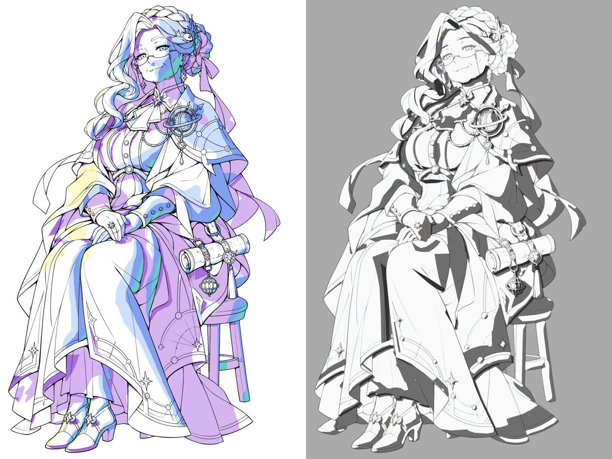

*The map, and the designed shadows alone. They should read as a drawing by themselves.*

**By hand.** A *Multiply* layer clipped to each part's flat, drawn with the lasso or a hard brush. A second, darker layer for deep shade, clipped above it.

**How the agent does it.** One line per shape: parts, tone, points. `~` makes a soft point.

```
panelC | S | 430,850 438,900~ 452,960~ 480,1030~ 512,1100 …     the near shin turns away
panelC | X | 352,806 366,822~ 384,830 402,826 420,814 …         the hands cast on the knee
skirt  | S | 222,860 236,900~ 246,960 250,1040 …                core shadow in the valley
```

Tones: `S` turns away, `X` cast, `H` half tone, `D` deep, `L` lit, `B` second light, `W` hair highlight.

**Where it is weak.** This is typed by hand, and it is the main cost. On Meridian only the lap and knees are designed. The sleeves, the robe on the right and the train still come from the mesh, and a blind critic named exactly those: "blotchy dark-teal patches that don't follow the knees or thighs".

## 6. Cast shadows tell distance

Everything that stands off a surface casts on it: hair on the face, a brooch on the cape, a scroll on the bag, glasses on the cheek. The width of the cast tells how far apart they are. A shadow that tells a distance stays, even when it looks like a blot. Without it, accessories look pasted on.

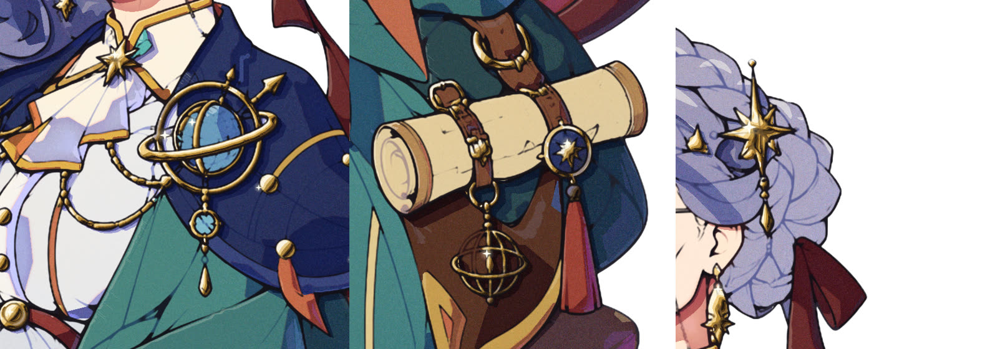

**By hand.** Copy the caster's silhouette, fill it, move it away from the light by the distance, and clip it to the surface below. Hard edge, no soft band.

**How the agent does it.** Caster, receiver, distance, and how much of it is deep:

```
c("ring globe", "cape vest jabot capeC", 10, 0.5)     the armillary brooch on the cape
c("scroll roll scrollE", "hip tabard panelR skirtR", 18, 0.5)
c("spec", "face", 5, 0.4)                              the glasses on the cheek
```

**Mistake.** On the second round, most accessories on Meridian had no cast at all. The client: "Some of her accessories also look pasted, flat, they miss cast shadow for the most part." Now every accessory has one, onto what it lies on.

## 7. Deep shade

The darkest step goes where light cannot reach: in folds, under the chin, beside a caster, where locks tuck under each other. Use black only under something that stands well off the surface. Everywhere else, the deep shade is a darker step of the part's own colour.

**How the agent does it.** Tone `D` in the design, plus a rule that adds deep shade beside every caster. A per-part setting makes shades deeper than the material's default (`deep: 1.25`), used on Meridian's mid-value robe, where the default shade was too weak to read.

## 8. Second light

The side away from the light is not dead. Along far edges with open air behind them, add a band of reflected light: bold, pointed at both ends, always darker than the lit side. Its colour comes from what is around: cool from the sky, warm from skin or a wooden floor.

**How the agent does it.** Tone `B` on every far edge of the design, plus a check that at least 45% of far edges have some. A per-part strength (`rim`, 0 to 1) tones it down where it misreads.

**Mistake.** On warm, saturated hems and linings, the rule made the reflected light pink, and a critic read it as a colour glitch. Strength 0 to 0.4 on those parts fixed it.

## 9. Face and eyes

The face is the place people look first, and the one where 2 px is another expression.

- **Never redraw the artist's eye, nose or mouth lines.** Paint only between them.
- **Keep the face almost flat.** The hair's cast, a small nose mark, perhaps the lower lid, a thin sliver at the jaw. No side plane. The neck carries the shade.
- **An eye in pieces:** the white with the lid's shadow across the top, an iris in clear steps (dark at the top, lighter and more saturated at the bottom), a pupil, one large and a few small lights.
- **Brows:** one solid tapered shape each, the hair's dark.
- **Warmth:** a soft blush on the cheeks, warm shade under the jaw.

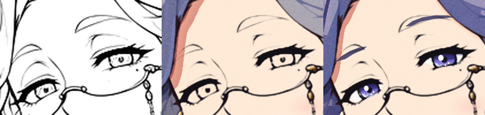

*The artist's lines, the eyes forgotten (two flat dots), and the eye painted in pieces with brows.*

**How the agent does it.** An eye kit: the opening as an outline traced from the artist's lid lines, the iris centre and size, and a look shared by both eyes.

```
open: "526,161 530,157~ 538,155.4~ 548,155 556,155.4 560,157 560,162 …", x: 544.8, y: 162, rx: 10, ry: 9.6
stops: [[0, "#241f55"], [0.32, "#3d3594"], [0.33, "#4c43b0"], … [1, "#c4b6ff"]]
```

Every piece becomes its own layer in the exported file, so a person can move the iris later.

**Mistake.** The face step was skipped on Meridian's first rounds. The client noticed at once: "You forgot completely about the eyes, the eyebrows."

## 10. Hair

Treat hair as one mass first: it must read as a single value shape, under the face. Then lock by lock.

- **One shadow shape per lock,** root to tip, on the side away from the light.
- **Deep shade where locks tuck** under each other and behind the neck.
- **A highlight band per lock,** at the same height across the head, like a ring, wavy on its lower edge.
- **A braid is a chain of small forms.** Each lobe turns on its own and gets its own highlight.
- **Strands, not scratches.** A few tapered strokes along the lock, grouped. Not a line per hair.
- **Colour in the shade.** Grey hair shaded grey looks dirty. A lavender base turns violet in shade.


*Round one and round four: lavender base, the braid lobe by lobe, strands and highlight bands as brush strokes.*

**How the agent does it.** The braid is its own part, shaded patch by patch. Strands and highlights are brush strokes: a curve with a width that swells and runs out (`<` swells late).

```
hairF | W | 11< | 432,70 420,98 412,126 406,150      a highlight band down the big lock
hairF | D | 3   | 456,70 447,100 440,130 436,160     a deep line between strands
braid | W | 6   | 482,56 491,49 502,47 510,49        a highlight on one lobe
```

**Where it is weak.** Strokes are placed by eye, and a critic still finds the loose waves too flat at viewing size. The flow of a lock is the hardest thing to get from typed points.

## 11. Materials

The same light, answered differently:

| Material | Shade | Light |
|---|---|---|
| Skin | warm, never grey: an orange overlay in shade | no shiny spot; a soft blush |
| Cloth | through rose for warm colours, through blue for cool ones | no white highlight; a band of richer colour where it starts to turn |
| Metal | darkest right beside brightest | a lit rim, one sharp glint per piece |
| Leather | darker, slightly warmer | a soft sheen on the bevel |
| Glass | the colour behind, tinted | a hard reflection |

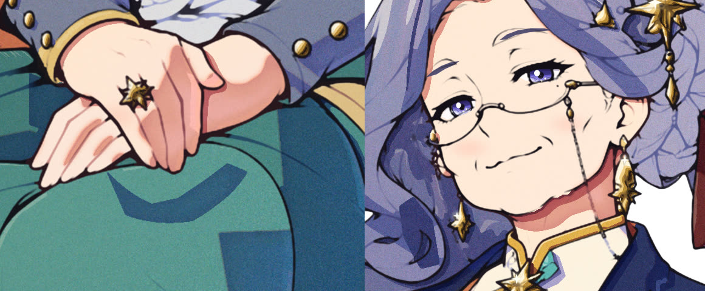

*Warm shade on the hands; the face almost flat; gold with a lit rim and a glint.*

**How the agent does it.** Each part's `kind` picks how it shades. Small metal pieces get a bevel (`bevels: [{ on: ["ring", "brooch", "pin", …], w: 1.6, lit: 0.95 }]`) and a glint drawn over the lines.

**Mistakes.** White highlights on cloth and skin looked oily. Shades that gained saturation turned cream green. A critic still finds Meridian's gold "flat mustard" at viewing size: the glints are too small to carry from a distance.

## 12. Line colour

Leave the outer line dark. Turn the inner lines into a darker step of the colour they sit on: they say where a form bends, the shading carries the rest. Lines between front and back stay dark. Black only in tight spots without light.

**By hand.** A layer clipped to the line art, painted with each part's deep shade colour; keep the silhouette and the overlaps dark.

**How the agent does it.** Automatic: a line inside one part takes a darker step of its colour; a line between parts stays dark; parts further back get softer, bluer lines.

## 13. Air and grain

A light warm overlay on the lit side, a cool one in the shade, never lifting a dark. Parts further back get paler and bluer. A fine, coloured grain, strongest in darks and mid tones, almost none on lit skin. All of it was measured on the reference images, not guessed.

## 14. Check: greyscale, three values, fresh eyes

Every time the picture is shown to anyone:

1. **Greyscale** beside the references. Is the head a mass of its own, framing a light face?
2. **Three values** without lines. Does the figure still hold?
3. **Piece by piece** at 200 to 400%: every plane follows a line, every shadow turns, nothing is 3 px beside a line.
4. **A fresh eye.** Someone who did not make it, shown the picture without names beside a known good and a known bad one. If they cannot sort those two, their verdict does not count.

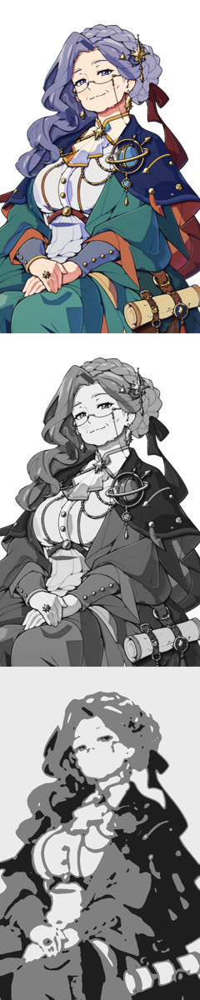

*Meridian in colour, grey and three values.*

**How the agent does it.** `finish.ts` puts the result beside the references and fails when big neighbours are too close in grey. `gate.ts` checks the value plan. Then a blind critic, a fresh agent, scores it among anonymous anchors.

**What the checks taught.** Value checks passed on every drawing the client rejected. A blind critic agreed with the client every time; the maker, judging its own work, did not. And the critic and the client see different things: Meridian's critic score stayed at 5 through the eyes, brows and casts, because at viewing size it judges the large cloth. Both are needed.

| Round | Blind critic, of 10 | What changed |
|---|---|---|
| 1 | 4 | first render |
| 2 | 5 | lap designed, gold bevels, whiter blouse, no pink edges |
| 3 | 5 | eyes, brows, braid, hair strands, accessory casts |
| 4 | 5 | hair colour and bands, iris, metal glints |

Approved drawings score 5 to 6.5 with the same critic, a rejected one 3 to 3.5.

## 15. Layers to go on by hand

The agent's render comes out as a `.clip` and a `.psd`: a folder per part, the same layers in each, clipped to its base: Base, Gradient, Half tone, Shadow 1, Shadow edge, Shadow 2, Light, Highlight, Reflected light. A layer is a set of related marks with one job, such as both irises or all the first shadows of a part, not a single stroke.

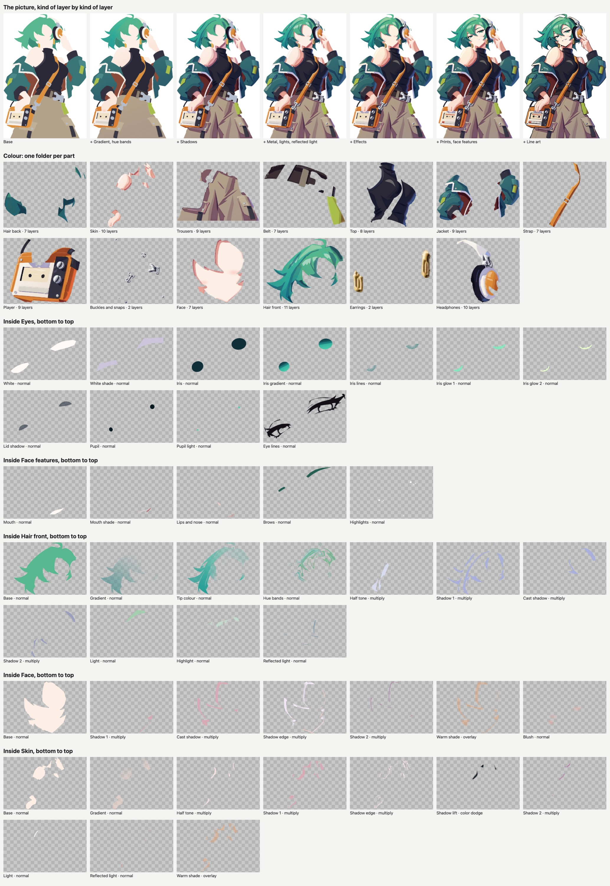

Open the file and take over where the agent is weak. [How it is structured](layers.md).

---

## Where to beat the agent

What a person can already do better than the agent here:

- **Large cloth.** Design every fold from its anchor (the knee, the hip, the stool's edge), with a soft gradient inside each shadow. The agent types points and leaves large areas to the mesh.
- **Hair flow.** Lay locks in one stroke each, with lost and found edges. The agent's strokes are placed point by point.
- **Lost edges.** Let a shadow edge soften where the form turns slowly and stay hard where it turns fast. The agent's edges are all hard.
- **Glints that carry.** Make the brightest point of every metal piece readable at stamp size.
- **Sitting in space.** Contact shadow where the figure meets the seat, and a gradient from top to bottom so she sits in the room. A critic: "she doesn't clearly sit on the stool."

## More

- [`process.md`](process.md): the same steps as the agent's rule list, with every tool
- [`form-guide.md`](form-guide.md): steps 3 to 5 in full
- [`lessons.md`](lessons.md): every note on every drawing, sorted by why it was missed
- [`drawing/`](drawing/README.md): why the agent does not draw the line art itself
- [`journey.md`](journey.md): how the process came to be, step by step
