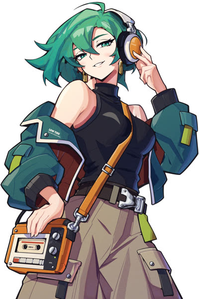

# Rendering guides

How anime illustrations are rendered, from finished line art to a splash picture. Each guide takes one picture apart step by step: where each kind of paint goes, what it looked like before and after, and why it is there. Read them in order.

| | Guide | What it adds |
|---|---|---|
|  | **1. [Maren](maren.md)** | The whole process on a half figure: plans, values, form, then fifteen steps from flat colours to the finish |
|  | **2. [Visor](visor.md)** | The same steps on a full figure walking, with a prop held in front and many materials side by side |
