# Rendering Visor: a full figure with a prop

This second guide applies the fifteen steps from [the first guide](maren.md) to a full walking figure carrying a crate of oranges. Beyond a bust, it adds a deep stride, a large prop held in front of the body, flowing hair, and many materials side by side.

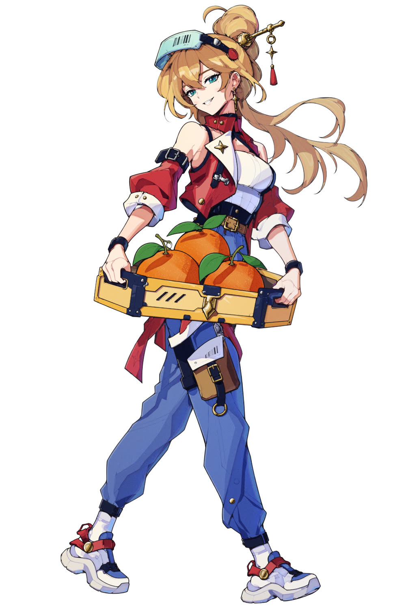

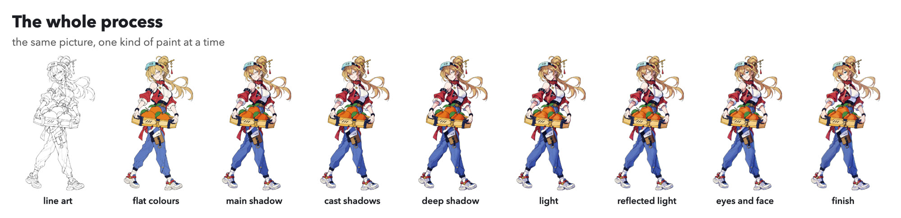

## Before you paint

Fix one upper-left light and hold it steady from visor to shoes.

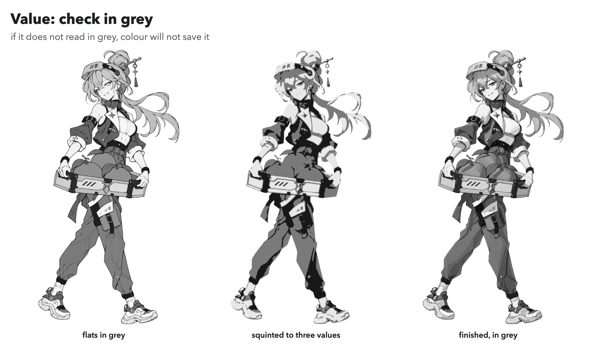

With red, yellow, orange, green, blue, and white competing, value keeps the figure readable. Checking in grey confirms the face still leads the eye and the crate separates from the trousers behind it.

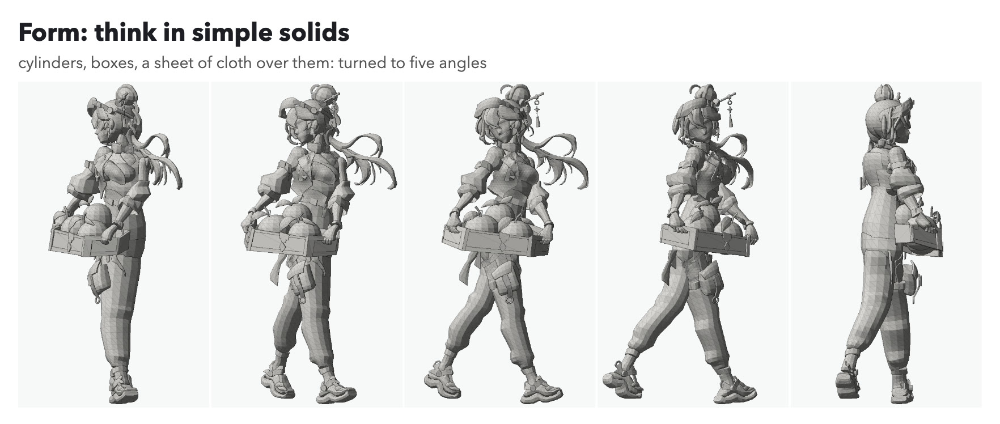

Picture the figure and prop as basic solids: balls for fruit, a box for the crate, cylinders for limbs, ribbons for hair. Turning them shows how far the crate projects and how the back leg steps behind.

Mapping the light across the whole body keeps head, prop, and legs under one sun. Planning shadow shapes first settles where the crate blocks light and how deeply the receding side falls in shade.

## Step by step

### 1 · Flat colours

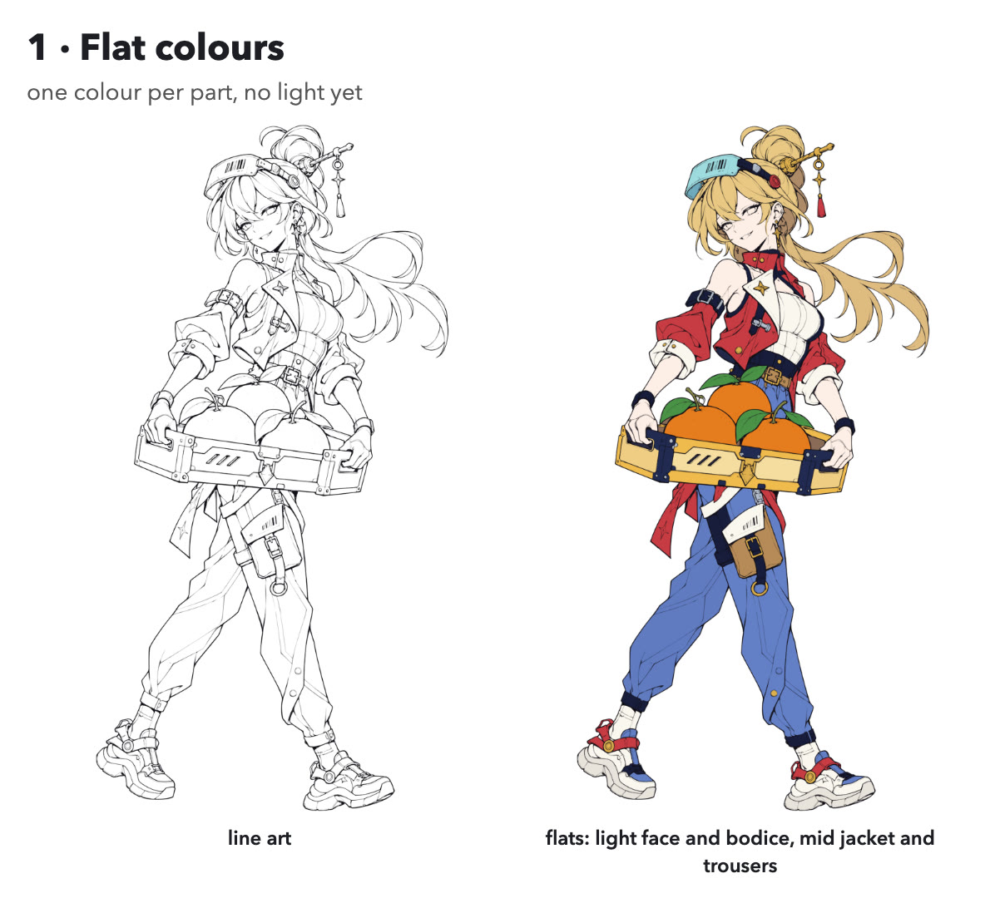

As in [the first guide](maren.md#1--flat-colours), flats lock in values across many bright materials. Starting the white bodice and shoes slightly off-white leaves room for light and shadow.

- Separate face, prop, and trousers cleanly in value.
- Tint white cloth slightly instead of leaving it blank.

### 2 · Colour shifts

Like [the first guide](maren.md#2--colour-shifts), gentle hue drift keeps large flats alive—especially long flowing hair and wide trousers.

- Shift colour slowly along long hair and legs.
- Keep lightness steady so big shapes hold.

### 3 · Main shadow

This follows [the first guide](maren.md#3--main-shadow) with three new points: round fruit gives the clearest ball shadow, the white bodice and shoes are mostly shadow colours, and the far side takes heavier shade.

- Shade each orange with one clean curve away from the light.
- Group wide blue trousers into few, big shapes.
- Let cool shadows carry the form of white cloth.

Common mistake: adding dozens of tiny trouser folds until the legs become noise.

### 4 · Cast shadows

As in [the first guide](maren.md#4--cast-shadows), crisp cast shadows show depth. On a busy head they also sort the layers: the visor band sits on the hair, the fringe on the face, the hair on the collar.

- Throw a sharp shadow from every part that sits on top of another.
- The same goes for the crate on the body: a cast is what makes a held prop read as a separate object.

### 5 · Half tone

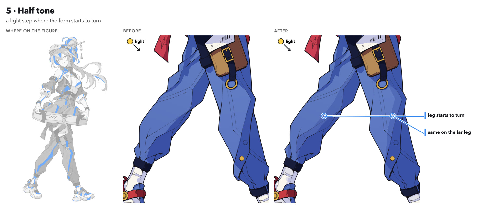

Same turning step as [the first guide](maren.md#5--half-tone), rounding both fruit and wide legs. A narrow mid-step turns balls and cloth cylinders smoothly without clutter.

- Add a thin turning band between lit and dark on fruit and limbs.
- Keep trouser half tones broad and few.

### 6 · Shadow edge

Like [the first guide](maren.md#6--shadow-edge), a thin warm border keeps skin from looking chalky on bare shoulders, arms, and hands holding the crate.

- Hold the warm band tight on skin shadow borders.
- Use less on cloth so skin stays warmer.

### 7 · Deep shadow

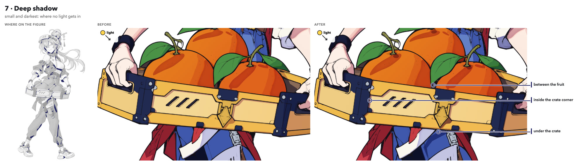

As in [the first guide](maren.md#7--deep-shadow), tight dark pockets give overlaps weight—tucking the fruit inside the crate and separating the crate from the waist.

- Put the darkest tone only where touching shapes shut out light.
- Keep pockets small so the prop never looks outlined.

### 8 · Shadow lift

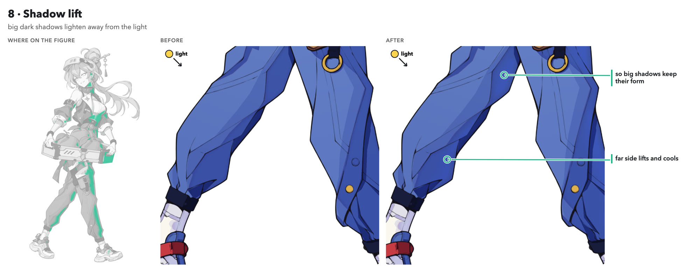

Same lift as [the first guide](maren.md#8--shadow-lift), keeping broad blue trouser shadows clear and pushing the receding leg back in space.

- Lighten big trouser shadows gently away from the light.
- Cool the back leg and far arm for depth.

### 9 · Light

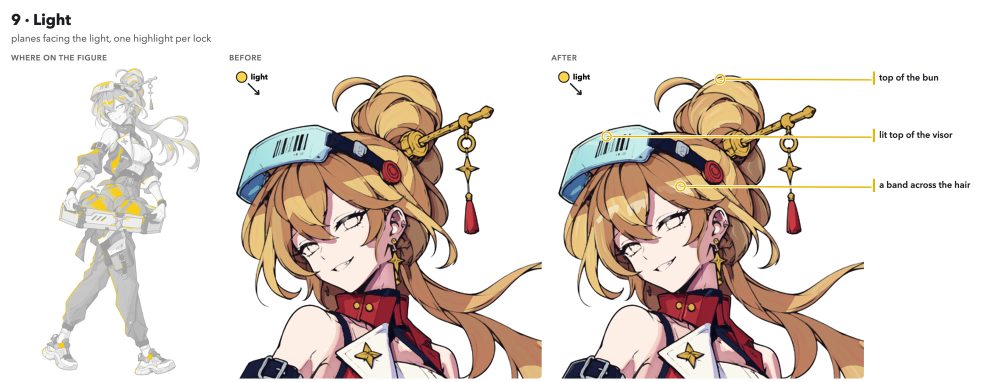

This follows [the first guide](maren.md#9--light), pairing a glassy visor and blonde hair with matte cloth. Selective bright planes separate smooth surfaces from soft ones.

- Place clean lit shapes on the visor and hair locks.
- Leave matte trousers, jacket, and shoes unpolished.

### 10 · Reflected light

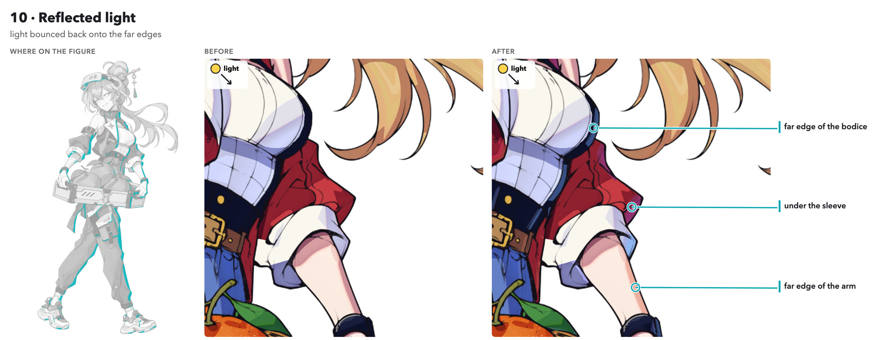

Like [the first guide](maren.md#10--reflected-light), a thin bounced rim finishes each orange's curve and lifts the bodice, far arm, and shoes off the air behind them.

- Catch bounced light along far edges of fruit, white cloth, and limbs.
- Keep it darker than the lit side.

### 11 · Materials

Building on [the first guide](maren.md#11--materials), orange peel, leaves, plastic, metal bolts, a glassy visor, denim-like trousers, and white shoes sit side by side. Distinct light behaviour separates them.

- Put metal's darkest tone right beside a crisp glint.
- Give plastic and the visor smoother sheen than peel or leaves.
- Keep trousers and shoes matte so hard accents pop.

### 12 · Warm skin

As in [the first guide](maren.md#12--warm-skin), warm skin shade links face, shoulders, arms, hands, and ankles next to cool blue cloth.

- Keep skin shadows warm across the whole figure, never grey.
- Touch cheeks and joints lightly with blush.

### 13 · Eyes and face

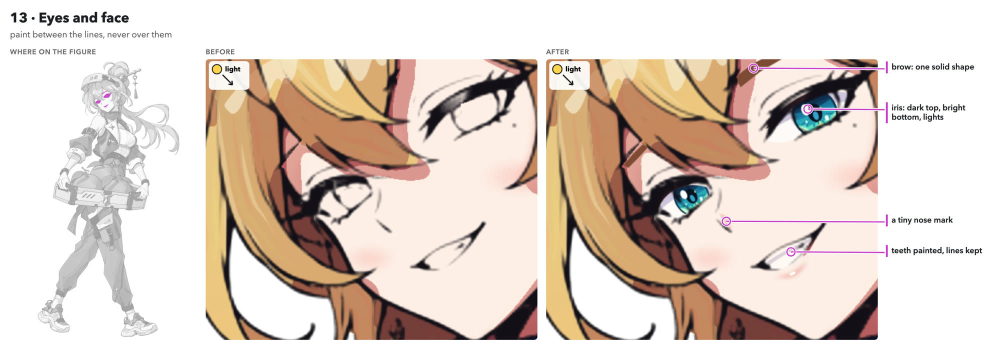

Same focus as [the first guide](maren.md#13--eyes-and-face), vital when the head is small. A quiet face with crisp eyes pulls attention back up from the bright crate.

- Keep facial shading light so the expression reads afar.
- Put tight contrast in the eyes and keep mouth lines clean.

### 14 · Line colour

Like [the first guide](maren.md#14--line-colour), tinting inner lines lets skin, fruit, leaves, and white cloth sit together while dark outlines separate the crate and limbs.

- Match inner lines to a darker version of their surface.
- Keep dark outlines where overlapping parts sit apart.

### 15 · Finish

As in [the first guide](maren.md#15--finish), one pass pulls every hue into shared air and pushes the back leg, far arm, and trailing hair cooler and paler.

- Warm the lit side slightly and cool the far side.
- Make receding limbs cooler and paler for depth.
- Tie all materials together with subtle grain.

Common mistake: pushing tints or grain until they distract from the shadow shapes.

## Check your work

- **Check in grey.** Make sure the face reads first and the crate clears the trousers.
- **Check the stride.** The far arm and back leg should sit deeper, cooler, and paler.
- **Squint at the legs.** Wide trousers should read as few big shapes, not wrinkles.
- **Compare materials.** Metal, plastic, peel, leaves, cloth, and shoes should handle light differently.

## Practice

- **A ball under one light.** Render one orange: main shadow on the away side, a narrow half tone at the turn, and reflected light on the far edge.
- **A box in front of a body.** Paint a torso holding a crate using only main shadows, the cast shadow onto the body, and deep shadows where they meet until the crate stands clear.
- **A walking figure in depth.** Shade a striding figure as cylinders, pushing the far leg and arm back with heavier, cooler, paler shadows.
