# Rendering Visor: a full figure with a prop

This second guide applies the fifteen steps from [the first guide](maren.md) to a full walking figure carrying a crate of oranges. Beyond a bust, it adds a deep stride, a large prop held in front of the body, flowing hair, and many materials side by side.

## Before you paint

Fix one upper-left light and hold it steady from visor to shoes.

With red, yellow, orange, green, blue, and white competing, value keeps the figure readable. Checking in grey confirms the face still leads the eye and the crate separates from the trousers behind it.

Picture the figure and prop as basic solids: balls for fruit, a box for the crate, cylinders for limbs, ribbons for hair. Turning them shows how far the crate projects and how the back leg steps behind.

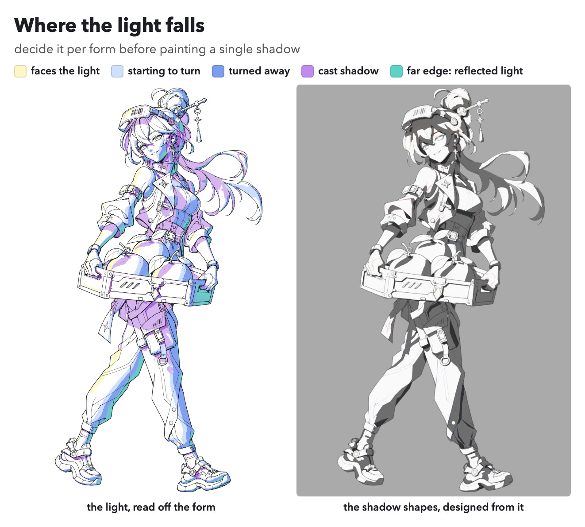

Mapping the light across the whole body keeps head, prop, and legs under one sun. Planning shadow shapes first settles where the crate blocks light and how deeply the receding side falls in shade.

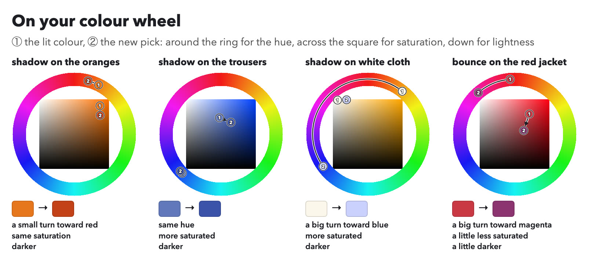

The colour moves work as in [the first guide](maren.md#before-you-paint), which also explains the picker and the ways of mixing one colour over another. Here they are on four very different colours: a strong orange barely turns, a blue only gets stronger, a white turns all the way to pale blue, and a red's bounce turns toward magenta.

## Step by step

### 1 · Flat colours

As in [the first guide](maren.md#1--flat-colours), flats lock in values across many bright materials. Starting the white bodice and shoes slightly off-white leaves room for light and shadow.

- Separate face, prop, and trousers cleanly in value.
- Tint white cloth slightly instead of leaving it blank.

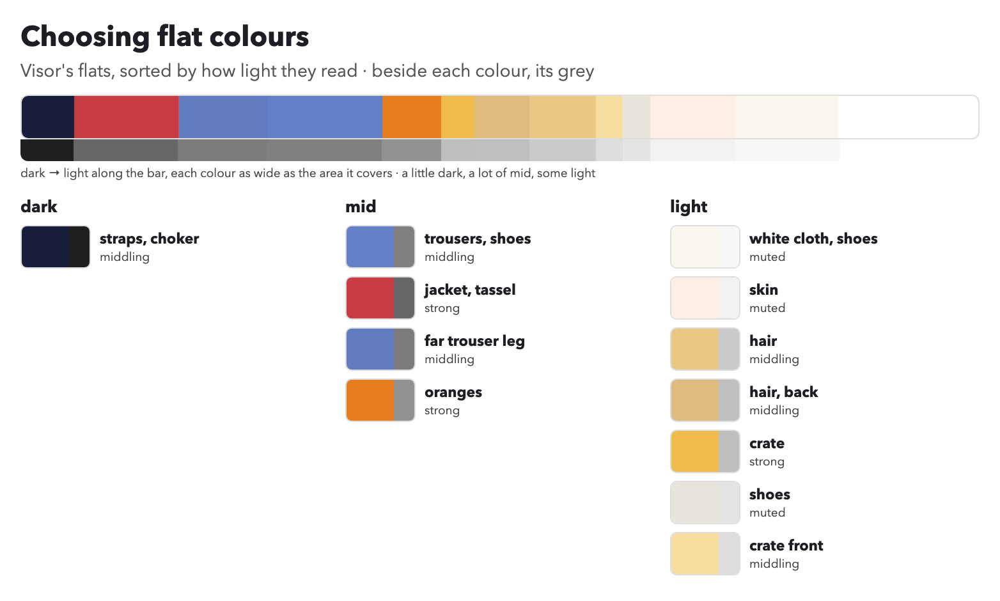

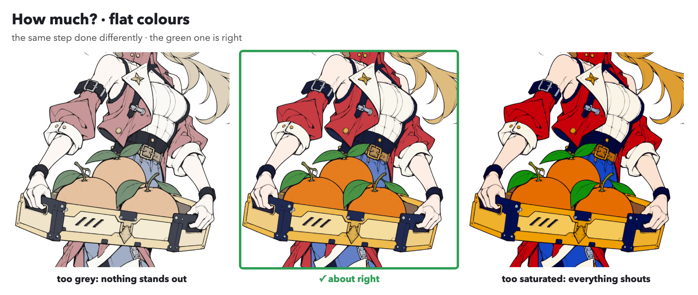

**Colour:** the big strong colours (red jacket, orange fruit, blue trousers) can share a middle grey, because their hues are far apart. What must stand apart in grey is the face, the crate and the white cloth. Keep the biggest area, the trousers, middling rather than strong, and the white cloth a warm off-white so it has room for shadow.

### 2 · Colour shifts

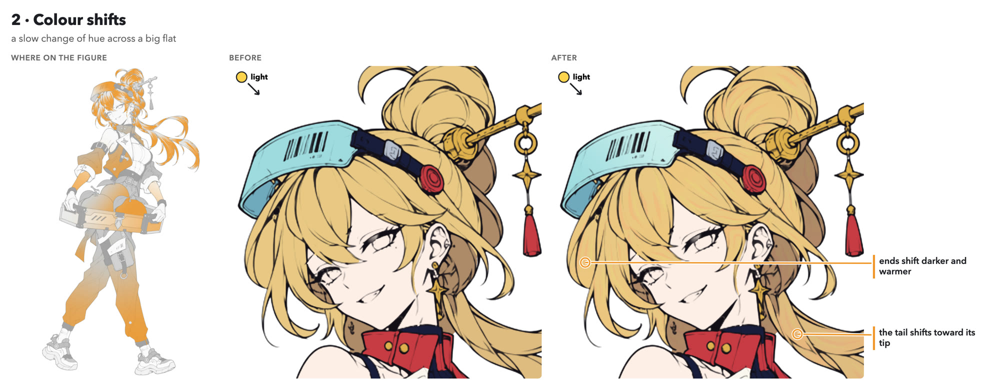

Like [the first guide](maren.md#2--colour-shifts), gentle hue drift keeps large flats alive—especially long flowing hair and wide trousers.

- Shift colour slowly along long hair and legs.
- Keep lightness steady so big shapes hold.

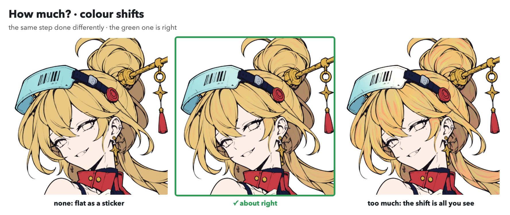

**Colour:** on long blonde hair the slide is in hue only: a little more orange toward the ends, at the same lightness. Keep it gentle, so the ponytail still reads as one mass.

### 3 · Main shadow

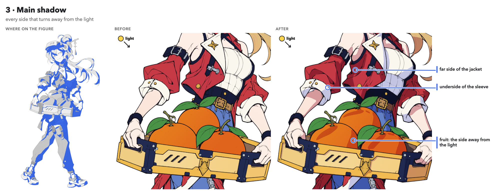

This follows [the first guide](maren.md#3--main-shadow) with three new points: round fruit gives the clearest ball shadow, the white bodice and shoes are mostly shadow colours, and the far side takes heavier shade.

- Shade each orange with one clean curve away from the light.
- Group wide blue trousers into few, big shapes.
- Let cool shadows carry the form of white cloth.

Common mistake: adding dozens of tiny trouser folds until the legs become noise.

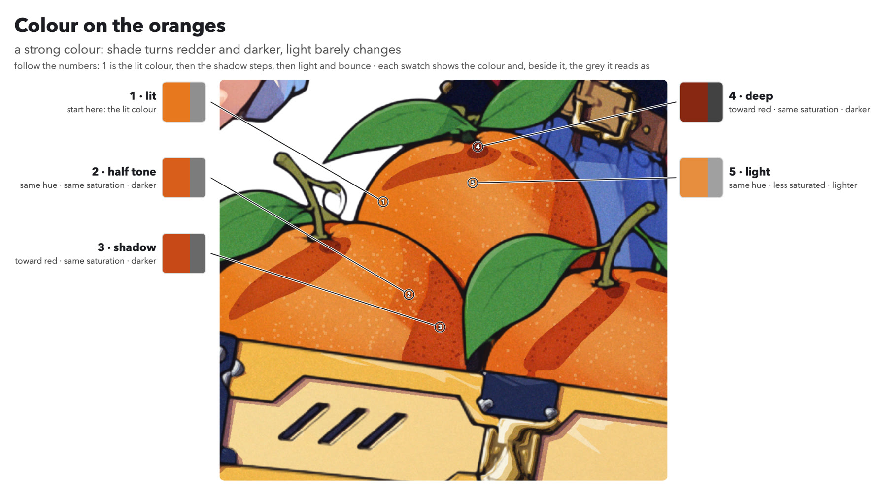

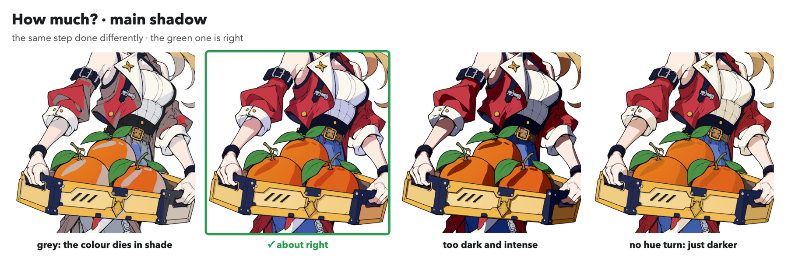

**Colour:** a colour that is already strong cannot get much stronger, so its shadow mostly gets darker and turns a little: orange toward red. A softer colour has more room to move, like the blonde hair, which turns from yellow to orange as it darkens. Either way, never grey and never just darker.

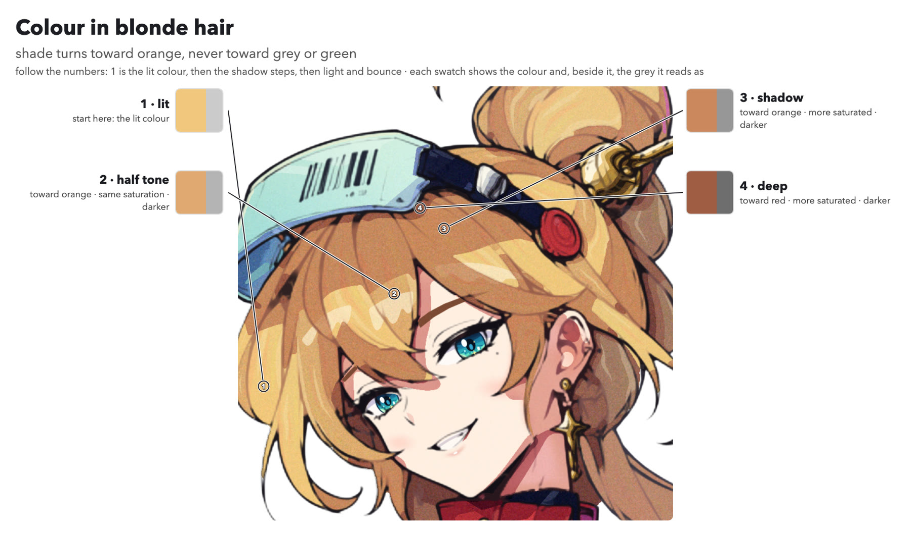

### 4 · Cast shadows

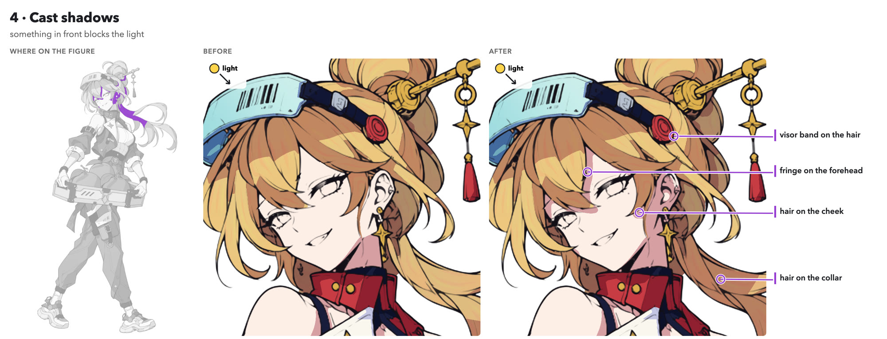

As in [the first guide](maren.md#4--cast-shadows), crisp cast shadows show depth. On a busy head they also sort the layers: the visor band sits on the hair, the fringe on the face, the hair on the collar.

- Throw a sharp shadow from every part that sits on top of another.
- The same goes for the crate on the body: a cast is what makes a held prop read as a separate object.

**Colour:** a cast takes the shadow colour of the surface it lands on, not of what throws it: the crate casts blue on the trousers and pale violet on the bodice.

### 5 · Half tone

Same turning step as [the first guide](maren.md#5--half-tone), rounding both fruit and wide legs. A narrow mid-step turns balls and cloth cylinders smoothly without clutter.

- Add a thin turning band between lit and dark on fruit and limbs.
- Keep trouser half tones broad and few.

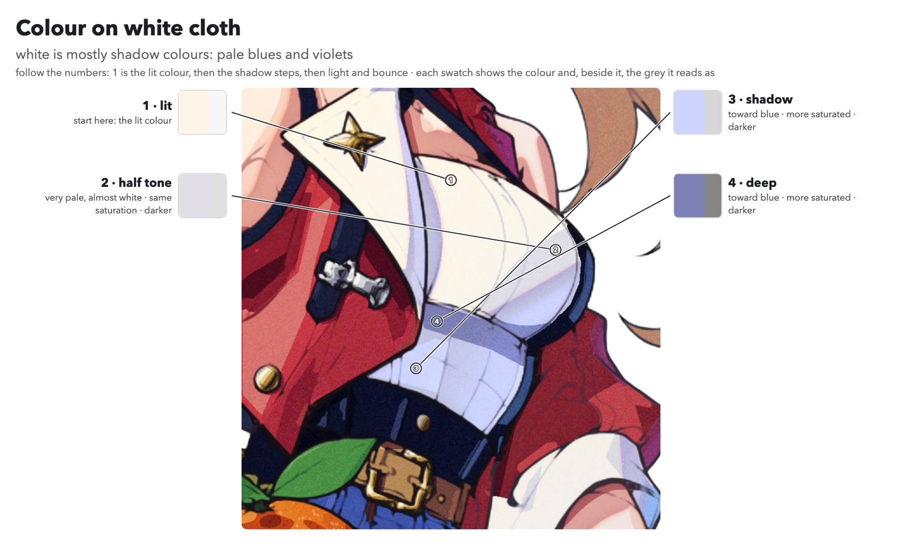

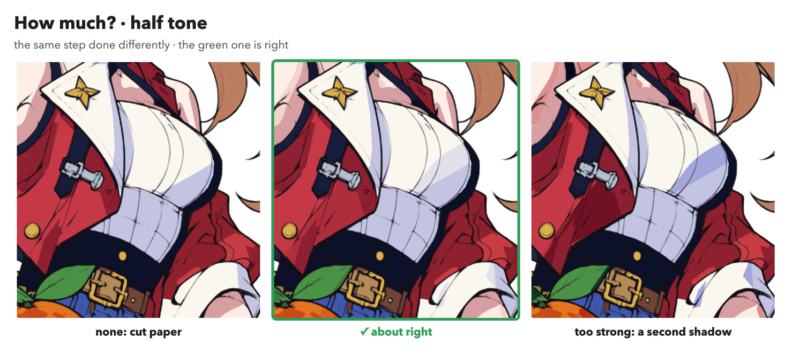

**Colour:** on white, the half tone is barely darker and only a touch cooler than the white; the shadow is a clear pale blue or violet, never grey. The shadow carries the shape.

### 6 · Shadow edge

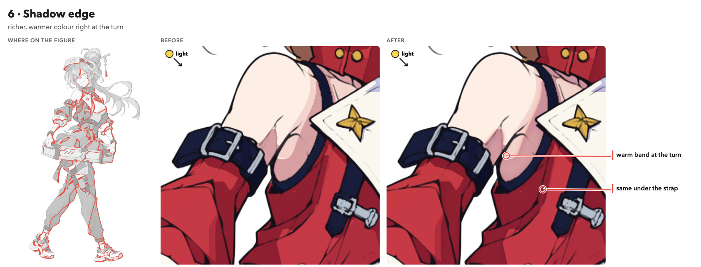

Like [the first guide](maren.md#6--shadow-edge), a thin warm border keeps skin from looking chalky on bare shoulders, arms, and hands holding the crate.

- Hold the warm band tight on skin shadow borders.
- Keep it for skin; on cloth it would vanish or look like a stain.

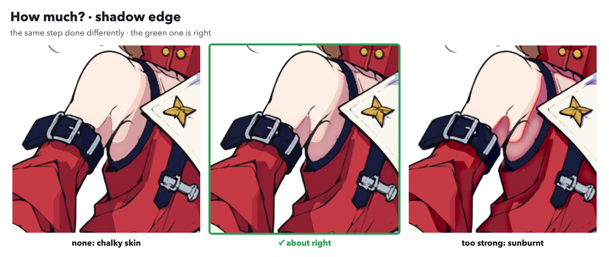

**Colour:** thin and redder than the shadow beside it, on skin. The red sleeve next to it already is red: a band there would vanish.

### 7 · Deep shadow

As in [the first guide](maren.md#7--deep-shadow), tight dark pockets give overlaps weight—tucking the fruit inside the crate and separating the crate from the waist.

- Put the darkest tone only where touching shapes shut out light.
- Keep pockets small so the prop never looks outlined.

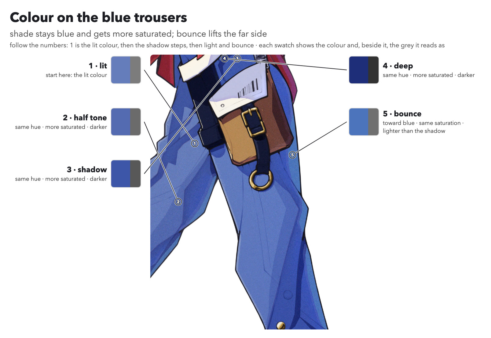

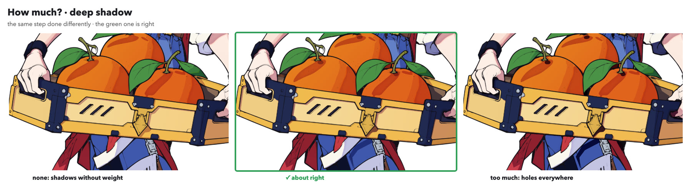

**Colour:** on the blue trousers the deep shade keeps the same hue and gets much more saturated and darker. Small: between the fruit, inside the crate corners, under the crate.

### 8 · Shadow lift

Same lift as [the first guide](maren.md#8--shadow-lift), keeping broad blue trouser shadows clear and pushing the receding leg back in space.

- Lighten big trouser shadows gently away from the light.
- Cool the back leg and far arm for depth.

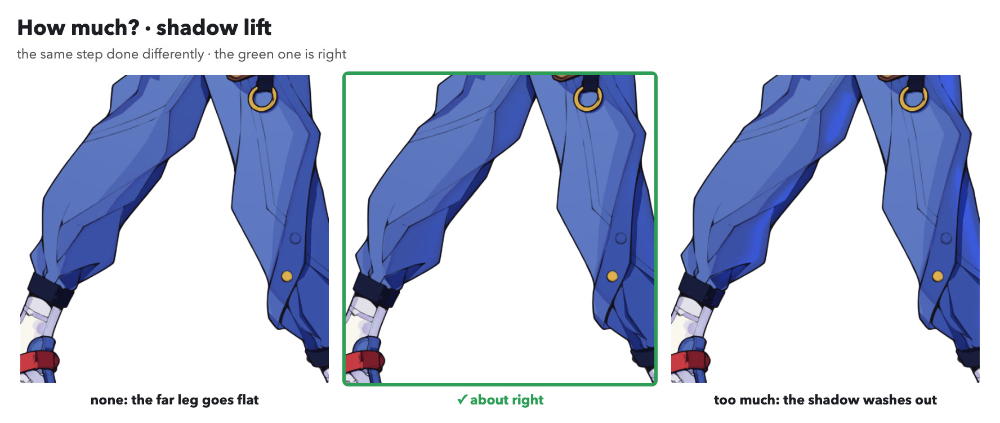

**Colour:** on the big trouser shadows, a slightly lighter and cooler patch away from the light keeps the far leg from turning into one flat dark shape.

### 9 · Light

This follows [the first guide](maren.md#9--light), pairing a glassy visor and blonde hair with matte cloth. Selective bright planes separate smooth surfaces from soft ones.

- Place clean lit shapes on the visor and hair locks.
- Leave matte trousers, jacket, and shoes unpolished.

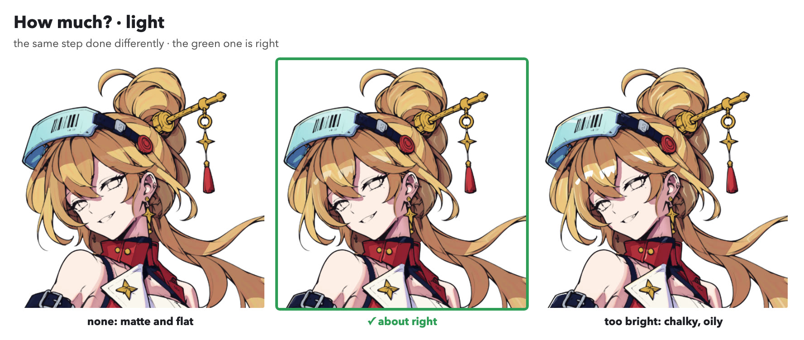

**Colour:** the brightest lights go to the visor and the metal, the shiniest things; the fruit and cloth get only a slightly lighter, softer version of their colour, so the eye goes to the head first.

### 10 · Reflected light

Like [the first guide](maren.md#10--reflected-light), a thin bounced rim finishes each orange's curve and lifts the bodice, far arm, and shoes off the air behind them.

- Catch bounced light along far edges of fruit, white cloth, and limbs.
- Keep it darker than the lit side.

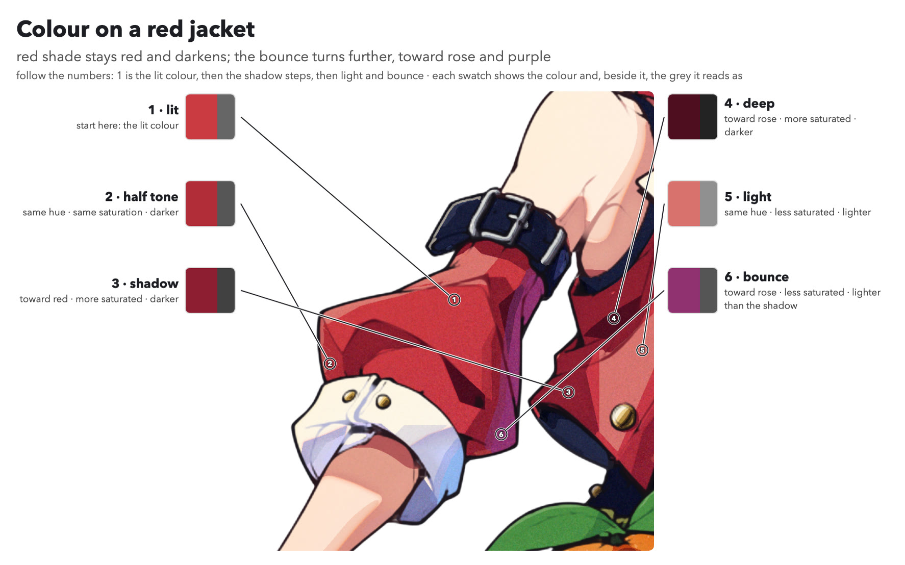

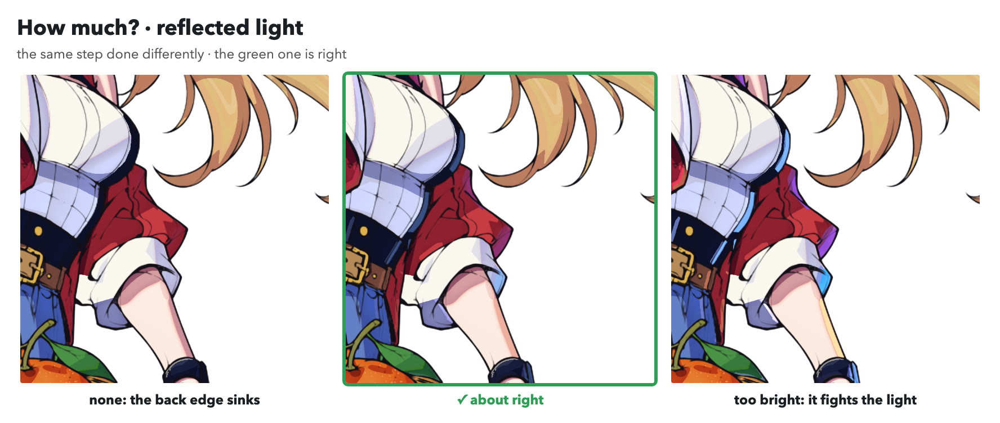

**Colour:** take the colour of what is around: on the red jacket it turns toward rose and purple, on the white bodice toward blue. Lighter than the shadow it sits in, darker than the lit colour.

### 11 · Materials

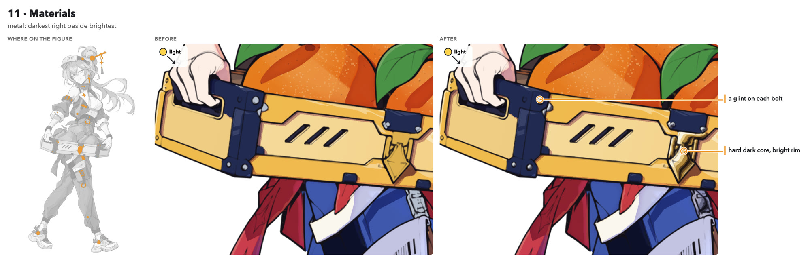

Building on [the first guide](maren.md#11--materials), orange peel, leaves, plastic, metal bolts, a glassy visor, denim-like trousers, and white shoes sit side by side. Distinct light behaviour separates them.

- Put metal's darkest tone right beside a crisp glint.
- Give plastic and the visor smoother sheen than peel or leaves.
- Keep trousers and shoes matte so hard accents pop.

**Colour:** metal uses almost the whole range from near black to near white in a small space. Peel and leaves stay matte, with soft light. The visor is the only glossy surface: a pale, cool colour with the sharpest light in the picture.

### 12 · Warm skin

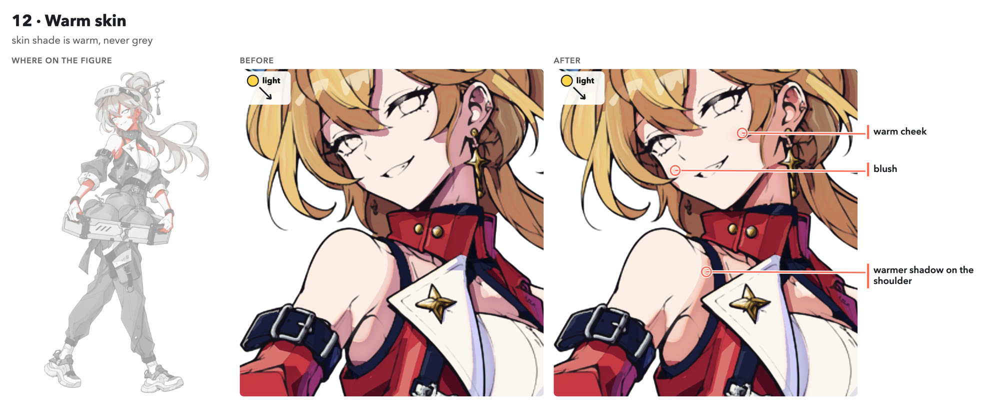

As in [the first guide](maren.md#12--warm-skin), warm skin shade links face, shoulders, arms, hands, and ankles next to cool blue cloth.

- Keep skin shadows warm across the whole figure, never grey.
- Touch cheeks and joints lightly with blush.

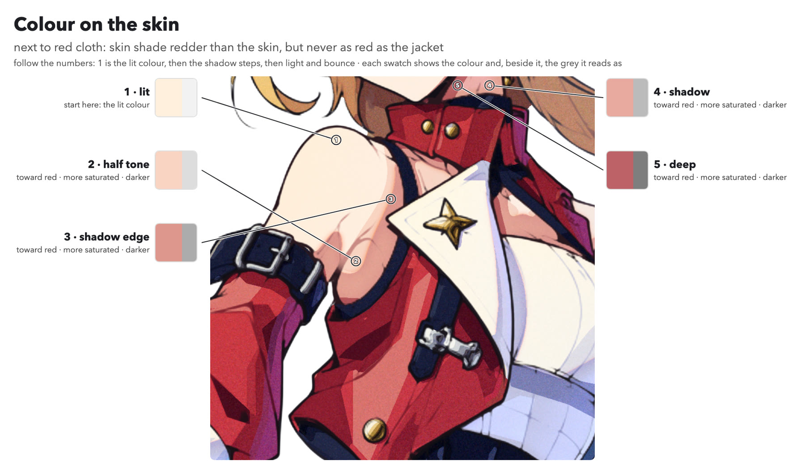

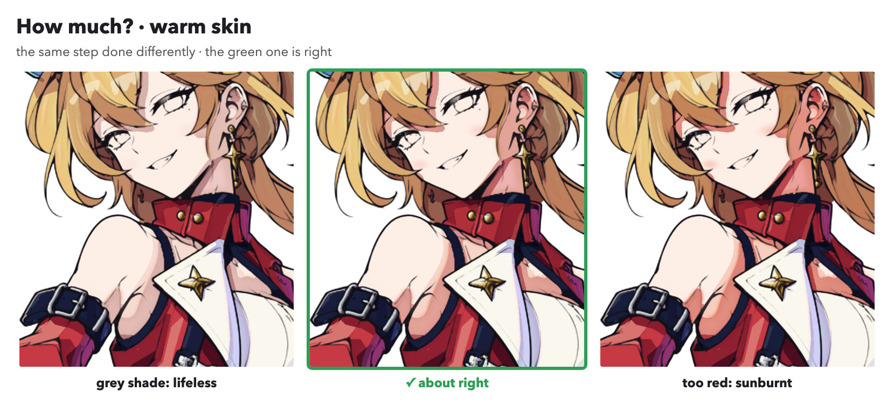

**Colour:** next to so much red cloth, keep skin shade redder than the skin but clearly lighter and softer than the jacket, and keep the blush light, or the face joins the jacket.

### 13 · Eyes and face

Same focus as [the first guide](maren.md#13--eyes-and-face), vital when the head is small. A quiet face with crisp eyes pulls attention back up from the bright crate.

- Keep facial shading light so the expression reads afar.
- Put tight contrast in the eyes and keep mouth lines clean.

**Colour:** on a small head under a bright prop, the eyes need the most saturated, cleanest colour on the face, so they pull attention back up from the crate.

### 14 · Line colour

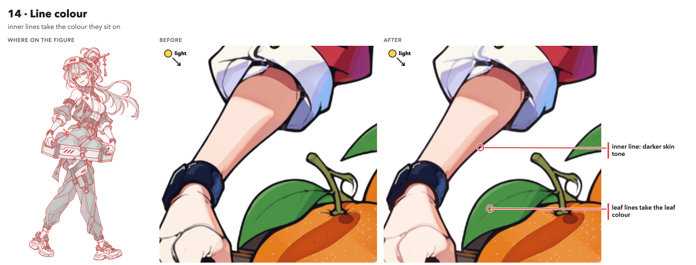

Like [the first guide](maren.md#14--line-colour), tinting inner lines lets skin, fruit, leaves, and white cloth sit together while dark outlines separate the crate and limbs.

- Match inner lines to a darker version of their surface.
- Keep dark outlines where overlapping parts sit apart.

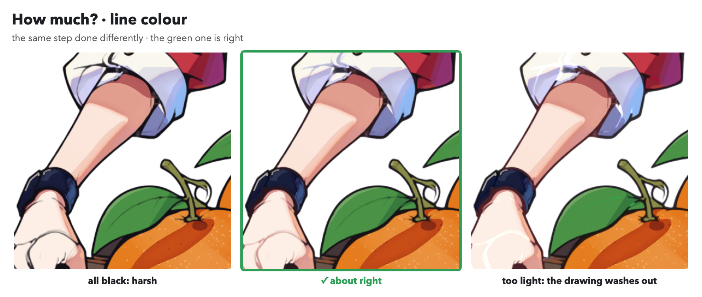

**Colour:** with this many materials, each keeps lines in its own family: brown on skin, dark green in the leaves, dark red in the peel, dark blue in the trousers. The outline of the crate stays dark, so the prop stays separate from the body.

### 15 · Finish

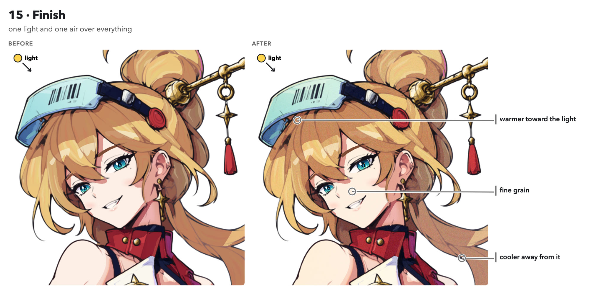

As in [the first guide](maren.md#15--finish), one pass pulls every hue into shared air and pushes the back leg, far arm, and trailing hair cooler and paler.

- Warm the lit side slightly and cool the far side.
- Make receding limbs cooler and paler for depth.
- Tie all materials together with subtle grain.

Common mistake: pushing tints or grain until they distract from the shadow shapes.

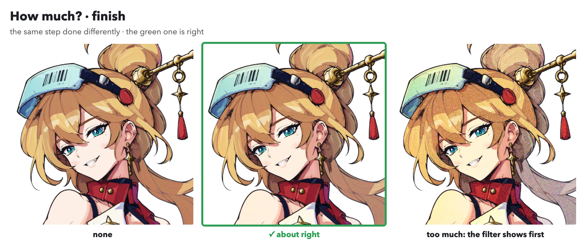

**Colour:** on a full figure the cool side matters more: the far leg, the back of the ponytail and the shoes a little paler and bluer, so the figure has depth from head to toe.

## Check your work

- **Check in grey.** Make sure the face reads first and the crate clears the trousers.
- **Check the stride.** The far arm and back leg should sit deeper, cooler, and paler.
- **Squint at the legs.** Wide trousers should read as few big shapes, not wrinkles.
- **Compare materials.** Metal, plastic, peel, leaves, cloth, and shoes should handle light differently.

## Practice

- **A ball under one light.** Render one orange: main shadow on the away side, a narrow half tone at the turn, and reflected light on the far edge.
- **A box in front of a body.** Paint a torso holding a crate using only main shadows, the cast shadow onto the body, and deep shadows where they meet until the crate stands clear.
- **A walking figure in depth.** Shade a striding figure as cylinders, pushing the far leg and arm back with heavier, cooler, paler shadows.
