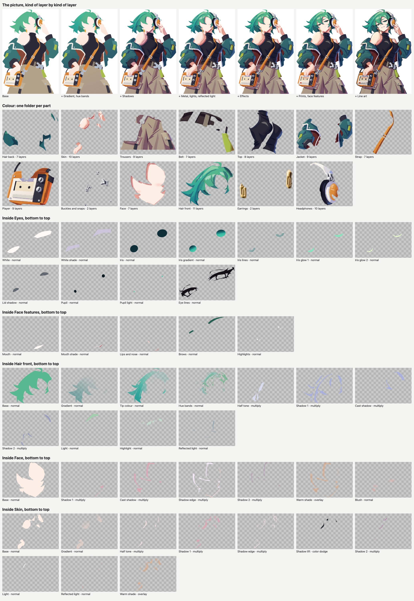

# Layers: the file an illustrator gets

Every drawing can be exported as a `.clip` (CLIP STUDIO PAINT) and a `.psd`. **The goal: an illustrator opens it and goes on painting.** So it is organised the way an illustrator keeps a file, the same way in every drawing, and a check fails when it is not.

```sh
node scripts/layers.ts maren output/layers/maren --clip     # .clip, .psd, layer PNGs, and the checks (dev server running)
node scripts/layerview.ts output/layers/maren               # view.html to look through the layers, and sheet.png
```



An example to open: [`examples/layers/maren/maren.clip`](../examples/layers/maren/maren.clip). How it works inside, the `.clip` format and all measurements: [`layers-internals.md`](layers-internals.md).

## Five ideas
1. **A folder per part, a layer per job.** Not the renderer's order, not a layer per stroke.
2. **A layer is a set of related marks:** same role, same colour, not over each other. Both pupils are one layer, all reflections of the face are one. Marks that overlap, or that one changes without the other (a cast shadow and a form's own), stay apart.
3. **The same names in the same order everywhere.** Who knows one folder knows them all.
4. **Everything is clipped to its base**, so painting never spills.
5. **A layer carries its own colour, not a ghost of the picture:** shadows are flat multiply colours, so they follow when a base is recoloured.

## The file, as in the layer panel
```
Line art            Body, Face, Hair outline, Hair strands   (one ink each, its colour clipped to it)
Face features
  Highlights        all reflections of the face
  Eyes              both eyes: White, White shade, Iris, Iris gradient, Iris lines, Iris glow 1 and 2,
                    Lid shadow, Pupil, Pupil light, Eye lines   (iris whole under the lid, clipped to White)
  Brows, Lips and nose, Mouth shade, Mouth
Prints              what is printed on things
Effects             Grain, Depth haze, Glow, Tint   (over the whole figure)
Colour              one folder per part, nearest on top
  Headphones
  Hair front
  Face
  …
  Hair back
Background          only if there is one
Paper
```

## Inside a part's folder
Top to bottom, only where there is something:

| Layer | Mode | |
|---|---|---|
| Blush | normal | cheeks, ears, nose |
| Warm shade | overlay | orange over shaded skin |
| Reflected light | normal | bounce, neighbours' colour, second light |
| Highlight | normal | gloss, glints |
| Light | normal | lit planes, rims, sheen |
| Metal | normal | the planes of a metal piece |
| Shadow 2 | multiply | deep shade |
| Shadow lift | color dodge | a shade lighter towards the far side |
| Shadow edge | multiply | scattering band, and the dark just behind the edge |
| Cast shadow | multiply | face and hair only: what falls from something else |
| Shadow 1 | multiply | the designed shadow shapes |
| Half tone | multiply | the lighter step before it |
| Hue bands, Tip colour | normal | hair only: they move the hue, not the value |
| Gradient | normal | slow colour |
| **Base** | normal | flat colours, opaque |

## What a drawing has to say
In its data file, e.g. `src/splash/maren.ts`:

| | |
|---|---|
| `folders` | which parts go in which folder, furthest first; `"fine"` for face and hair. Every part in exactly one |
| `details` | what is painted in the face, by name (`bold/eye.ts` paints eyes). The same name is the same layer |
| `lineGroups` | the strokes that belong to the eyes and the face. Hair and the rest are told apart by rule |

A new paint step in the renderer gets a name in `src/layers/steps.ts` and a place in `src/layers/arrange.ts`, or the export says so.

## What "clean" means
Checked at every export:
- every part in exactly one folder, every paint step placed;
- only the known folders and layer names, in order, none twice;
- every folder starts with Base, everything else is clipped and has no pixel outside it;
- no empty layer;
- `look: A and B could be one layer` where two neighbours look like one set.

Layers that hardly show are left out, specks are swept, soft edges take the colour of their shape. The stack is compared with the render: on Maren 98% of pixels are within 2 levels of 255. `clipcheck.ts` reads the `.clip` back.

## Limits

- Layers are pixels at the render's scale, not vector strokes, and not the renderer's shapes. Edit them like painted layers.
- Shadows follow when a Base is recoloured; normal layers (Gradient, lights, reflected light) keep their colours.
- Bases are hard edged and end in the middle of a line; a part does not go on under what covers it.
- Eyes are in pieces where the eye kit paints them (`maren`, `visor`). The older drawings paint them with the eye rig or by hand: one layer.
- Lines are told apart by walking through the ink from each stroke's middle: where two meet, the cut is a guess and can look blunt on its own.
- A part's Base holds all its colours in one layer (Jacket: cloth, lining, trim, cuffs).
- Re-render after changing the drawing's data; the layers are not read back into the code.
- The background lies under the line art. `cut` renders and the `masks`, `value`, `grey` and `regions` views have no layers.
