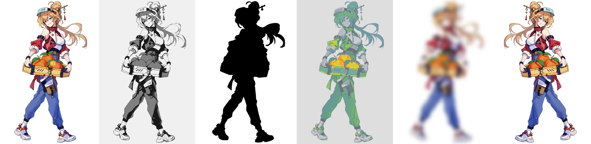

# Critic: review and redline for CLIP STUDIO PAINT

A second pair of eyes for stylized anime illustration (the polish of Genshin Impact / Zenless Zone Zero key art), at every stage from sketch to render. You save or export from CLIP STUDIO PAINT (CSP) and get, in `_review/<filename>/` next to the file:

- **`review.html`**, one self-contained page that opens offline. It has a viewer that switches between the original and each diagnostic view, or shows two side by side. Numbered pins sit over the picture and are linked to the critique cards.
- **`ai_redline.png`**, a transparent PNG at exactly the picture's pixel size. You place it once in CSP as a file object and refresh it with a shortcut after each review.

The measured checks are deterministic: the same file gives the same findings, with no network and no key. An AI critique from any vision-language model can be added on top: a local one (Ollama, llama.cpp, LM Studio), a cloud API that speaks the OpenAI protocol, or Claude.



## Install

**Core** (measured checks, review, redline, watch mode): Node 22.18 or later, then `pnpm install` in the repository. It needs no native modules and no Python. The packages it uses are `jpeg-js` (JPEG decoding), `zod` (the critique schema) and `@anthropic-ai/sdk` (only when Claude is the model).

**Optional**, each detected at run time, so nothing breaks without it:

| For | Install | Then |
|---|---|---|
| a local AI critic | [Ollama](https://ollama.com) and a vision model, e.g. `ollama pull qwen2.5vl:7b` | `API_BASE_URL=http://localhost:11434/v1 MODEL=qwen2.5vl:7b` |
| a cloud AI critic | an OpenAI-compatible vision API, or an Anthropic key | `API_BASE_URL`, `API_KEY`, `MODEL`; or `ANTHROPIC_API_KEY` |
| a better silhouette on busy backgrounds | `pip install "rembg[cli]"` | used automatically when `rembg` is on `PATH` |
| pose and proportion metrics | `pip install mediapipe` (on Linux also `libegl1`) | `--pose-cmd "python3 scripts/critic-pose-mediapipe.py {in}"` |
| pose from DWPose / OpenPose | ComfyUI's DWPose preprocessor, or any OpenPose editor | `--keypoints pose.json` |

## Use

```sh
node scripts/critic.ts art.png --no-ai                       # measured checks only: no key, no network
node scripts/critic.ts art.clip --stage flats                # .clip is read only, never written
node scripts/critic.ts --watch ~/Pictures/wip --stage sketch # review every save or export in a folder
pnpm critic art.jpg --stage lineart --no-ai                  # the same through pnpm
```

AI critique from a local model (Ollama, llama.cpp's `llama-server`, LM Studio and vLLM all serve `/v1/chat/completions`):

```sh
export API_BASE_URL=http://localhost:11434/v1   # Ollama; llama-server: http://localhost:8080/v1
export MODEL=qwen2.5vl:7b                       # any vision model the server has: gemma3:12b, llama3.2-vision, ...
node scripts/critic.ts art.clip --stage render
```

From a cloud API that speaks the same protocol: set `API_BASE_URL` to its `/v1` URL, `API_KEY` to your key and `MODEL` to a vision model. From Claude: leave `API_BASE_URL` unset and set `ANTHROPIC_API_KEY` (or run `ant auth login`); the default model is `claude-opus-5-5`, and `MODEL` or `--model` overrides it.

| Option | |
|---|---|
| `--stage sketch\|lineart\|flats\|render` | what to judge, default `render` (see Stages) |
| `--no-ai` | measured checks and review only |
| `--watch <dir>` | review each `.png`, `.jpg` or `.clip` when it is saved; `--initial` also reviews the files already there |
| `--provider openai\|anthropic` | the AI backend; default `openai` when `API_BASE_URL` is set, else `anthropic` |
| `--model <id>`, `--api-base <url>` | override `MODEL` and `API_BASE_URL` |
| `--out <dir>` | write here instead of `_review/<filename>/` (with `--watch`, one folder per file inside it) |
| `--focus x,y,w,h` | the focal area in canvas pixels, if the face finder misses or the focus is not a face |
| `--mask <png>` | the silhouette: black figure on white, or any PNG with transparency |
| `--segmenter auto\|none\|"<cmd {in} {out}>"` | background removal; `auto` uses `rembg` if on `PATH`, or `$CRITIC_SEGMENTER` |
| `--keypoints <json>` | pose keypoints: OpenPose / DWPose JSON, a COCO-17 array, or `{"points": {"nose": [x, y, score], …}}` |
| `--pose-cmd "<cmd {in}>"` | a pose estimator that prints such JSON for a PNG (or `$CRITIC_POSE_CMD`) |

## Setting up the redline in Clip Studio Paint

`ai_redline.png` keeps the same path for a file across reviews, so CSP can treat it as a file object: placed once, refreshed in place.

1. **Make it once.** Review the file (`node scripts/critic.ts art.clip`), or start `--watch` on your work folder and save. `_review/art.clip/ai_redline.png` now exists next to your file.
2. **Place it as a file object.** With the illustration open: **File › Import › Create file object**, then pick `ai_redline.png`. It is exactly the canvas size, so it lines up with the drawing. Keep the layer on top; lower its opacity or hide it while painting.
3. **Refresh it with a key.** **File › Shortcut Settings › Menu commands › Layer › File object**: give **Update file object** (or **Update all file objects**) a key. After each review, press it and the marks move to where the new problems are.

The loop with `--watch` is then: paint, save (Ctrl+S), wait a few seconds for the review, press your refresh key. Open `review.html` in a browser for the explanations behind the numbers.

Menu names are from CSP's [file objects manual](https://help.clip-studio.com/en-us/manual_en/180_layers/File_objects.htm) and [Layer › File object menu](https://www.clip-studio.com/site/gd_en/csp/userguide/csp_userguide/500_menu/500_menu_layer_fobject.htm); they can differ a little between versions and languages. A file object needs its source to stay where it was, so do not move the `_review` folder.

## Files it writes

| File | |
|---|---|
| `review.html` | viewer (Original, Greyscale, 3-Value, Saturation, Silhouette, Flip, Squint, and Mud, Attention, Pose), side by side, pins linked to cards; AI critique cards; measured findings; palette swatches; value histogram; proportion metrics; focal crops |
| `ai_redline.png` | transparent, the picture's exact pixel size (a `.clip`'s canvas size): AI boxes with pins 1–5 in pink-red, measured flags with pins M1, M2… in orange, and the pose skeleton when there is one. Every stroke has a dark edge, so it reads on light and dark areas |
| `findings.json`, `metrics.json` | every finding in canvas pixels, every measurement, and the AI's answer as validated |
| `views/*.png`, `crops/*.png` | the diagnostic views, and full-resolution crops of the face, upper body, hands and strongest attractors |

Nothing is ever written to the input. Every output path is checked against it, and the input is opened read-only.

## Stages

Every check runs at every stage. The stage decides which checks are in focus (findings from the others stay, as notes) and gives the AI critic its rubric.

| Stage | In focus | The AI critic judges |
|---|---|---|
| `sketch` | silhouette, flip, squint, pose, focus | gesture, balance, proportion, composition, eye flow; not line quality, colour or finish |
| `lineart` | silhouette, flip, pose, focus, squint | line weight hierarchy, closed shapes, tangents, anatomy the clean line locks in |
| `flats` | values, palette, saturation, silhouette, focus | separation of big shapes in value, palette harmony, saturation placed on the focus, gaps and bleed; not missing shading |
| `render` | everything | value grouping, light logic, edges, shadow colour, rim and bounce light, materials, face and eyes, detail hierarchy |

## Measured checks

Measured at 1200 px on the long side and mapped back to the canvas. Each finding in the review quotes the numbers behind it.

- **Value.** Greyscale is CIE L*, perceived lightness, so a saturated blue gets the grey it looks like. The 3-value map is a three-class Otsu split of L* over the figure (the whole image if there is no reliable silhouette). Flags:
  - a value range (L* 95th − 5th percentile) under 45, or over 62% in L* 30–70 with a range under 60;
  - neighbouring groups closer than 18 L*;
  - a group under 4% of the figure;
  - over 22% *mud*: mid values with almost no chroma (OKLab C < 0.035).
- **Saturation and palette.** HSV saturation × value, as a heatmap over faded greyscale. Over 30% highly saturated is flagged, and so is a saturated area over 1.2% of the picture away from the focus. The palette is k-means (k = 7, seeded, so it is repeatable) in OKLab, with near-identical colours merged.
- **Silhouette.** The source, in order of preference: `--mask`, the file's transparency, a segmenter, then a border flood from the edges. The flood says the silhouette is unreliable when under 70% of the border matches one colour. Flags, for a figure not cut by the frame:
  - a compact blob with no negative space;
  - a main axis 7–45° off vertical;
  - a centre of mass more than 22% of the figure's width outside its base.
- **Flip and squint.** A mirrored copy, and the picture shrunk to 160 px and blurred. If the blurred L* varies by less than 10 (standard deviation), the figure disappears at thumbnail size.
- **Focus and crops.** An attention map combines value contrast, colour contrast and edge density; its peaks give the eye flow. The focus is `--focus`, or else the face: from pose keypoints if there is skin where they put it, otherwise the skin patch in the top of the figure with the most dark detail (eyes, lashes, mouth). An attractor outside the focus with 15% more attention is flagged. Crops come from the full-size source.
- **Pose (optional).** Shoulder and hip tilt and whether they counter each other (contrapposto), height in heads (approximate, with the method stated), and left/right limb lengths. Keypoints that contradict the silhouette are dropped and the review says so: points off the figure, or a head halfway down it.

## AI critique

The model receives four kinds of image and the context to judge them:

- the original, the 3-value map and the saturation heatmap;
- each focal crop, with its position;
- the stage rubric;
- the measurements and their flags.

It must answer with JSON in one schema:

```json
{
  "summary": "one or two sentences",
  "issues": [
    { "id": 1, "category": "Focal Point", "box_2d": [0.62, 0.02, 0.86, 0.36],
      "diagnosis": "The cassette player is the most saturated object and pulls the eye from the face.",
      "actionable_fix": "Lower its saturation 20-30% with a clipped Hue/Saturation/Luminosity layer." }
  ]
}
```

- 3–5 issues, most important first; `id` is the priority.
- `box_2d` is `[ymin, xmin, ymax, xmax]`, normalized 0–1 in the original.
- `category` is one of: Value Hierarchy, Silhouette, Saturation, Tangent, Focal Point, Composition, Anatomy, Proportion, Gesture, Line Weight, Lighting, Edges, Color Harmony, Rendering, Other.

Every answer is checked against this schema here, whatever the server promised:

- **Constrained output first.** The schema is sent as `response_format` (`json_schema`). A server that rejects that gets `json_object`, then plain instructions.
- **Lenient extraction.** JSON is taken out of code fences and chatter.
- **Box conventions.** Boxes in 0–1000 (Qwen-VL, Gemini) or in pixels are recognised and normalized, and swapped corners are put right.
- **One repair turn.** An answer that fails validation is sent back once, with the errors.
- **Trimming and renumbering.** Extra issues are cut to five, unusable boxes are dropped, and ids are renumbered by position.
- **Failure is contained.** Anything that still fails becomes a stated reason in the review; the measured findings never depend on it.

The first two priorities are marked major, the rest minor. Claude is called through its SDK with structured outputs, effort `high`, and server-side refusal fallbacks.

The picture goes to whichever endpoint you configure, so with a local model it never leaves your machine; `--no-ai` sends nothing anywhere. Local models get smaller images (1280 px original, 768 px views) to stay fast. A cloud review sends 6–8 images, roughly 10–20k input tokens.

## Limits

- **The face finder is a colour heuristic.** It is right on most drawings in this repository. It can land on a bare shoulder or a tan goggle lens, and its confidence is shown in the review. `--focus` overrides it.
- **The border flood needs a plain or gently graded background.** On a painted scene, export with the background hidden, pass `--mask`, or install `rembg`.
- **"Mud" also counts materials meant to be neutral** (khaki, steel). The mud map shows where it is.
- **Photo-trained pose estimators miss stylized and cropped figures.** MediaPipe put Visor's head on the crate she carries; the plausibility check dropped it.
- **The checks measure; they do not know intent.** A deliberate lean or a muted palette is flagged anyway.
- **AI quality depends on the model.** Small local VLMs find composition and value problems more reliably than anatomy.

## Tests

```sh
pnpm test:critic   # 43 tests, offline, about a minute
pnpm typecheck
```

The tests use synthetic images only, and no test reaches the network. They cover:

- every PNG colour type and the JPEG decoder;
- `.clip` reading, from repository files and synthetic containers, including a missing preview, a truncated file, a corrupt preview and a non-`.clip`, with each file's bytes checked unchanged;
- each check, on generated figures;
- both AI paths against stub servers: schema, retries, repair, box conventions and failures;
- `review.html` contents and `ai_redline.png` dimensions, including a `.clip` whose preview is smaller than its canvas;
- the refusal to overwrite the input, and watch mode.

## Code

| File | |
|---|---|
| `scripts/critic.ts` | the CLI |
| `scripts/critic-pose-mediapipe.py` | the optional MediaPipe pose adapter |
| `run.ts` | the pipeline |
| `image.ts`, `clip.ts` | decoding; the read-only `.clip` preview |
| `checks/` | one file per check |
| `stages.ts` | stage profiles and rubrics |
| `vlm.ts` | the AI layer: both providers, the schema, validation |
| `report.ts` | `review.html` |
| `redline.ts`, `draw.ts` | `ai_redline.png` |
| `watch.ts` | watch mode |
| `test/` | the tests |
